<a id="topo"></a>

<picture>
  <source media="(prefers-color-scheme: dark)" srcset="readme/hero_escuro.svg">
  <source media="(prefers-color-scheme: light)" srcset="readme/hero_claro.svg">
  
</picture>

<p align="center">
  
  
  
  
  
</p>

<p align="center">
  <b>TCC do Enzo</b> · Lumiar Vila Olímpia · 9º ano · 2026 · Orientador: Prof. Antônio Francisco da Silva Junior
</p>

<p align="center">
  <a href="entrega/TCC_Enzo_final.pdf"></a>
  <a href="documento/TCC_texto.md"></a>
  <a href="figuras/LEGENDAS.md"></a>
</p>

<p align="center">
  <a href="#trabalho"></a>
  <a href="#resposta"></a>
  <a href="#corrida"></a>
  <a href="#custo"></a>
  <a href="#estrategias"></a>
  <a href="#resultados"></a>
  <a href="#matematica"></a>
  <a href="#dados"></a>
  <a href="#rodar"></a>
</p>

<picture>
  <source media="(prefers-color-scheme: dark)" srcset="readme/numeros_escuro.svg">
  <source media="(prefers-color-scheme: light)" srcset="readme/numeros_claro.svg">
  
</picture>

<a id="resposta"></a>

## 💡 A pergunta, e a resposta

> **Dá para ter lucro constante e seguro no *day trade* usando a matemática?**

Muita gente diz que sim. Um estudo com dados reais da bolsa brasileira mostrou que **97% das pessoas que
insistiram no *day trade* por mais de 300 dias perderam dinheiro** (Chague, De-Losso e Giovannetti, 2019).
Este trabalho transformou 4 estratégias famosas e um modelo de previsão em **regras exatas de computador** e
testou todas em dados reais de 9 ativos, descontando o custo de cada operação.

> [!IMPORTANT]
> **Nesse teste, não.** Sem os custos, todas as abordagens ficaram perto de zero (de +0,9% a +2,6% no mês).
> Com os custos, **todas perderam**, de −0,7% (IFR) a −9,2% (cruzamento de médias). No mesmo mês, só comprar
> e esperar (*buy and hold*) rendeu **+20,6%**.

<a id="trabalho"></a>

## 📄 O trabalho, pronto

> [!TIP]
> **O TCC foi concluído em 08/11/2026** (entrega: 12/11/2026). Dá para ler de três jeitos:
> o [**PDF de entrega**](entrega/TCC_Enzo_final.pdf), com as páginas e o sumário certos;
> o [**texto aqui no GitHub**](documento/TCC_texto.md), com as figuras e as fórmulas;
> ou só a [**galeria das 44 figuras**](figuras/LEGENDAS.md), cada uma com a legenda e a fonte.

<p align="center">
  <b>99</b> páginas · <b>4</b> capítulos · <b>44</b> figuras · <b>4</b> tabelas · <b>1</b> quadro · <b>40</b> referências · <b>2</b> apêndices
</p>

| Parte | O que tem |
|---|---|
| [Introdução](documento/TCC_texto.md#introdução) | o que é *day trade*, o estudo dos 97% que perderam dinheiro, os ODS e os objetivos (geral e específicos) |
| [1 Revisão bibliográfica](documento/TCC_texto.md#1-revisão-bibliográfica) | a bolsa e o *day trade*, análise fundamentalista e técnica, os indicadores, as emoções do *trader*, o *trading* quantitativo e a economia (juros, oferta e demanda, VIX e regimes de mercado) |
| [2 Método e materiais](documento/TCC_texto.md#2-método-e-materiais) | a matemática (retorno, acerto, *payoff*, esperança, acerto mínimo, lei dos grandes números, margem de erro e *drawdown*), os dados e as 4 estratégias, com as fórmulas e um exemplo real de cada |
| [3 Resultados e discussões](documento/TCC_texto.md#3-resultados-e-discussões) | a regressão linear, as 4 estratégias e o *buy and hold* no mês de teste, com e sem custos |
| [4 Conclusão](documento/TCC_texto.md#4-conclusão) | a resposta à pergunta, os limites do teste e os trabalhos futuros |
| [Apêndice A](documento/TCC_texto.md#apêndice-a--código-das-estratégias) | o trecho principal do código das estratégias ([`apendice_A_trecho.py`](estrategias_2_9/apendice_A_trecho.py)) |
| [Apêndice B](documento/TCC_texto.md#apêndice-b--glossário) | glossário com as 23 palavras técnicas do trabalho |

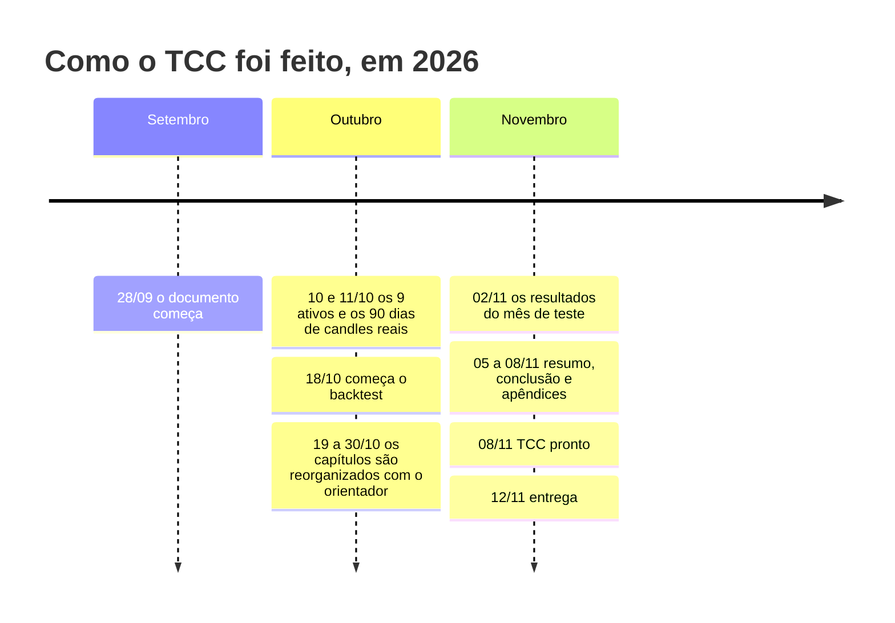

<a id="corrida"></a>

## 🏁 A corrida dos US$1.000

Cada abordagem começou com **US$1.000 em cada ativo** no mês de teste (10/09 a 09/10/2026). O gráfico anda
dia a dia e mostra quanto cada uma ganhou ou perdeu, já com os custos.

<p align="center">
  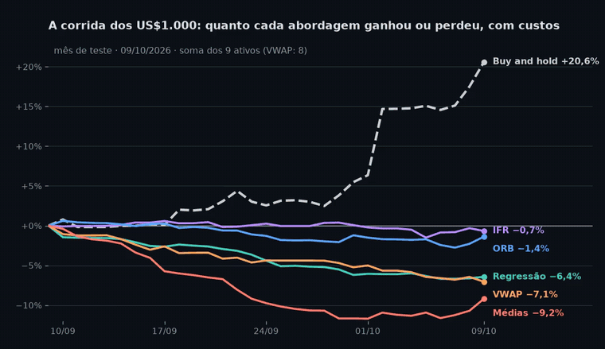<br>
  <sub>🎥 <a href="readme/videos/corrida.mp4">ver em vídeo (MP4)</a> · linha tracejada = <i>buy and hold</i> · soma dos 9 ativos (VWAP: 8, porque o EUR/USD não tem volume)</sub>
</p>

<a id="custo"></a>

## 💸 O custo comeu o lucro

O ponto mais importante do trabalho: **antes do custo, todas ganham um pouquinho; depois, todas perdem.**
No IFR, por exemplo, cada operação ganhava em média **0,079%**, mas pagava **0,114%** de custo. É como uma loja
que lucra em cada produto, mas paga um frete maior que esse lucro: quanto mais vende, mais perde.

<p align="center">
  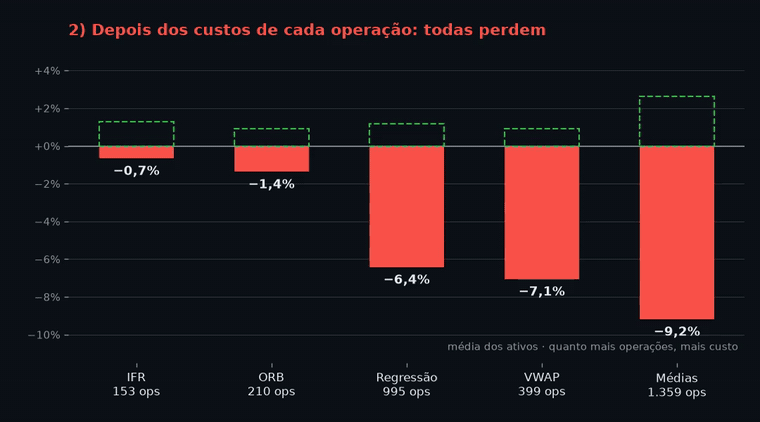<br>
  <sub>🎥 <a href="readme/videos/custo.mp4">ver em vídeo (MP4)</a> · o contorno verde tracejado é o resultado sem custos</sub>
</p>

<table>
<tr><th>Operações no mês (por ativo)</th><th>Resultado médio, com custos</th></tr>
<tr><td>até 30</td><td>🟨 −0,4%</td></tr>
<tr><td>de 31 a 100</td><td>🟧 −4,4%</td></tr>
<tr><td>mais de 100</td><td>🟥 −17,2%</td></tr>
</table>

<a id="como"></a>

## 🧭 Como o trabalho foi feito

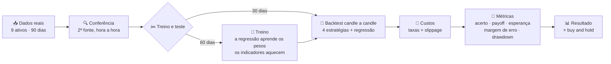

> [!NOTE]
> As estratégias usaram **uma versão só**, com as regras dos exemplos do TCC (seção 2.9), **sem ajuste nenhum**
> no treino. Assim o teste não fica "viciado" no passado (*overfitting*). Testar várias versões fica para
> trabalhos futuros.

<a id="estrategias"></a>

## 🎯 As 4 estratégias, candle a candle

Cada GIF repete um dia real, candle a candle, do jeito que o *backtest* enxerga: sem saber o que vem depois.
Clique em cada estratégia para abrir.

<details open>
<summary><b>📈 ORB: rompimento da faixa de abertura</b> · segue a tendência · 30 min</summary>
<br>

<p align="center">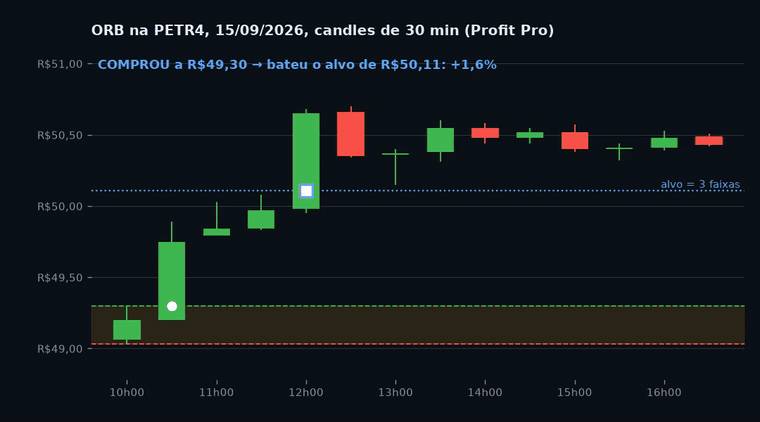<br>
<sub>🎥 <a href="readme/videos/orb.mp4">ver em vídeo</a> · PETR4, 15/09/2026, dados do Profit Pro</sub></p>

| Regra | Como funciona |
|---|---|
| Faixa | máxima e mínima do 1º candle do dia |
| Entrada | compra se o preço passa da máxima; vende se passa da mínima (1 operação por dia) |
| Alvo | 3 vezes o tamanho da faixa |
| *Stop* | no outro lado da faixa |
| **No mês** | **210 operações · acerto 34,3% · −1,4%** (melhor: MGLU3 +6,9%; pior: Tesla −9,6%) |

</details>

<details>
<summary><b>📊 VWAP: preço médio ponderado pelo volume</b> · aposta na volta · 15 min</summary>
<br>

<p align="center">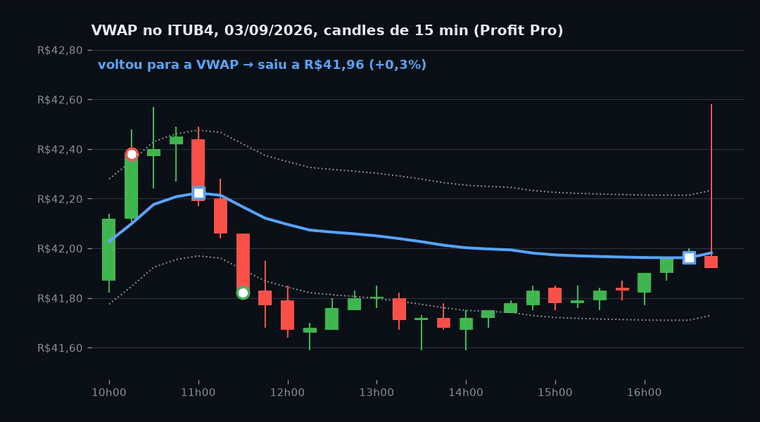<br>
<sub>🎥 <a href="readme/videos/vwap.mp4">ver em vídeo</a> · ITUB4, 03/09/2026, dados do Profit Pro</sub></p>

| Regra | Como funciona |
|---|---|
| Linha | preço médio do dia, em que cada preço pesa pelo volume negociado |
| Entrada | vende quando o candle fecha 0,6% acima da VWAP; compra quando fecha 0,6% abaixo |
| Alvo | voltar para a VWAP |
| *Stop* | 0,6% contra a operação |
| **No mês** | **399 operações · acerto 43,6% · −7,1%** (na MGLU3, que subiu 122%, perdeu 39,0%) |

</details>

<details>
<summary><b>🔁 IFR: índice de força relativa</b> · aposta na volta · 30 min</summary>
<br>

<p align="center">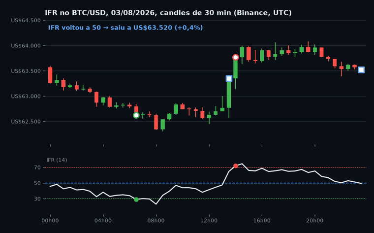<br>
<sub>🎥 <a href="readme/videos/ifr.mp4">ver em vídeo</a> · BTC/USD, 03/08/2026, dados da Binance</sub></p>

| Regra | Como funciona |
|---|---|
| Indicador | IFR de 14 períodos (Wilder, 1978), numa escala de 0 a 100 |
| Entrada | compra com IFR ≤ 30 (sobrevendido); vende com IFR ≥ 70 (sobrecomprado) |
| Alvo | o IFR voltar a 50 |
| *Stop* | 1% contra a operação |
| **No mês** | **153 operações · acerto 49,7% · −0,7%** (a que menos perdeu, porque operou menos) |

</details>

<details>
<summary><b>✂️ Cruzamento de médias móveis</b> · segue a tendência · 5 min</summary>
<br>

<p align="center">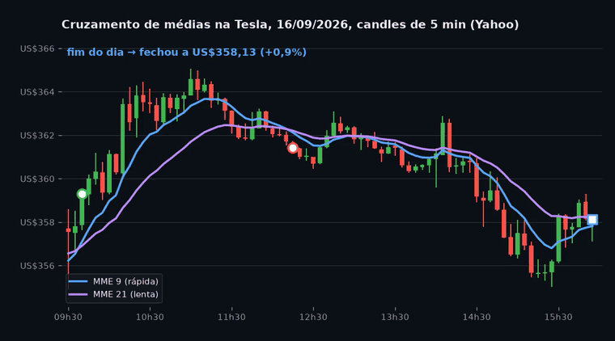<br>
<sub>🎥 <a href="readme/videos/medias.mp4">ver em vídeo</a> · Tesla, 16/09/2026, dados do Yahoo Finance</sub></p>

| Regra | Como funciona |
|---|---|
| Médias | MME de 9 (rápida) e de 21 (lenta) |
| Entrada | compra quando a rápida cruza a lenta para cima; vende quando cruza para baixo |
| Saída | no cruzamento contrário, fecha e já entra do outro lado ("vira a mão") |
| *Stop* | 1,5% contra a operação |
| **No mês** | **1.359 operações · acerto 25,7% · −9,2%** (sem custos seria a melhor: +2,6%) |

</details>

<details>
<summary><b>🧮 Bônus: regressão linear</b> · previsão estatística · 1 h</summary>
<br>

Um modelo que tenta prever a variação da próxima hora a partir das 3 últimas:

$$\text{variação prevista} = a + b_1 \cdot v_1 + b_2 \cdot v_2 + b_3 \cdot v_3$$

Os pesos $a$, $b_1$, $b_2$ e $b_3$ foram escolhidos no treino por mínimos quadrados. Na PETR4, por exemplo,
$b_1 = -0{,}057$: quase zero. O modelo **acertou a direção em 42,9% a 55,6% das horas**, perto dos 50% de uma
moeda, e **perdeu 6,4%** com custos em 995 operações.

<p align="center">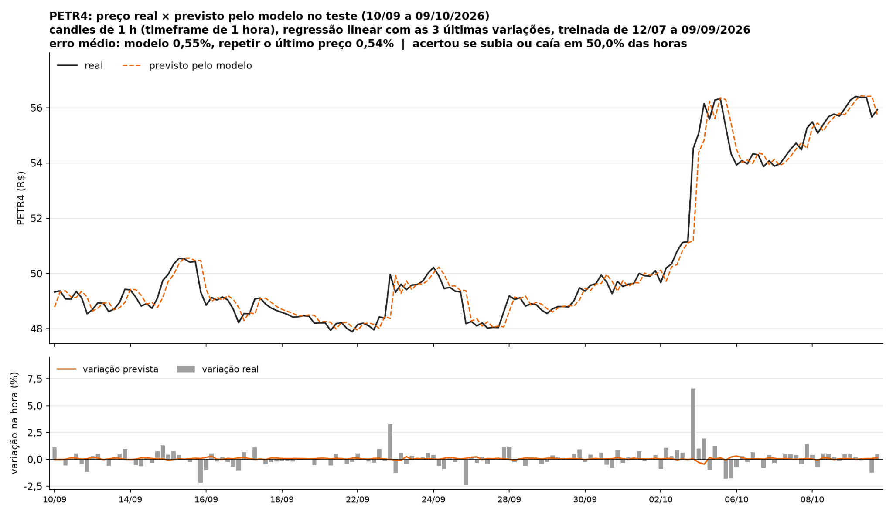</p>

</details>

<details>
<summary><b>📏 Regras que valem para todas</b></summary>
<br>

- 💰 **US$1.000 em cada ativo**, o capital inteiro em cada operação, sem alavancagem.
- 🌙 Tudo é ***day trade***: a operação fecha no fim do dia, e o último candle não abre operação nova.
- 🛑 Se o *stop* e o alvo acontecem no mesmo candle, conta o *stop* (o pior caso).
- 🕳️ Se o preço abre depois do nível (*gap*), a saída é no preço de abertura.
- 👀 Para não "olhar o futuro", no candle da entrada só o *stop* é conferido.
- 🧾 Custo de cada operação = taxas + 1 *tick* de *slippage* na entrada e na saída.

</details>

<p align="right"><a href="#topo">⬆ topo</a></p>

<a id="resultados"></a>

## 🗺️ Todos os resultados

<p align="center">
  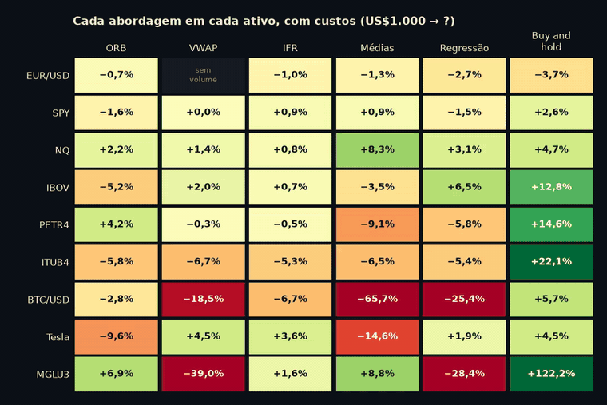<br>
  <sub>🎥 <a href="readme/videos/heatmap.mp4">ver em vídeo</a> · verde = ganhou, vermelho = perdeu · com custos</sub>
</p>

| Abordagem | *Timeframe* | Operações | Acerto | *Payoff* | Sem custos | Com custos |
|---|:-:|--:|--:|--:|--:|--:|
| 🔁 IFR | 30 min | 153 | 49,7% | 0,93 | +1,3% | 🟥 **−0,7%** |
| 📈 ORB | 30 min | 210 | 34,3% | 1,68 | +0,9% | 🟥 **−1,4%** |
| 🧮 Regressão | 1 h | 995 | 46,2% | 0,83 | +1,2% | 🟥 **−6,4%** |
| 📊 VWAP | 15 min | 399 | 43,6% | 0,78 | +0,9% | 🟥 **−7,1%** |
| ✂️ Médias | 5 min | 1.359 | 25,7% | 1,70 | +2,6% | 🟥 **−9,2%** |
| 🧺 *Buy and hold* | — | 9 | — | — | +20,6% | 🟩 **+20,6%** |

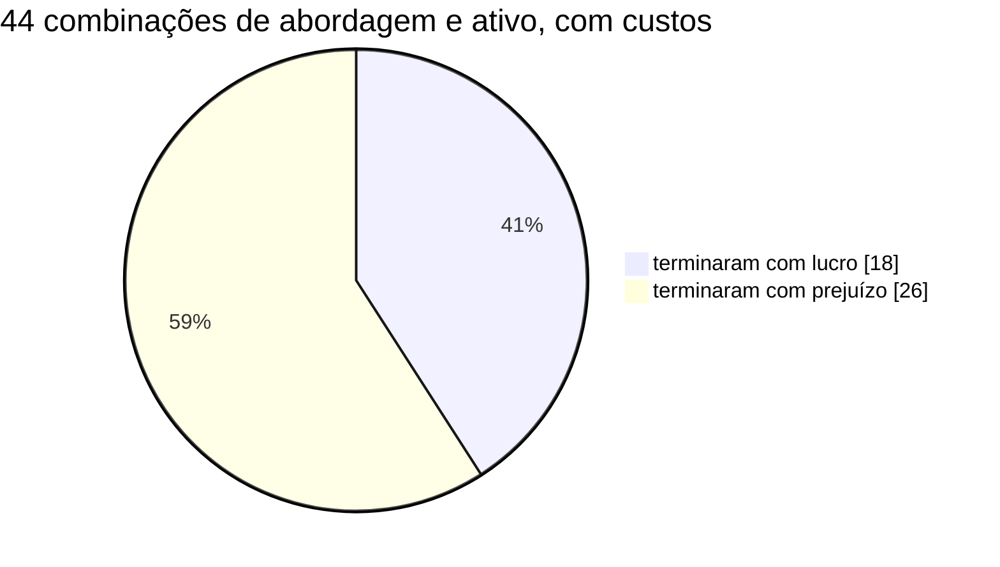

> [!WARNING]
> **Sorte ou vantagem?** Pela margem de erro, só **1 de 43 combinações** teve a faixa toda acima de zero: o
> cruzamento de médias no NQ, exatamente no limite (de 0,000% a 0,076% por operação). Com 43 testes e 2,5% de
> chance de "sorte" em cada um, o acaso já daria cerca de 1 (43 × 2,5% ≈ 1,1). Ou seja: **nenhuma vantagem
> real comprovada.**

> [!CAUTION]
> **O mês foi de alta forte na B3** (IBOV +12,8%, MGLU3 +122,2%). Em um mercado assim, quem compra e espera
> fica com quase toda a alta, e quem faz *day trade* fecha tudo todo dia e paga o custo de novo. Em outro
> mês, de queda ou lateral, o resultado poderia ser outro. No EUR/USD, que caiu 3,7%, o *buy and hold* perdeu
> mais que todas as abordagens.

### 📉 O pior caso: *drawdown* de 65,7%

<p align="center">
  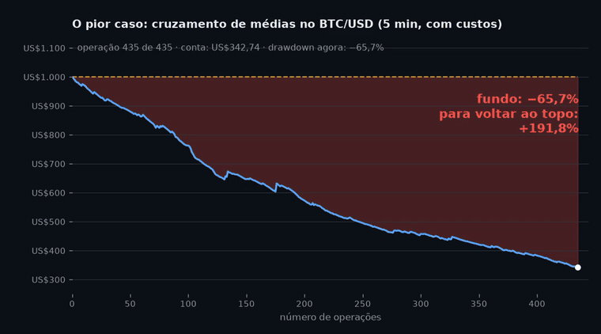<br>
  <sub>🎥 <a href="readme/videos/drawdown.mp4">ver em vídeo</a> · 435 operações, cada uma custando 0,22%, levaram US$1.000 para US$342,74</sub>
</p>

Depois de cair 65,7%, a conta precisa subir **191,8%** só para voltar ao começo, porque:

$$\text{ganho para recuperar} = \frac{\text{perda}}{1 - \text{perda}} = \frac{0{,}657}{0{,}343} \approx 1{,}918$$

<p align="right"><a href="#topo">⬆ topo</a></p>

<a id="matematica"></a>

## 📐 A matemática por trás

<details>
<summary><b>As fórmulas do capítulo 2, com os exemplos do TCC</b></summary>
<br>

| Conceito | Fórmula | Exemplo do TCC |
|---|---|---|
| Retorno | $\dfrac{\text{saída} - \text{entrada}}{\text{entrada}} - \text{custos}$ | $\dfrac{100 - 80}{80} - 1\\% = 24\\%$ |
| Taxa de acerto | $\dfrac{\text{operações com lucro}}{\text{total}}$ | $\dfrac{21}{35} = 60\\%$ |
| *Payoff* | $\dfrac{\text{ganho médio}}{\text{perda média}}$ | $\dfrac{40}{20} = 2$ |
| Esperança | $\text{acerto} \cdot \text{ganho} - \text{erro} \cdot \text{perda}$ | $0{,}4 \cdot 40 - 0{,}6 \cdot 20 = 4$ |
| Acerto mínimo | $\dfrac{1}{1 + \text{payoff}}$ | $\dfrac{1}{1 + 2} = 33{,}3\\%$ |
| Margem de erro | $\dfrac{2 \cdot \text{desvio-padrão}}{\sqrt{n}}$ | $\dfrac{2 \cdot 0{,}5}{\sqrt{1000}} \approx 3{,}2\\%$ |
| *Drawdown* | $\dfrac{\text{atual} - \text{pico}}{\text{pico}}$ | $\dfrac{23380 - 24500}{24500} \approx -4{,}6\\%$ |
| MME | $\text{preço} \cdot k + \text{MME}_{\text{anterior}} \cdot (1 - k)$, com $k = \dfrac{2}{N + 1}$ | $N = 9 \Rightarrow k = \dfrac{1}{5}$; $15 \cdot \dfrac{1}{5} + 10 \cdot \dfrac{4}{5} = 11$ |
| VWAP | $\dfrac{\Sigma (P \cdot V)}{\Sigma V}$, com $P = \dfrac{\text{máx} + \text{mín} + \text{fech}}{3}$ | $\dfrac{10 \cdot 10 + 14 \cdot 30}{10 + 30} = \dfrac{520}{40} = 13$ |
| IFR | $100 - \dfrac{100}{1 + RS}$, com $RS = \dfrac{\text{média das altas}}{\text{média das quedas}}$ | $RS = \dfrac{30}{10} = 3 \Rightarrow 100 - \dfrac{100}{4} = 75$ |

</details>

<details>
<summary><b>Por que o acerto sozinho engana</b></summary>
<br>

O cruzamento de médias teve *payoff* de 1,70. Então precisava acertar pelo menos:

$$\frac{1}{1 + 1{,}70} \approx 37{,}0\\%$$

Ele acertou só **25,7%** e perdeu. Já a VWAP no NQ acertou **72,2%**, mas, com *payoff* de 0,59, precisava de
62,9%: passou do mínimo e ganhou. O que decide não é acertar muito, é **passar do acerto mínimo**.

</details>

<p align="center">
  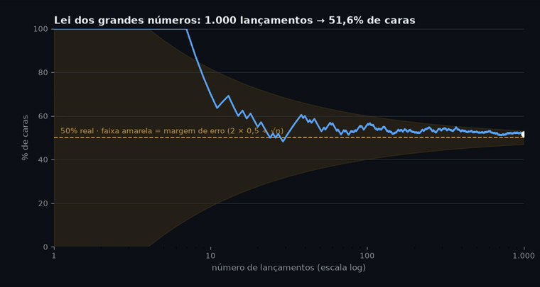<br>
  <sub>🎥 <a href="readme/videos/lei_grandes_numeros.mp4">ver em vídeo</a> · com poucos lançamentos a sorte pesa; com muitos, o resultado chega perto dos 50% reais.
  A faixa amarela é a margem de erro, que encolhe com √n.</sub>
</p>

<details>
<summary><b>🌎 A economia por trás dos preços (galeria)</b></summary>
<br>

<table>
<tr>
<td width="50%">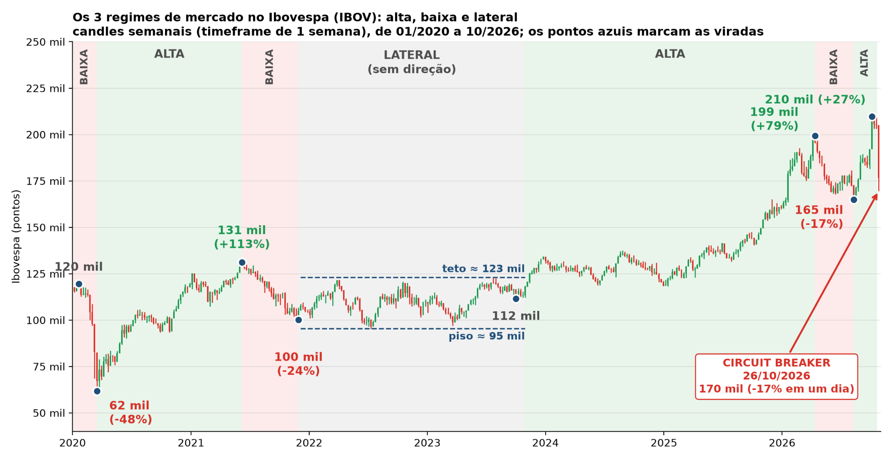<br><sub>Os regimes de mercado no IBOV (2020–2026), com o <i>circuit breaker</i> de 26/10/2026</sub></td>
<td width="50%">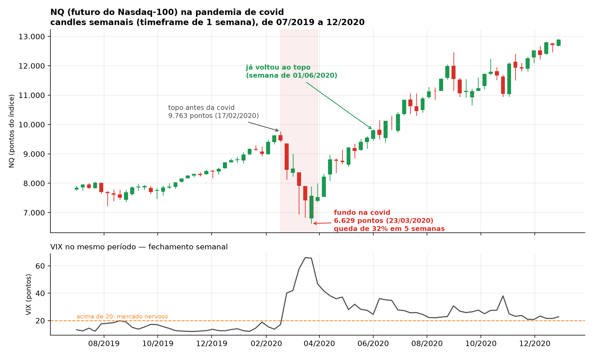<br><sub>O NQ e o VIX na pandemia de covid</sub></td>
</tr>
<tr>
<td width="50%">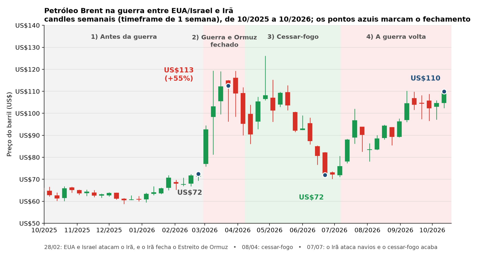<br><sub>O petróleo Brent na guerra entre EUA/Israel e Irã</sub></td>
<td width="50%">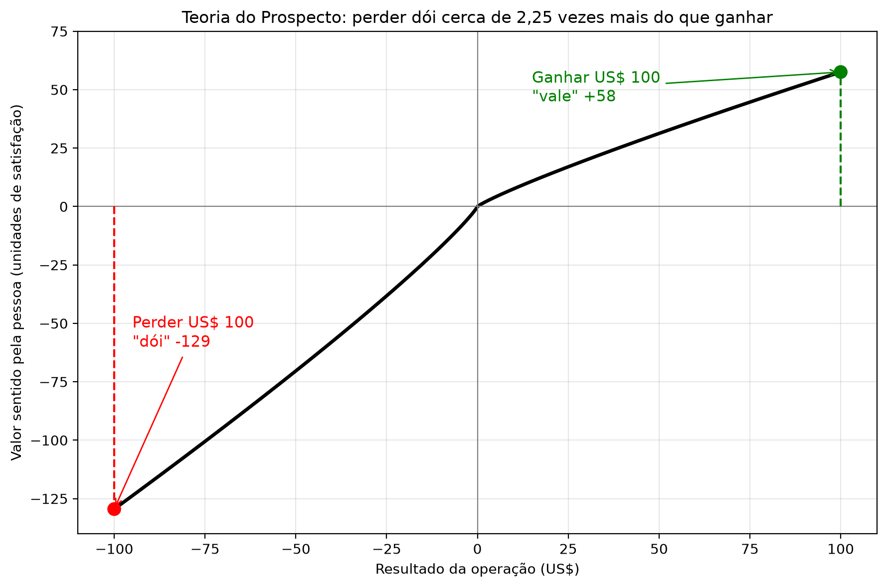<br><sub>Teoria do Prospecto: perder dói mais do que ganhar alegra</sub></td>
</tr>
<tr>
<td width="50%">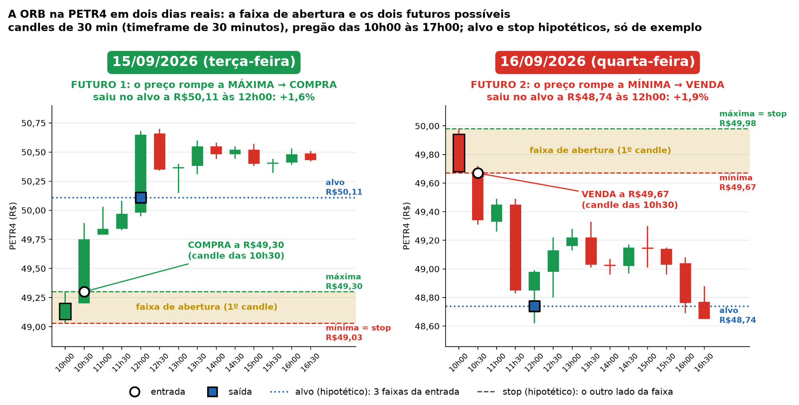<br><sub>A ORB em dois dias reais da PETR4</sub></td>
<td width="50%">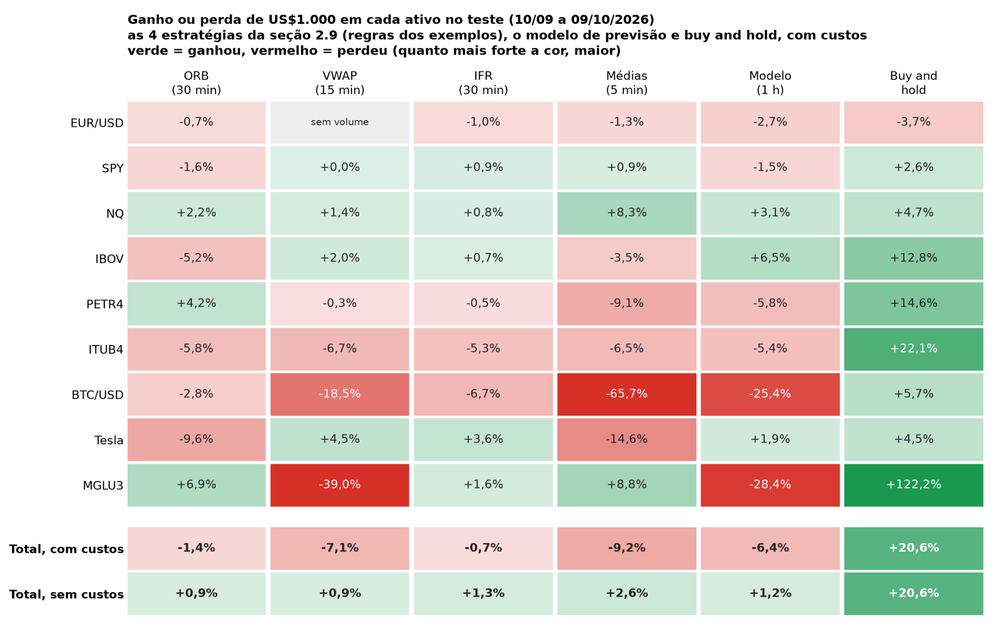<br><sub>O mapa de calor dos resultados (Figura 40)</sub></td>
</tr>
</table>

</details>

<p align="right"><a href="#topo">⬆ topo</a></p>

<a id="dados"></a>

## 🔬 Os dados

| Ativo | De onde vieram os dados de minuto | Custo de ida e volta |
|---|---|--:|
| 💶 EUR/USD | HistData | 0,010% |
| 🇺🇸 SPY · 📉 NQ | HistData (índices S&P 500 e Nasdaq-100) + volume do Yahoo | 0,005% · 0,003% |
| 🇧🇷 IBOV · 🛢️ PETR4 · 🏦 ITUB4 · 🛍️ MGLU3 | Profit Pro (Nelogica) | 0,052% · 0,090% · 0,093% · 0,404% |
| ₿ BTC/USD | Binance | 0,220% |
| 🚗 Tesla | Bybit (contrato TSLAUSDT) | 0,008% |

- 📅 **90 dias**: treino de 12/07 a 09/09/2026 e teste de 10/09 a 09/10/2026.
- 🔍 **Conferência**: cada ativo foi comparado hora a hora com uma segunda fonte (diferença média de 0,004% a 0,10%).
  Ela achou e corrigiu 2 erros: um salto falso de 1% no NQ, na troca do contrato futuro, e a última operação
  que ficava sem custo.
- 🧾 **Custo** = taxas + 1 *tick* de *slippage* na entrada e na saída. Na MGLU3 (cerca de R$5,58), 1 centavo já é
  0,18% do preço: por isso ela é tão cara de operar.
- 🔒 **Os dados brutos não são publicados:** as regras de uso do Yahoo Finance, do HistData e do Profit Pro não
  permitem redistribuir. Os programas que baixaram e conferiram os dados estão em `Dados 90 dias/` e
  `Dados do Yahoo Finance/`; os minutos da B3 vêm do Profit Pro, que exige assinatura.

<a id="estrutura"></a>

<details>
<summary><b>🗂️ O que tem neste repositório</b></summary>
<br>

```text
📦 tcc-day-trade
├── 📁 entrega/             📄 o TCC em PDF (99 páginas) e o programa que acerta o sumário
├── 📁 documento/           o texto final em Markdown, para ler aqui no GitHub
├── 📁 figuras/             as 44 figuras do TCC (tiradas do PDF) e a galeria LEGENDAS.md
├── 📁 Dados 90 dias/       os programas que baixaram e conferiram os candles dos 9 ativos
├── 📁 backtest/            leitura dos dados, custos e o motor do backtest
├── 📁 estrategias_2_9/     as 4 estratégias no mês de teste → ESTRATEGIAS.md
│                           e o trecho do código do Apêndice A (apendice_A_trecho.py)
├── 📁 previsao/            a regressão linear, a simulação e a conferência dos dados
├── 📁 comparativo/         as 5 abordagens juntas → COMPARATIVO.md e a corrida dos US$1.000
├── 📁 graficos_*/          os programas que geram as figuras do TCC
├── 📁 readme/              os SVGs, GIFs e vídeos desta página (gerar_visuais.py)
└── 🐍 *.py na raiz         os programas de matemática do Enzo (retorno, acerto, payoff...)
```

</details>

<a id="rodar"></a>

## ▶️ Como rodar

Os programas precisam dos dados brutos, que não vêm junto (veja [Os dados](#dados)).

```bash
py -3.14 estrategias_2_9/estrategias.py   # as 4 estratégias no mês de teste
py -3.14 previsao/previsao.py             # a regressão linear
py -3.14 comparativo/comparativo.py       # junta tudo e compara
py -3.14 readme/gerar_visuais.py          # refaz os SVGs, GIFs e vídeos desta página
```

Se o texto do TCC mudar, o PDF e a pasta `figuras/` são refeitos assim (o `python` precisa ter o pymupdf):

```bash
python entrega/corrigir_sumario_pdf.py TCC_exportado.pdf entrega/TCC_Enzo_final.pdf   # acerta o sumário
python figuras/extrair_do_pdf.py entrega/TCC_Enzo_final.pdf                          # as 44 figuras
py -3.14 documento/limpar_markdown.py TCC_exportado.md documento/TCC_texto.md        # o texto
```

## 🤝 Ferramentas e créditos

- **Python** (pandas, numpy, matplotlib) e **ffmpeg**, para os cálculos, gráficos e vídeos.
- **Claude Code** (Anthropic), para ajudar a montar os programas e os gráficos, conferir as fontes e escrever e
  revisar partes do texto. O TCC cita o Claude Code na seção 2.8.3, e as figuras dizem "gerado pelo Claude
  (ANTHROPIC, 2026)".
- **Fontes dos dados:** Yahoo Finance, Binance, HistData, Bybit e Profit Pro (Nelogica).

---

<p align="center">
  <sub>✅ TCC concluído em 08/11/2026 · entrega em 12/11/2026<br>
  ⚠️ Trabalho escolar. Nada aqui é recomendação de investimento.<br>
  Resultados de um único mês de teste, com uma versão de cada estratégia: outro período pode dar outro resultado.</sub><br><br>
  <a href="#topo">⬆ voltar ao topo</a>
</p>
