> [!NOTE]
> Texto final do TCC, exportado do Google Docs em 08/11/2026 para ler no GitHub. A versão de entrega, com as páginas, é o PDF [`entrega/TCC_Enzo_final.pdf`](../entrega/TCC_Enzo_final.pdf). As figuras estão em [`figuras/`](../figuras/LEGENDAS.md).

**LUMIAR VILA OLÍMPIA**

ENZO BOTTO DE BARROS MARZIONNA DUDU

**MODELAGEM MATEMÁTICA EM ESTRATÉGIAS PARA *DAY TRADE***  
Risco, gestão de capital e a influência da economia

SÃO PAULO  
2026  
ENZO BOTTO DE BARROS MARZIONNA DUDU

**MODELAGEM MATEMÁTICA EM ESTRATÉGIAS PARA *DAY TRADE***  
risco, gestão de capital e a influência da economia

Trabalho de Conclusão de Curso apresentado ao Lumiar Vila Olímpia como requisito parcial para a conclusão do nono ano do Ensino Fundamental.

Orientador: Prof. Mestre Antônio Francisco da Silva Junior

SÃO PAULO  
2026  
**RESUMO**  
Muitas pessoas acreditam que é possível ganhar dinheiro com *trading* seguindo regras simples olhando o gráfico. Este trabalho usou matemática e algoritmos para testar se essas regras realmente têm vantagem estatística. As estratégias escolhidas e testadas foram o IFR, a ORB, o cruzamento de médias móveis e a VWAP, além de um modelo de regressão linear. Todas foram programadas em Python e testadas nos seguintes ativos: IBOV, MGLU3, ITUB4, PETR4, Tesla, NQ, SPY, EUR/USD e BTC/USD. Os dados foram divididos em duas partes: o treino, com 60 dias (de 12/07 a 09/09/2026), usado para ajustar a regressão linear, e o teste, com 30 dias (de 10/09 a 09/10/2026), em que todas as abordagens foram executadas. Cada estratégia começou com um capital inicial de US\$1.000 em cada ativo, e os resultados foram calculados com e sem custos e comparados com o *buy and hold*, que é comprar o ativo no começo do mês e vendê-lo no fim. No total, foram 3.116 operações no mês de teste. Com custos, todas as abordagens perderam, do IFR, com −0,7%, ao cruzamento de médias, com −9,2%. Sem custos, todas teriam ficado perto de zero, entre \+0,9% e \+2,6%. A conclusão é que nenhuma regra mostrou vantagem estatística real depois dos custos e que, por isso, é preciso testar uma regra com matemática antes de usar dinheiro de verdade no mercado.

**Palavras-chave:** *Day trade*. Probabilidade. Esperança matemática. Gestão de risco. *Backtest*.

**ABSTRACT**

Many people believe it is possible to make money from trading by following simple rules based on price charts. This work used mathematics and algorithms to test whether these rules really have a statistical edge. The strategies chosen and tested were the RSI (Relative Strength Index), the ORB (Opening Range Breakout), the moving average crossover and the VWAP (Volume Weighted Average Price), in addition to a linear regression model. All of them were programmed in Python and tested on the following assets: IBOV, MGLU3, ITUB4, PETR4, Tesla, NQ, SPY, EUR/USD and BTC/USD. The data were split into two parts: the training period, with 60 days (from July 12 to September 9, 2026), used to fit the linear regression, and the test period, with 30 days (from September 10 to October 9, 2026), in which all approaches were run. Each strategy started with an initial capital of US\$1,000 in each asset, and the results were calculated with and without costs and compared with buy and hold, which means buying the asset at the beginning of the month and selling it at the end. In total, there were 3,116 trades in the test month. With costs, all approaches lost money, from −0.7% for the RSI to −9.2% for the moving average crossover. Without costs, all of them would have stayed close to zero, between \+0.9% and \+2.6%. The conclusion is that no rule showed a real statistical edge after costs and that, therefore, a rule must be tested with mathematics before real money is used in the market.

**Keywords:** Day trading. Probability. Expected value. Risk management. Backtest.

**LISTA DE FIGURAS**

Figura 1 – *Candles* do SPY no *timeframe* diário, com médias móveis simples de 20 e 50 períodos (exemplo de análise técnica)  
Figura 2 – Juros dos Estados Unidos e preço do SPY, dados mensais (exemplo de análise fundamentalista)  
Figura 3 – Lucro líquido anual e preço mensal da ação da NVIDIA (exemplo de análise fundamentalista)  
Figura 4 – Inflação e juros nos Estados Unidos, dados mensais (exemplo de análise fundamentalista)  
Figura 5 – Médias móveis exponenciais de 9 e 21 períodos no SPY, *timeframe* diário  
Figura 6 – IFR de 14 períodos no SPY, *timeframe* diário  
Figura 7 – Bandas de Bollinger de 20 períodos e 2 desvios-padrão no SPY, *timeframe* diário  
Figura 8 – MACD (12, 26, 9\) no SPY, *timeframe* diário  
Figura 9 – Volume financeiro diário do SPY, em bilhões de US\$, *timeframe* diário  
Figura 10 – VWAP no SPY, *timeframe* de 1 hora, últimos 5 pregões  
Figura 11 – Teoria do Prospecto: quanto um ganho e uma perda de US\$100 são sentidos pela pessoa  
Figura 12 – Efeito disposição: porcentagem de ações no lucro e no prejuízo que foram vendidas por investidores de uma corretora americana (1987 a 1993\)  
Figura 13 – Preço do petróleo Brent na guerra entre EUA/Israel e Irã, *candles* semanais (*timeframe* de 1 semana), de 10/2025 a 10/2026  
Figura 14 – O que acontece quando a taxa Selic sobe e quando ela cai  
Figura 15 – Juros (meta da taxa Selic) e inflação (IPCA acumulado em 12 meses) no Brasil, dados mensais, de 01/2015 a 09/2026  
Figura 16 – Exemplo da lei da oferta e da demanda no preço de uma ação (números hipotéticos)  
Figura 17 – Indicadores macroeconômicos do Brasil: PIB (anual), dívida bruta do governo, resultado primário e dólar (mensais), de 2015 a 2026  
Figura 18 – Indicadores microeconômicos do Itaú Unibanco (ITUB4): receita, lucro líquido, lucro por ação e dividendos (anuais) e preço da ação (mensal), de 2022 a 2026  
Figura 19 – VIX, o índice de volatilidade (“índice do medo”) do mercado americano, dados diários, de 01/2015 a 10/2026  
Figura 20 – NQ (contrato futuro do índice Nasdaq-100) na pandemia de covid, com o VIX embaixo, *candles* semanais (*timeframe* de 1 semana), de 07/2019 a 12/2020  
Figura 21 – Os 3 regimes de mercado (alta, baixa e lateral) no Ibovespa (IBOV), *candles* semanais (*timeframe* de 1 semana), de 01/2020 a 10/2026, com o *circuit breaker* de 26/10/2026  
Figura 22 – Um exemplo de cálculo do retorno de uma operação em Python, sem e com custos (compra de 10 ações a US\$80 e venda a US\$100)  
Figura 23 – Exemplo de cálculo da taxa de acerto em Python (6 operações com lucro em um total de 10\)  
Figura 24 – Exemplo de cálculo do *payoff* em Python (21 operações com lucro e 14 com prejuízo)  
Figura 25 – Exemplo de cálculo da esperança matemática em Python (taxa de acerto de 40%, ganho médio de US\$40 e perda média de US\$20)  
Figura 26 – Exemplo de cálculo da taxa de acerto mínima em Python (*payoff* de 2\)  
Figura 27 – Simulação da lei dos grandes números em Python (moeda lançada 10, 100, 1.000 e 10.000 vezes)  
Figura 28 – Porcentagem de caras de acordo com o número de lançamentos da moeda (resultado da simulação da Figura 27\)  
Figura 29 – Exemplo de cálculo da margem de erro em Python (1.000 lançamentos de uma moeda, com desvio-padrão de 0,5)  
Figura 30 – Exemplo de *drawdown* de uma conta hipotética ao longo de 7 dias  
Figura 31 – Exemplo de cálculo do ganho necessário para recuperar uma perda em Python (perdas de 10%, 20% e 50%)  
Figura 32 – Volatilidade dos ativos escolhidos, do menor para o maior desvio-padrão dos retornos diários (*timeframe* diário, de 12/07/2026 a 09/10/2026)  
Figura 33 – Exemplo da ORB na PETR4 em dois dias reais, 15/09/2026 e 16/09/2026: a faixa de abertura e os dois futuros possíveis, com alvo e *stop* hipotéticos (*timeframe* de 30 minutos)  
Figura 34 – Exemplo da VWAP no ITUB4 em um dia real, 03/09/2026: uma venda e uma compra quando o preço se afasta 0,6% da VWAP, com alvo e *stop* hipotéticos (*timeframe* de 15 minutos)  
Figura 35 – Exemplo do IFR no BTC/USD em um dia real, 03/08/2026: uma compra com o IFR abaixo de 30 e uma venda com o IFR acima de 70, com alvo e *stop* hipotéticos (*timeframe* de 30 minutos, IFR de 14 períodos)  
Figura 36 – Exemplo do cruzamento de médias na Tesla em um dia real, 16/09/2026: uma compra e uma venda quando a MME de 9 períodos cruza a de 21, virando a mão, com *stop* hipotético (*timeframe* de 5 minutos)  
Figura 37 – Preço real da PETR4 comparado com o previsto pela regressão linear no teste (*timeframe* de 1 hora, regressão com as 3 últimas variações; 10/09 a 09/10/2026)  
Figura 38 – Ganho ou perda de US\$1.000 em cada ativo com a regressão linear, com e sem custos, comparado com o *buy and hold* (*timeframe* de 1 hora; 10/09 a 09/10/2026)  
Figura 39 – Capital de cada abordagem dia a dia no mês de teste, com custos, somando os ativos (*timeframes*: ORB e IFR de 30 minutos, VWAP de 15 minutos, cruzamento de médias de 5 minutos e regressão de 1 hora; 10/09 a 09/10/2026)  
Figura 40 – Ganho ou perda de US\$1.000 de cada abordagem em cada ativo, com custos (*timeframes*: ORB e IFR de 30 minutos, VWAP de 15 minutos, cruzamento de médias de 5 minutos e regressão de 1 hora; 10/09 a 09/10/2026)  
Figura 41 – Ganho ou perda de US\$1.000 em cada ativo com a ORB, com e sem custos, comparado com o *buy and hold* (*timeframe* de 30 minutos; 10/09 a 09/10/2026)  
Figura 42 – Ganho ou perda de US\$1.000 em cada ativo com a VWAP, com e sem custos, comparado com o *buy and hold* (*timeframe* de 15 minutos; 10/09 a 09/10/2026)  
Figura 43 – Ganho ou perda de US\$1.000 em cada ativo com o IFR, com e sem custos, comparado com o *buy and hold* (*timeframe* de 30 minutos; 10/09 a 09/10/2026)  
Figura 44 – Ganho ou perda de US\$1.000 em cada ativo com o cruzamento de médias, com e sem custos, comparado com o *buy and hold* (*timeframe* de 5 minutos; 10/09 a 09/10/2026)

**LISTA DE TABELAS**

Tabela 1 – Preço dos compradores e dos vendedores para cada quantidade de ações (valores hipotéticos)  
Tabela 2 – Erro da previsão da regressão linear e acerto da direção no teste, com *candles* de 1 hora (10/09 a 09/10/2026)  
Tabela 3 – Resultado de cada abordagem no teste, somando os ativos, com capital inicial de US\$1.000 por ativo (10/09 a 09/10/2026)  
Tabela 4 – Ganho ou perda de US\$1.000 em cada ativo no teste, com custos (10/09 a 09/10/2026)

**LISTA DE ABREVIATURAS E SIGLAS**

**B3**	Brasil, Bolsa, Balcão  
**BTC/USD**	Bitcoin cotado em dólar americano  
**CFD**	*Contract for Difference* (contrato por diferença)  
**CME**	*Chicago Mercantile Exchange* (bolsa de Chicago)  
**CVM**	Comissão de Valores Mobiliários  
**E**	Esperança matemática  
**ETF**	*Exchange Traded Fund* (fundo negociado na bolsa)  
**EUA**	Estados Unidos da América  
**EUR/USD**	Euro cotado em dólar americano  
**FOMO**	*Fear of Missing Out* (medo de ficar de fora)  
**FRED**	*Federal Reserve Economic Data* (base de dados econômicos do Federal Reserve de St. Louis)  
**IA**	Inteligência artificial  
**IBOV**	Índice Bovespa (Ibovespa)  
**IFR**	Índice de Força Relativa  
**IPCA**	Índice Nacional de Preços ao Consumidor Amplo  
**IS**	*In-sample* (dentro da amostra usada para ajustar o modelo)  
**ITUB4**	Ação preferencial do Itaú Unibanco  
**MACD**	*Moving Average Convergence Divergence* (convergência e divergência de médias móveis)  
**MGLU3**	Ação ordinária do Magazine Luiza  
**MME**	Média móvel exponencial  
**NQ**	Contrato futuro E-mini do índice Nasdaq-100  
**NYSE**	*New York Stock Exchange* (Bolsa de Valores de Nova York)  
**ODS**	Objetivos de Desenvolvimento Sustentável  
**OOS**	*Out-of-sample* (fora da amostra usada para ajustar o modelo)  
**ORB**	*Opening Range Breakout* (rompimento da faixa de abertura)  
**P2P**	*Peer-to-peer* (de pessoa para pessoa)  
**PETR4**	Ação preferencial da Petrobras  
**PIB**	Produto Interno Bruto  
**R\$**	Real (moeda brasileira)  
**S\&P 500**	*Standard & Poor's 500* (índice de 500 grandes empresas dos EUA)  
**Selic**	Sistema Especial de Liquidação e de Custódia (taxa básica de juros do Brasil)  
**SPY**	*SPDR S\&P 500 ETF Trust*, fundo que acompanha o índice S\&P 500  
**US\$**	Dólar americano  
**VIX**	*Cboe Volatility Index* (índice de volatilidade da Cboe, bolsa de opções de Chicago)  
**VWAP**	*Volume Weighted Average Price* (preço médio ponderado pelo volume)

**SUMÁRIO**

- [INTRODUÇÃO](#introdução)
- [1 REVISÃO BIBLIOGRÁFICA](#1-revisão-bibliográfica)
  - [1.1 A bolsa de valores e os ativos](#11-a-bolsa-de-valores-e-os-ativos)
  - [1.2 Como funciona o day trade](#12-como-funciona-o-day-trade)
  - [1.3 Análise fundamentalista e técnica](#13-análise-fundamentalista-e-técnica)
  - [1.4 Indicadores técnicos](#14-indicadores-técnicos)
  - [1.5 Emoções e uso de robôs](#15-emoções-e-uso-de-robôs)
  - [1.6 Trading quantitativo](#16-trading-quantitativo)
  - [1.7 A economia e o mercado: atuação conjunta no preço de um ativo](#17-a-economia-e-o-mercado-atuação-conjunta-no-preço-de-um-ativo)
    - [1.7.1 Juros, inflação e notícias](#171-juros-inflação-e-notícias)
    - [1.7.2 Lei da oferta e da demanda](#172-lei-da-oferta-e-da-demanda)
    - [1.7.3 Microeconomia e macroeconomia](#173-microeconomia-e-macroeconomia)
    - [1.7.4 Medindo o “nervosismo” do mercado: o VIX](#174-medindo-o-nervosismo-do-mercado-o-vix)
    - [1.7.5 A estratégia em momentos diferentes](#175-a-estratégia-em-momentos-diferentes)
    - [1.7.6 O que isso significa](#176-o-que-isso-significa)
- [2 MÉTODO E MATERIAIS](#2-método-e-materiais)
  - [2.1 Retorno](#21-retorno)
  - [2.2 Taxa de acerto e payoff](#22-taxa-de-acerto-e-payoff)
  - [2.3 Esperança matemática](#23-esperança-matemática)
  - [2.4 Taxa de acerto mínima](#24-taxa-de-acerto-mínima)
  - [2.5 Sorte ou vantagem: a lei dos grandes números](#25-sorte-ou-vantagem-a-lei-dos-grandes-números)
  - [2.6 Margem de erro da média](#26-margem-de-erro-da-média)
  - [2.7 Drawdown](#27-drawdown)
  - [2.8 Obtenção de dados](#28-obtenção-de-dados)
    - [2.8.1 Tipo de pesquisa](#281-tipo-de-pesquisa)
    - [2.8.2 Os ativos escolhidos](#282-os-ativos-escolhidos)
    - [2.8.3 Dados e ferramentas](#283-dados-e-ferramentas)
    - [2.8.4 O backtest](#284-o-backtest)
    - [2.8.5 Treino e teste](#285-treino-e-teste)
    - [2.8.6 Limitações](#286-limitações)
  - [2.9 As estratégias testadas](#29-as-estratégias-testadas)
    - [2.9.1 ORB: rompimento da faixa de abertura](#291-orb-rompimento-da-faixa-de-abertura)
    - [2.9.2 VWAP: preço médio ponderado pelo volume](#292-vwap-preço-médio-ponderado-pelo-volume)
    - [2.9.3 IFR: índice de força relativa](#293-ifr-índice-de-força-relativa)
    - [2.9.4 Cruzamento de médias móveis](#294-cruzamento-de-médias-móveis)
    - [2.9.5 As regras usadas na simulação](#295-as-regras-usadas-na-simulação)
- [3 RESULTADOS E DISCUSSÕES](#3-resultados-e-discussões)
- [4 CONCLUSÃO](#4-conclusão)
- [REFERÊNCIAS](#referências)
- [APÊNDICE A – CÓDIGO DAS ESTRATÉGIAS](#apêndice-a--código-das-estratégias)
- [APÊNDICE B – GLOSSÁRIO](#apêndice-b--glossário)

# **INTRODUÇÃO**

*Day trade* é o nome dado à operação de comprar e vender um ativo no mesmo dia. O *trader* quer aproveitar as variações de preço no ativo que acontecem ao longo do dia. As palavras técnicas usadas no trabalho estão explicadas no glossário (Apêndice B).  
Nos últimos anos, pesquisas sérias no Brasil apontam um resultado desfavorável ao *trader* pessoa física. Um estudo feito com dados reais da bolsa brasileira acompanhou pessoas que fizeram *day trade* no mini-índice por mais de 300 dias e encontrou que 97% delas perderam dinheiro (CHAGUE; DE-LOSSO; GIOVANNETTI, 2019). Por isso, muita gente compara o *day trade* a um jogo de cassino, mas, na prática e na teoria, não é, pois podem ser usados modelos matemáticos, algoritmos e padrões de repetição para lucrar no mercado. O presente trabalho tem a intenção de compreender se é possível obter uma margem de lucro constante e segura nas operações de *day trade* quando elas são realizadas com o auxílio de ferramentas matemáticas.   
Este trabalho se relaciona com os seguintes Objetivos de Desenvolvimento Sustentável (ODS) da Organização das Nações Unidas. O primeiro é o ODS 4, Educação de Qualidade, pois a pesquisa usa probabilidade, estatística e programação para resolver um problema real e mostra como a educação financeira e o pensamento crítico ajudam as pessoas a não cair em promessas de dinheiro fácil. O segundo é o ODS 8, Trabalho Decente e Crescimento Econômico, pois entender o risco e testar uma estratégia antes de usar dinheiro de verdade ajuda a proteger o patrimônio de quem investe e incentiva uma relação mais responsável com o mercado financeiro.  
O objetivo geral deste trabalho é compreender, com o auxílio de modelagem matemática, como as estratégias de *day trade* baseadas em análise técnica (ORB, VWAP, IFR e cruzamento de médias móveis) se relacionam com probabilidade e esperança matemática. O trabalho busca estabelecer em que condições uma estratégia sustenta resultado positivo a partir da utilização de ferramentas matemáticas (como a regressão linear utilizada neste trabalho) e qual o papel da taxa de acerto e do *payoff* nesse resultado.   
Os objetivos específicos são: transformar as estratégias, que normalmente são explicadas olhando um gráfico, em regras exatas que um computador consegue seguir (algoritmos); testar essas regras com dados reais do passado e calcular a taxa de acerto, *payoff*, esperança matemática e *drawdown*; e observar se as estratégias funcionam melhor em momentos calmos ou agitados da economia.

# **1 REVISÃO BIBLIOGRÁFICA**

## **1.1 A bolsa de valores e os ativos**

A bolsa de valores é um lugar onde compradores e vendedores negociam ativos diariamente. No passado, quando não havia tecnologia suficiente, as negociações eram feitas de forma física e aos gritos em um salão, no famoso pregão viva-voz (COMISSÃO DE VALORES MOBILIÁRIOS – CVM, 2024). Hoje, tudo acontece por computador: as ordens de compra e de venda são enviadas pela internet e processadas rapidamente pela corretora e, depois, encaminhadas à bolsa (CVM, 2024). Nos Estados Unidos, as principais bolsas são a NYSE e a Nasdaq (STATISTA, 2026).  
Os produtos negociados são chamados de ativos. Entre eles estão as ações, em que se compra ou vende uma pequena parte de uma empresa; os índices, que são uma média do desempenho de um grupo de ativos; as criptomoedas, que são moedas digitais descentralizadas, ou seja, funcionam sem um banco ou governo no meio para validar os pagamentos, pois essa tarefa é feita pela própria rede de computadores, como no Bitcoin (NAKAMOTO, 2008), e que usam criptografia para proteger transações financeiras diretas entre pessoas, como o P2P (pessoa para pessoa); os fundos, mais conhecidos como ETFs, que são uma cesta de ativos financeiros; e os contratos futuros, que são acordos para comprar ou vender algo por um preço combinado em uma data futura, como o NQ.  
O preço de um ativo é formado pela oferta e pela demanda. Se, em um momento, existem mais compradores do que vendedores, os compradores precisam aceitar pagar um preço mais caro, e o preço do ativo tende a subir. Se existem mais vendedores no mercado, o preço tende a cair, pois os vendedores precisam aceitar um preço mais barato. Como milhões de pessoas e computadores negociam ao mesmo tempo, o preço muda o tempo todo; isso se chama volatilidade (B3, 2023). Quando sai uma notícia de alto impacto que afeta o mercado, o preço pode variar bruscamente para cima ou para baixo em questão de minutos, segundos ou até mesmo milissegundos.

## **1.2 Como funciona o *day trade***

No *day trade*, a operação deve ser aberta e fechada no mesmo dia; o próprio nome diz isso, pois, traduzido, significa “troca diária”.   
Existem duas formas de operar:

* **Comprado:** o *trader* pode comprar primeiro e vender depois, especulando que o preço suba. Exemplo: o *trader* compra a US\$100 e vende a US\$103, obtendo um lucro de US\$3.  
* **Vendido:** o *trader* pode vender primeiro e comprar depois, esperando que o preço caia. Isso é possível porque a corretora empresta ativos de outros investidores para o *trader* realizar a operação de venda. Exemplo: vende a US\$100 e compra a US\$97, obtendo um lucro de US\$3.

Essa possibilidade de ganhar tanto na alta quanto na baixa é uma característica importante do *day trade*. Outra característica é a **alavancagem**, que é operar um valor maior do que o dinheiro que se tem na conta. Com alavancagem de 5 vezes, por exemplo, quem tem US\$1.000 pode operar como se tivesse US\$5.000. Isso multiplica o lucro, mas também multiplica o prejuízo: uma queda de 20% no ativo faria essa pessoa perder todo o seu dinheiro na conta.  
Também é preciso considerar os **custos de corretagem**. A cada operação, o *trader* paga corretagem e taxas, e muitas vezes consegue um preço um pouco pior do que o que aparecia na tela, o que é chamado de escorregamento (em inglês, *slippage*). Esses custos parecem pequenos à primeira vista, mas quem faz centenas de operações por dia paga esses valores centenas de vezes. Uma estratégia com lucro médio muito pequeno por operação pode se tornar perdedora por causa dos custos operacionais, pois eles são cobrados em todas as operações e reduzem o resultado final. Por exemplo, se uma estratégia gera lucro médio de US\$2 por operação, mas os custos (corretagem, taxas e *slippage*) somam US\$3, o resultado líquido é de −US\$1 por operação. Assim, após 100 operações, o prejuízo total seria de US\$100.

## **1.3 Análise fundamentalista e técnica**

A análise fundamentalista e a análise técnica são dois métodos usados para decidir quando comprar ou vender um ativo. A fundamentalista estuda o valor de uma empresa e da economia, usando dados como balanços, notícias e taxa de juros. Já a técnica estuda o comportamento do preço ao longo do tempo, usando gráficos e indicadores. Assim, enquanto a primeira procura entender quanto vale um ativo, a segunda procura identificar o melhor momento para entrar ou sair de uma operação.

* **Análise técnica:** a análise técnica é o estudo da ação do mercado, principalmente por meio do uso de gráficos e indicadores com o objetivo de prever tendências futuras dos preços, utilizando dados históricos de preço e volume, padrões gráficos e padrões de *candles* (MURPHY, 1999).  
* **Análise fundamentalista:** a análise fundamentalista é o estudo da macroeconomia, da microeconomia e dos preços, a partir de dados econômicos, como balanços, taxa de juros e inflação, e de dados dos setores da economia. O objetivo é descobrir quanto o ativo vale de verdade (“o valor justo”) e comparar esse valor com o preço na bolsa (CVM, 2024).

Muitas vezes, o *trader* usa a análise técnica em vez da fundamentalista, pois a técnica é voltada para operadores de curto prazo e a fundamentalista, para investidores de longo prazo (CVM, 2024). Os dois tipos de análise se complementam, ou seja, as duas se sobrepõem: para fazer uma entrada em um ativo financeiro, o *trader* também deve consultar dados econômicos, notícias e setores da economia, e o investidor que faz a entrada baseada na análise fundamentalista também deve utilizar gráficos e dados.   
Porém, a análise técnica é muito criticada por economistas e pesquisadores, pois depende de interpretações subjetivas de padrões passados que não garantem o comportamento futuro dos preços. A crítica mais conhecida é a Hipótese dos Mercados Eficientes, proposta pelo economista Eugene Fama: segundo ela, o preço de um ativo já reflete todas as informações disponíveis, e por isso estudar os preços do passado não daria vantagem a ninguém (FAMA, 1970). Este trabalho testa justamente essa ideia: se as estratégias técnicas escolhidas conseguem ou não ter vantagem.   
A seguir, são apresentados alguns exemplos de como cada tipo de análise olha para o mercado. A Figura 1 é um exemplo de análise técnica: o gráfico de *candles* do SPY no *timeframe* diário (cada *candle* representa um dia), com as médias móveis simples de 20 e de 50 períodos.   
Figura 1 – *Candles* do SPY no *timeframe* diário, com médias móveis simples de 20 e 50 períodos (exemplo de análise técnica)  
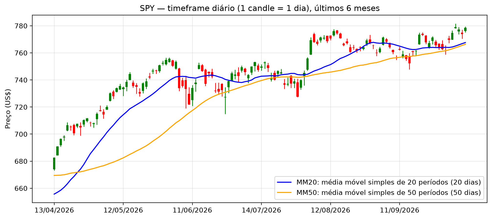  
Fonte: gerado pelo Claude (ANTHROPIC, 2026), com dados do Yahoo Finance (2026b).

As Figuras 2, 3 e 4 são exemplos de análise fundamentalista: os juros dos Estados Unidos, o lucro de uma grande empresa e a inflação.

Figura 2 – Juros dos Estados Unidos e preço do SPY, dados mensais (exemplo de análise fundamentalista)  
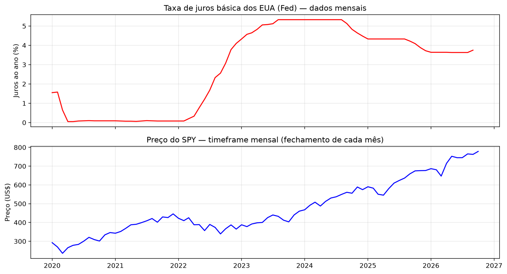  
Fonte: gerado pelo Claude (ANTHROPIC, 2026), com dados do FRED (FEDERAL RESERVE BANK OF ST. LOUIS, 2026\) e do Yahoo Finance (2026b).

Figura 3 – Lucro líquido anual e preço mensal da ação da NVIDIA (exemplo de análise fundamentalista)  
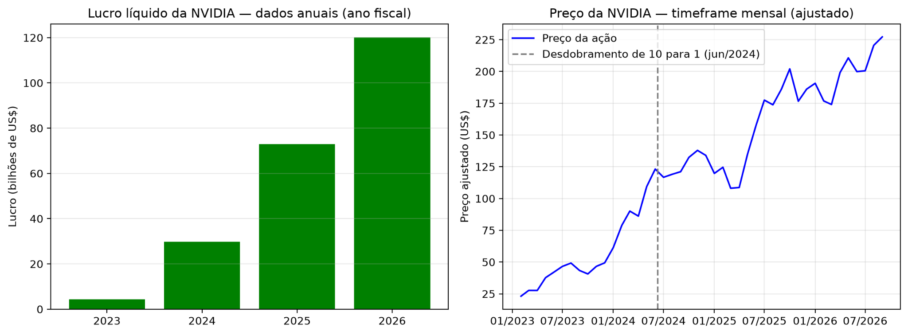  
Fonte: gerado pelo Claude (ANTHROPIC, 2026), com dados do Yahoo Finance (2026a).

Figura 4 – Inflação e juros nos Estados Unidos, dados mensais (exemplo de análise fundamentalista)  
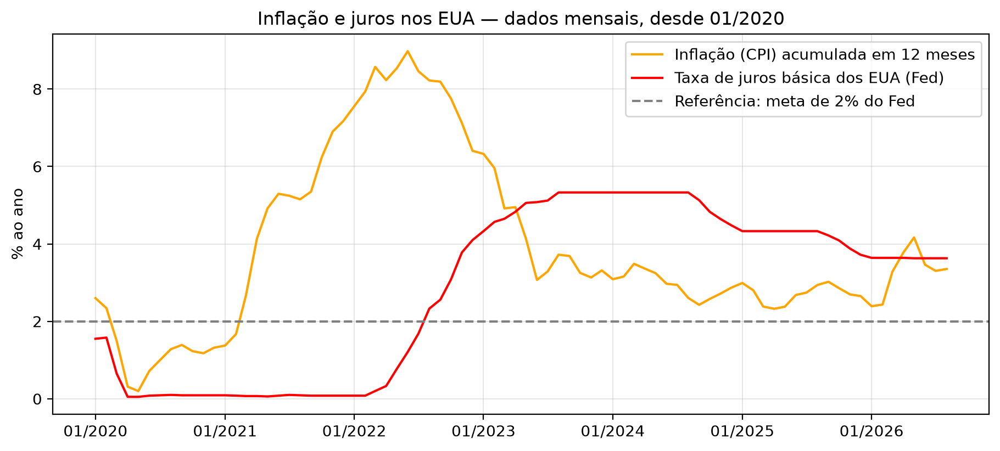  
Fonte: gerado pelo Claude (ANTHROPIC, 2026), com dados do FRED (FEDERAL RESERVE BANK OF ST. LOUIS, 2026).

## **1.4 Indicadores técnicos**

Os indicadores técnicos são cálculos matemáticos aplicados ao preço do ativo e são usados por *traders* para auxiliar nas decisões de compra e venda (MURPHY, 1999; B3, 2025). Alguns exemplos são Médias Móveis, IFR, Bandas de Bollinger, MACD, Volume Financeiro e VWAP (WILDER, 1978; BERKOWITZ; LOGUE; NOSER, 1988; MURPHY, 1999).  
Os indicadores medem o comportamento do ativo com estatística e histórico do preço. Eles pegam esses dados e os transformam em indicações mais claras, que ajudam os *traders* a analisar os gráficos e a decidir se entram em uma operação, ou seja, a decisão passa a ser baseada em dados (MURPHY, 1999; B3, 2025).  
*Traders* usam indicadores técnicos como filtros para reduzir o fator emocional de suas operações, pois eles transformam os dados de preço em sinais objetivos, chamados de gatilhos de compra e gatilhos de venda. Em vez de decidir por medo ou ganância, o *trader* define regras antes de operar, por exemplo, evitar comprar quando o IFR indicar sobrecompra, e segue essas regras durante o pregão (B3, 2025). Isso é importante porque Lo, Repin e Steenbarger (2005) observaram que *traders* com reações emocionais mais intensas aos ganhos e às perdas tiveram resultados piores. Os indicadores, porém, não eliminam a emoção, pois o *trader* ainda precisa ter disciplina para seguir os sinais, e também não garantem lucro, pois se baseiam em dados do passado.

As Figuras 5 a 10 mostram um exemplo de cada um desses indicadores aplicado ao SPY.  
Figura 5 – Médias móveis exponenciais de 9 e 21 períodos no SPY, *timeframe* diário  
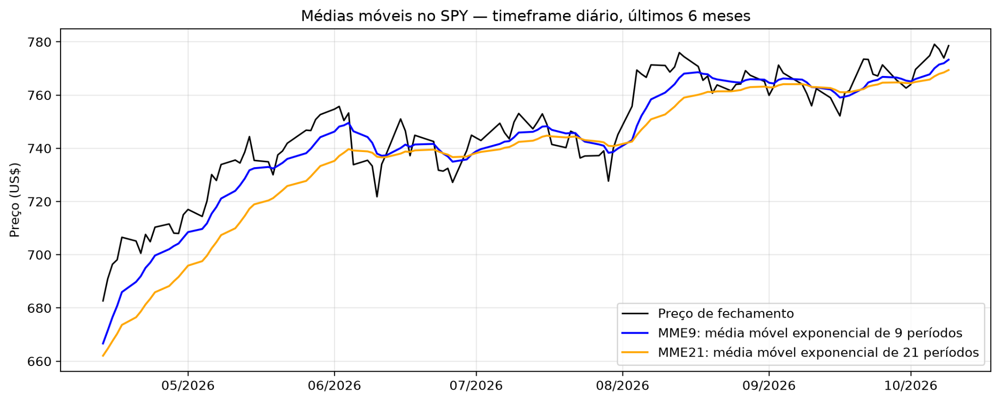  
Fonte: gerado pelo Claude (ANTHROPIC, 2026), com dados do Yahoo Finance (2026b).

Figura 6 – IFR de 14 períodos no SPY, *timeframe* diário  
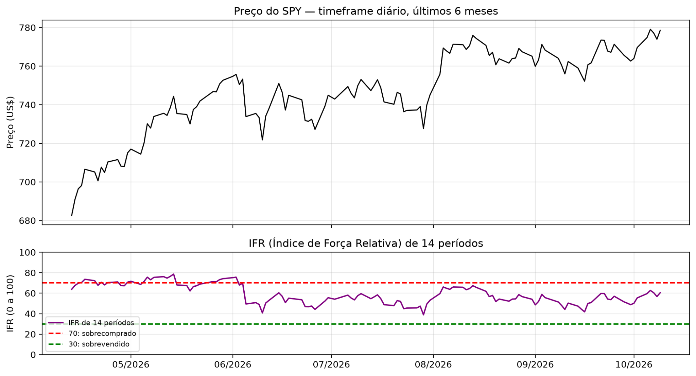  
Fonte: gerado pelo Claude (ANTHROPIC, 2026), com dados do Yahoo Finance (2026b).

Figura 7 – Bandas de Bollinger de 20 períodos e 2 desvios-padrão no SPY, *timeframe* diário  
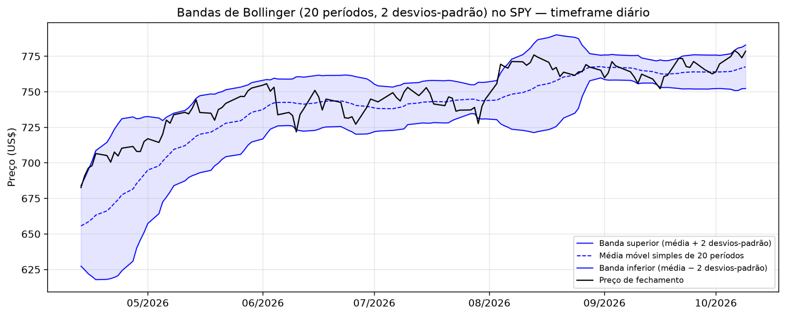  
Fonte: gerado pelo Claude (ANTHROPIC, 2026), com dados do Yahoo Finance (2026b).

Figura 8 – MACD (12, 26, 9\) no SPY, *timeframe* diário  
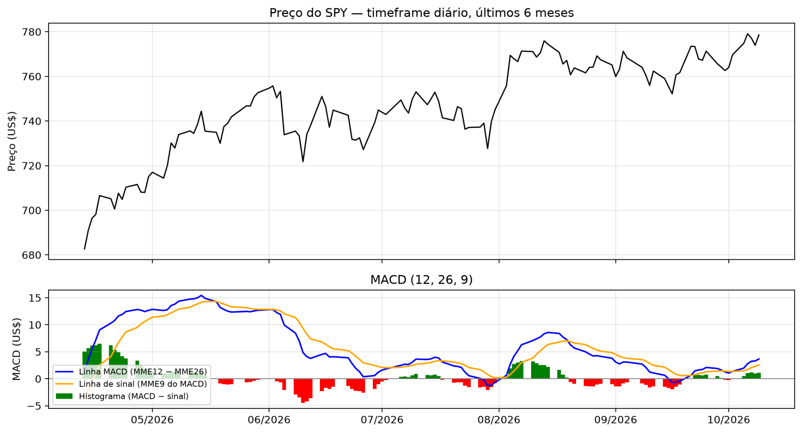  
Fonte: gerado pelo Claude (ANTHROPIC, 2026), com dados do Yahoo Finance (2026b).

Figura 9 – Volume financeiro diário do SPY, em bilhões de US\$, *timeframe* diário  
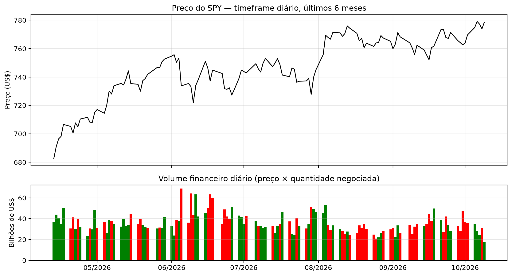  
Fonte: gerado pelo Claude (ANTHROPIC, 2026), com dados do Yahoo Finance (2026b).

Figura 10 – VWAP no SPY, *timeframe* de 1 hora, últimos 5 pregões  
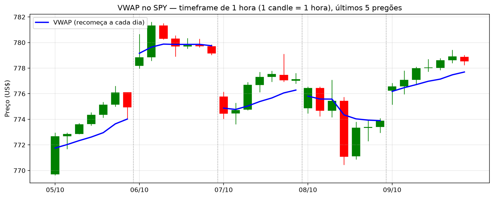  
Fonte: gerado pelo Claude (ANTHROPIC, 2026), com dados do Yahoo Finance (2026b).

## **1.5 Emoções e uso de robôs**

Existem problemas muito comuns que acontecem com todo *trader*, seja iniciante ou avançado: as emoções, como o medo, a ganância, a vontade de recuperar e a confusão.

* **Medo:** existem vários medos no *trading*: FOMO, medo de perder dinheiro, medo de devolver o lucro e medo de estar errado.  
- **FOMO**: vem do inglês *fear of missing out*, o medo de ficar de fora. O *trader* sente que, se não entrar agora, vai perder a grande oportunidade do dia. Por isso, ele não consegue ficar parado e acaba procurando entradas sem critério, só pela sensação de estar operando.  
- **Medo de perder dinheiro**: o *trader* fica tão preocupado com o prejuízo que trava e deixa de entrar em operações que estavam dentro do seu plano. Quando entra, coloca o *stop loss* perto demais, sem nenhum motivo técnico, e acaba saindo cedo de operações que, se tivesse esperado um pouco, poderiam ter dado lucro.  
- **Medo de devolver o lucro**: quando a operação começa a dar lucro, bate a ansiedade de ver esse ganho sumir, e o *trader* fecha a posição cedo demais. Assim, ele nunca aproveita os movimentos grandes do mercado. O resultado é um histórico com muitos lucros pequenos e prejuízos frequentes, o que, no longo prazo, torna muito difícil ganhar dinheiro.  
* **Ganância**: é a vontade de sempre querer ganhar mais. Por exemplo, o *trader* já lucrou US\$100 no dia, mas não se contenta e continua operando sem parar, atrás de mais lucros. Esse exagero se chama *overtrading* e funciona quase como um vício: quanto mais ele opera, maior o risco de quebrar a conta.  
* **Vontade de recuperar**: depois de uma perda, o *trader* não aceita o prejuízo e quer o dinheiro de volta na hora. Ele entra em novas operações por impulso, só para voltar ao zero (o chamado *break-even*) ou sair no lucro. Com pressa, deixa de lado o plano e o controle de risco, o que costuma gerar perdas ainda maiores e aumenta a chance de quebrar a conta.  
* **Confusão**: o *trader* recebe informação demais ao mesmo tempo: notícias, indicadores, opiniões nas redes sociais, várias estratégias diferentes e até *fake news*. Com tantas informações na cabeça, ele olha para o gráfico e não sabe mais se deve comprar ou vender. Aí, ou ele trava e não faz nada (a chamada paralisia por análise), ou entra em operações aleatórias, sem confiança no que está fazendo.

A seguir, são apresentados os gráficos de dois estudos (Figuras 11 e 12): o de Tversky e Kahneman (1992), que analisou como as pessoas se sentem ao perder e ao ganhar US\$100, e o de Odean (1998), que mostra que as pessoas vendem mais rápido as ações que estão no lucro e seguram as que estão no prejuízo.

Figura 11 – Teoria do Prospecto: quanto um ganho e uma perda de US\$100 são sentidos pela pessoa  
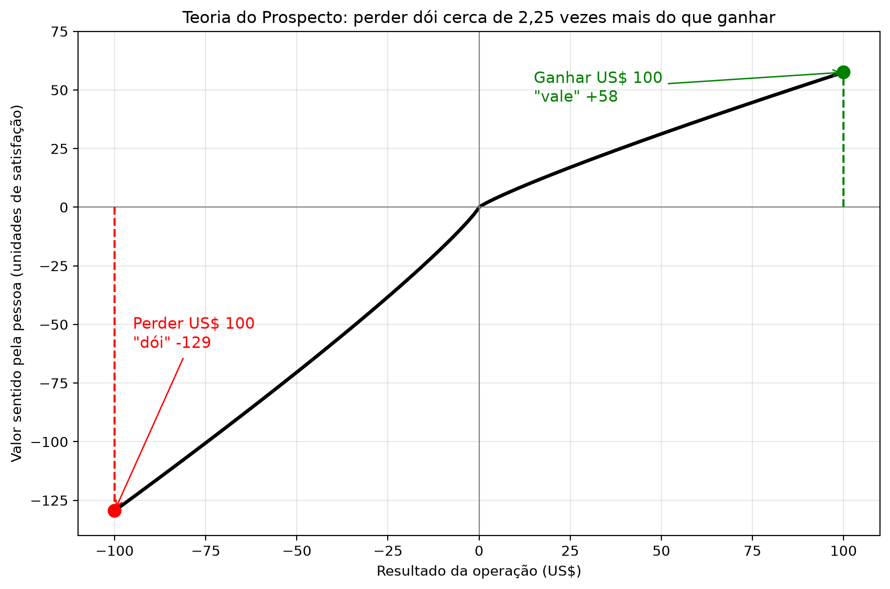  
Fonte: gerado pelo Claude (ANTHROPIC, 2026), com base em Tversky e Kahneman (1992).

Figura 12 – Efeito disposição: porcentagem de ações no lucro e no prejuízo que foram vendidas por investidores de uma corretora americana (1987 a 1993\)  
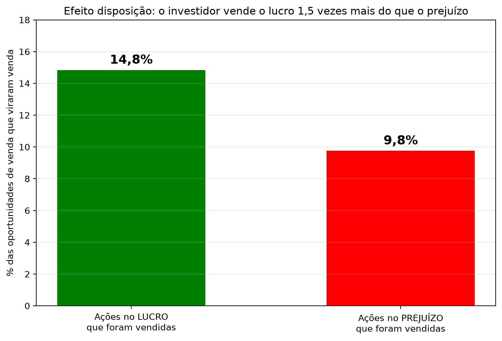  
Fonte: gerado pelo Claude (ANTHROPIC, 2026), com dados de Odean (1998).

Outros estudos chegaram a resultados parecidos. Lo, Repin e Steenbarger (2005) acompanharam 80 *day traders* e observaram que aqueles que reagiam com mais intensidade emocional aos ganhos e às perdas tiveram resultados piores. Já Coates e Herbert (2008) mediram os hormônios de *traders* em Londres: nos dias em que a testosterona deles amanhecia mais alta, eles lucravam mais, e o cortisol, hormônio do estresse, subia quando os resultados e o mercado ficavam mais instáveis.

Os robôs (automações) são completamente diferentes, pois não existe emoção: são usados códigos e algoritmos que sempre serão executados e seguidos, ou seja, não há intervenção humana por medo, ganância, vontade de recuperar ou confusão. Mas um robô com regras ruins perde dinheiro, por isso é preciso estudar muito e dedicar muito tempo construindo automações. Hoje, a inteligência artificial (IA) também está entrando no rumo das automações (utilização de agentes de IA para operar no mercado financeiro): segundo o Fundo Monetário Internacional, a IA pode mudar muito a estrutura do mercado financeiro, com o uso maior e mais poderoso de algoritmos de negociação e de novas estratégias de investimento (INTERNATIONAL MONETARY FUND, 2024).

## **1.6 *Trading* quantitativo**

O *trading* quantitativo é uma forma de operar no mercado financeiro usando matemática, estatística e programação, em vez de decidir pela emoção do momento. A ideia é analisar uma grande quantidade de dados do passado, fazer cálculos e, a partir disso, criar estratégias sólidas, que muitas vezes são executadas automaticamente por programas no computador, os algoritmos (CHAN, 2021; CVM, 2024, p. 350).

Quem trabalha dessa forma é chamado de *quant trader* (ou operador quantitativo). É ele quem cria, testa e coloca em prática os modelos matemáticos no *day trade*. Na prática, o *quant trader* levanta uma hipótese sobre como os preços se comportam, testa ideias com dados do passado (o *backtest*) e define no próprio código as regras de risco, como o tamanho do *stop*, para que nada fique por conta da emoção.

O maior risco do *trading* quantitativo é a estratégia ir muito bem no *backtest* e muito mal no mercado de verdade. Isso acontece, principalmente, por três motivos: o mercado muda, o *overfitting* e o *slippage* (CHAN, 2021). O primeiro é que o passado mostra só um dos caminhos que o mercado poderia ter seguido. Em um *backtest* de três anos, por exemplo, a pior sequência pode ter sido de oito *stops* seguidos, mas nada impede que, na vida real, venham nove, dez ou mais, porque o futuro não precisa respeitar o pior momento do passado. O segundo é o *overfitting*, que acontece quando a estratégia é ajustada tanto aos dados usados para criá-la (chamados de *in-sample*, IS) que ela acaba "decorando" os detalhes aleatórios daquele período, em vez de aprender algo que se repete. Aí, ela dá lucro no passado, mas falha nos dados que nunca viu (*out-of-sample*, OOS) e no mercado real (BAILEY et al., 2014).

O terceiro motivo é o *slippage*, que é a diferença entre o preço que o *trader* queria e o preço que ele realmente conseguiu (CHAN, 2021). Por exemplo, o *trader* manda uma ordem de compra a US\$10,00, mas, nos microssegundos que a ordem leva para chegar à bolsa, outra pessoa compra as ações a esse preço, e a dele acaba sendo executada a US\$10,03. Parece pouco, mas esse custo se repete em toda operação e, somado, pode acabar com o lucro de estratégias que ganham pouco em cada operação.

Neste trabalho, procura-se entender quais são os maiores perigos do *quant trading* e usa-se a matemática e a estatística para descobrir se dá para criar automações que continuem lucrando mesmo depois de pagar todos os custos.

## **1.7 A economia e o mercado: atuação conjunta no preço de um ativo**

A economia e o mercado financeiro andam juntos, ou seja, a economia movimenta os preços: o preço de um ativo não muda só por causa da lei da oferta e da demanda ou de um gráfico, mas também sofre influência dos juros, da inflação, do *payroll* (O *payroll* é o relatório mensal dos Estados Unidos que mede a variação de postos de trabalho criados ou eliminados na economia americana, excluindo o setor agrícola) e dos dados macroeconômicos e microeconômicos.   
Um exemplo atual é a guerra entre o Irã e os Estados Unidos da América, junto com Israel, que teve como consequência o fechamento do Estreito de Ormuz, por onde passa cerca de 20% do petróleo exportado no mundo (LISTER, 2026), o que causa sérias crises na economia global. Segundo a CNN Brasil, o tráfego de navios pelo estreito caiu 90% desde o início do conflito, com menos de 10 navios passando por dia, o que gera preocupação nos investidores e na população mundial (LISTER, 2026).

Figura 13 – Preço do petróleo Brent na guerra entre EUA/Israel e Irã, *candles* semanais (*timeframe* de 1 semana), de 10/2025 a 10/2026  
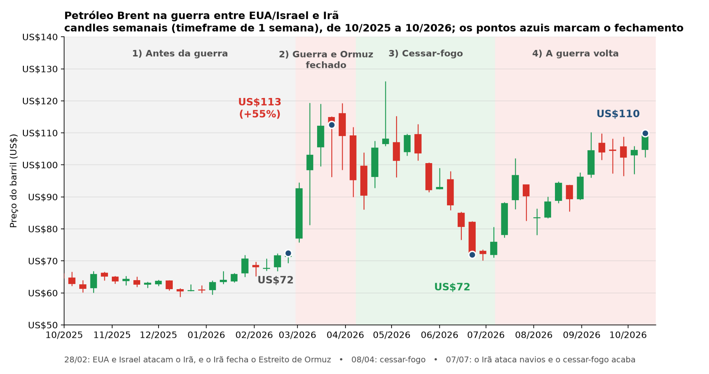  
Fonte: gerado pelo Claude (ANTHROPIC, 2026), com dados do Yahoo Finance (2026b) e da Encyclopaedia Britannica (2026).

A Figura 13 mostra um gráfico de *candles* semanais do preço do petróleo antes da guerra, na guerra, no cessar-fogo e na volta da guerra. Antes da guerra, o petróleo estava mais estável do que durante o conflito, em torno de US\$72. Quando a guerra começou e o Estreito de Ormuz foi fechado, o barril disparou e chegou ao pico de US\$113 (alta de 55%). Depois que os EUA e o Irã fizeram um acordo de cessar-fogo, o mercado entrou em um período de queda e o barril voltou a US\$72. Quando a guerra voltou (com o fim do cessar-fogo), o barril disparou mais uma vez, voltando aproximadamente ao pico anterior.

### **1.7.1 Juros, inflação e notícias**

Os juros e a inflação exercem grande influência sobre o mercado financeiro. Ambos são indicadores macroeconômicos, isto é, medidas que refletem a situação da economia de um país, e afetam os preços dos ativos no momento em que são divulgados. No Brasil, a taxa básica de juros é a Selic, que representa o custo básico do dinheiro, e a inflação é medida pelo Índice Nacional de Preços ao Consumidor Amplo (IPCA). Esses indicadores estão relacionados: quando a inflação aumenta, o Banco Central tende a elevar a Selic para conter a alta dos preços. As notícias, por sua vez, são acontecimentos de maior ou menor impacto que podem alterar os indicadores e as expectativas do mercado, como uma guerra ou uma decisão do Comitê de Política Monetária (Copom).

Quando a taxa de juros sobe, significa que o Banco Central quer combater a inflação, ou seja, fazer com que ela caia. Essa decisão traz consequências negativas e também benefícios para a economia.  
Entre as consequências estão o financiamento e o empréstimo mais caros, o encarecimento do crédito, a redução do consumo e a queda da bolsa de valores, onde são negociadas as ações das principais empresas de capital aberto do país. Entre os benefícios estão a atração de capital estrangeiro, já que os investimentos no país passam a render mais, e a migração dos investidores, inclusive das pessoas físicas, para ativos mais conservadores, como a renda fixa, porque o apetite por risco diminui.  
Quando o Banco Central corta a taxa de juros, normalmente é porque a inflação está controlada e ele quer estimular a economia. Nesse caso, acontece o inverso: o crédito fica mais barato, o consumo e a economia crescem, a bolsa tende a subir, as dívidas das empresas ficam mais leves e o apetite por risco aumenta, pois a renda fixa passa a render menos e os investidores procuram a bolsa. Por outro lado, parte do capital estrangeiro sai do país, e a inflação pode voltar a subir. Nos Estados Unidos, Bernanke e Kuttner (2005) mostraram que um corte inesperado de 0,25 ponto percentual nos juros do banco central americano (Federal Reserve) é acompanhado, em média, de uma alta de cerca de 1% nas ações no mesmo dia. A Figura 14 resume esses efeitos.

Figura 14 – O que acontece quando a taxa Selic sobe e quando ela cai  
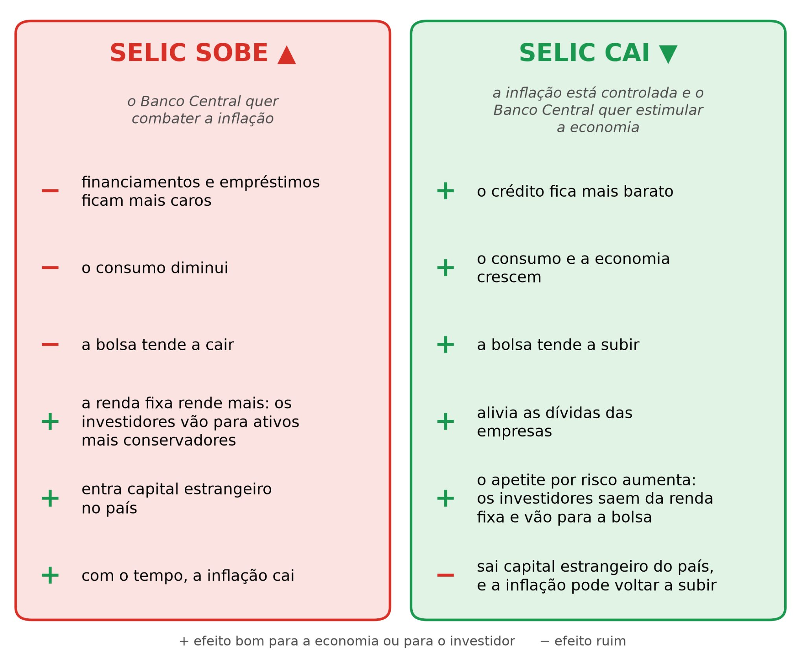  
Fonte: gerado pelo Claude (ANTHROPIC, 2026), com base no texto do autor e em Bernanke e Kuttner (2005).  
   
Figura 15 – Juros (meta da taxa Selic) e inflação (IPCA acumulado em 12 meses) no Brasil, dados mensais, de 01/2015 a 09/2026  
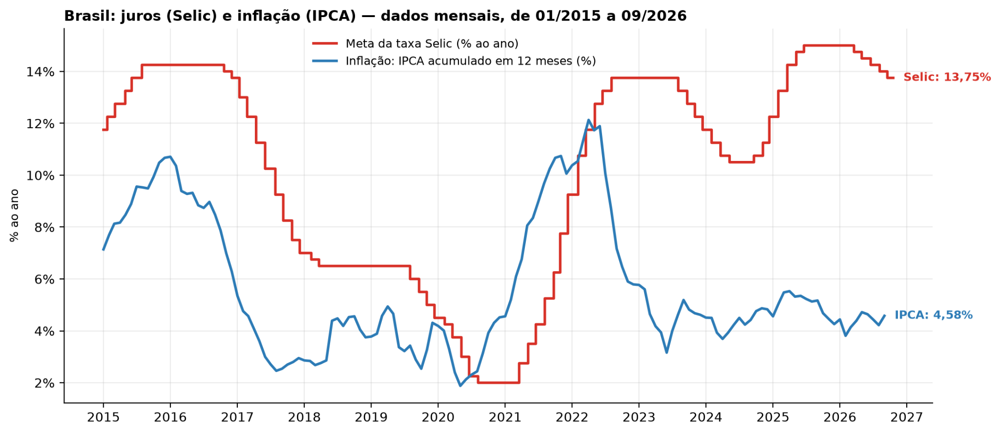  
Fonte: gerado pelo Claude (ANTHROPIC, 2026), com dados do Banco Central do Brasil (2026).

A Figura 15 mostra a relação entre o IPCA (linha azul) e a Selic (linha vermelha) no Brasil. Em 2020, durante a pandemia, a inflação estava baixa, perto de 2% ao ano, e o Banco Central reduziu a Selic até 2%, o menor valor do período, para estimular a economia. A partir de 2021, o IPCA subiu e chegou a 12,13% em abril de 2022; para conter essa alta, o Banco Central elevou a Selic de 2%, em março de 2021, para 13,75%, em agosto de 2022\.   
Com os juros altos, a inflação caiu para cerca de 4% em 2023, e a Selic voltou a ser reduzida, até 10,5% em 2024\. Quando o IPCA voltou a subir, a Selic foi elevada de novo e chegou a 15% em 2025\. Assim, a figura mostra que a Selic acompanha o IPCA: quando a inflação sobe, os juros sobem logo depois e, quando ela cai, os juros também caem.

### **1.7.2 Lei da oferta e da demanda**

A lei da oferta e demanda é o princípio básico da economia que diz que quanto maior o preço maior a oferta (estão querendo vender mais, porque está caro) e quanto menor o preço maior a demanda (estão querendo comprar mais, porque está barato) (MANKIW, 2005). Quando o preço de um ativo sobe, há mais pessoas querendo vender para obter lucros consequentemente cai e vice-versa. 

Figura 16 – Exemplo da lei da oferta e da demanda no preço de uma ação (números hipotéticos)  
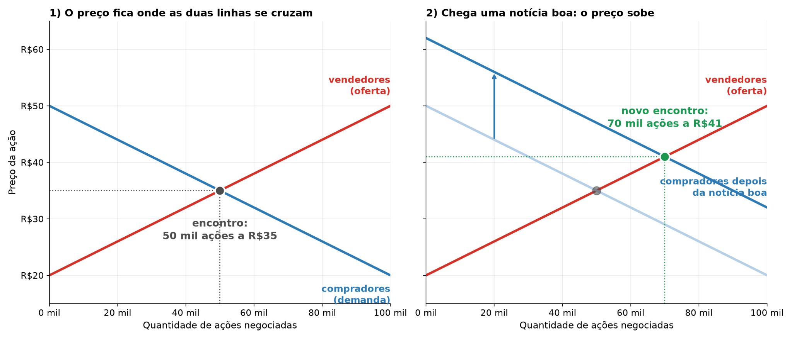  
Fonte: gerado pelo Claude (ANTHROPIC, 2026), com valores hipotéticos e com base em Mankiw (2005).

A Figura 16 mostra 2 exemplos de gráficos de oferta e demanda a primeira mostra um equilíbrio (preço justo) entre os compradores e vendedores a R\$35,00 e a segunda imagem mostra um novo equilíbrio entre os compradores e vendedores e podemos concluir que o preço subiu, pois o novo equilíbrio passou a ser R\$41,00 e comparando com antes estava a R\$35,00, ou seja, subiu R\$6,00.

Cada linha do gráfico pode ser escrita como uma equação:  

$$
{P}_{c}=a-bQ
$$

$$
{P}_{v}=m+nQ
$$

Em que:

* Pc \= preço que os compradores aceitam pagar (demanda), em reais;  
* Pv \= preço que os vendedores aceitam receber (oferta), em reais;  
* Q \= quantidade de ações negociadas, em milhares;  
* a \= maior preço que um comprador aceita pagar;  
* b \= quanto o preço cai a cada mil ações a mais (os compradores só compram mais se o preço baixar);  
* m \= menor preço que um vendedor aceita receber;  
* n \= quanto o preço sobe a cada mil ações a mais (os vendedores só vendem mais se o preço subir).

Por exemplo, a Tabela 1 mostra o preço de cada linha para algumas quantidades: a cada 10 mil ações, o preço dos compradores cai R\$3 e o dos vendedores sobe R\$3, ou seja, R\$0,30 a cada mil ações (b \= n \= 0,3). Em 50 mil ações, os dois preços ficam iguais.  
Tabela 1 – Preço dos compradores e dos vendedores para cada quantidade de ações (valores hipotéticos)

| Quantidade de ações | Preço dos compradores (Pc) | Preço dos vendedores (Pv) |
| :---: | :---: | :---: |
| 0 mil | R\$50 | R\$20 |
| 10 mil | R\$47 | R\$23 |
| 20 mil | R\$44 | R\$26 |
| 30 mil | R\$41 | R\$29 |
| 40 mil | R\$38 | R\$32 |
| **50 mil (equilíbrio)** | **R\$35** | **R\$35** |

Fonte: gerado pelo Claude (ANTHROPIC, 2026), com valores hipotéticos e com base em Mankiw (2005).

Na Figura 16, foram usados valores hipotéticos, escolhidos para o exemplo: a \= 50, b \= 0,3, m \= 20 e n \= 0,3. No ponto de equilíbrio, os dois preços são iguais (Pc \= Pv):

$$
50-0,3Q=20+0,3Q\rightarrow Q=50
$$

$$
P=20+0,3\times 50=35
$$

Em que:

* Q \= quantidade de ações negociadas no ponto de equilíbrio, em milhares;  
* P \= preço de equilíbrio, em reais, em que o preço dos compradores é igual ao dos vendedores (Pc \= Pv).

Ou seja, o equilíbrio acontece com 50 mil ações a R\$35.

### **1.7.3 Microeconomia e macroeconomia**

A macroeconomia estuda o país inteiro, com indicadores como o PIB, a taxa Selic, a inflação (medida pelo IPCA), a taxa de câmbio e a taxa de desemprego, entre outros, ou seja, tudo o que está relacionado ao macro (ao todo), às coisas grandes.   
A microeconomia estuda apenas as partes menores, como o lucro das empresas, os custos de produção, os dividendos pagos, os gráficos de ações e a lei da oferta e da demanda, entre outros, ou seja, ela foca em coisas específicas e tem uma visão micro dos dados (MANKIW, 2005).

Figura 17 – Indicadores macroeconômicos do Brasil: PIB (anual), dívida bruta do governo, resultado primário e dólar (mensais), de 2015 a 2026  
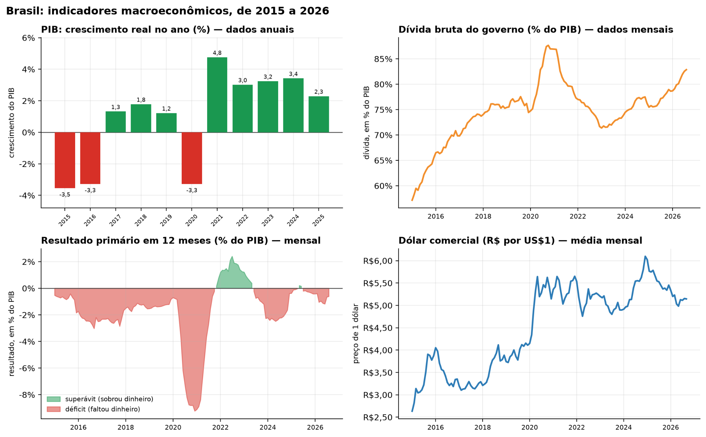  
Fonte: gerado pelo Claude (ANTHROPIC, 2026), com dados do Banco Central do Brasil (2026).

Figura 18 – Indicadores microeconômicos do Itaú Unibanco (ITUB4): receita, lucro líquido, lucro por ação e dividendos (anuais) e preço da ação (mensal), de 2022 a 2026  
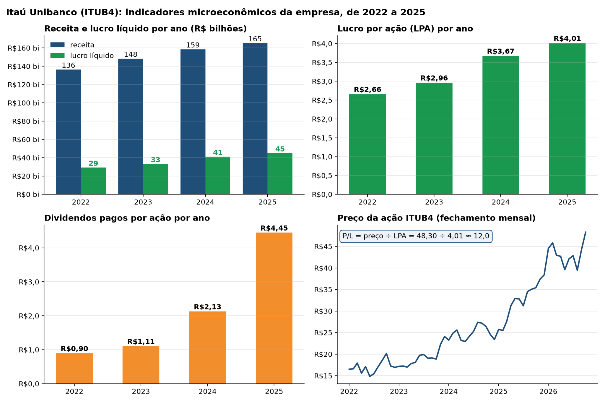  
Fonte: gerado pelo Claude (ANTHROPIC, 2026), com dados do Yahoo Finance (2026b).

As Figuras 17 e 18 são exemplos de análises macroeconômica e microeconômica. A primeira mostra o PIB, a dívida bruta do governo, o resultado primário e o dólar, ou seja, uma análise do Brasil inteiro. A segunda mostra uma instituição privada, o Itaú Unibanco: os dividendos pagos, as receitas e os lucros líquidos anuais, o lucro por ação (o lucro líquido dividido pelo número de ações em circulação) e um gráfico de linhas com o fechamento mensal da ação.

### **1.7.4 Medindo o “nervosismo” do mercado: o VIX**

O VIX (Cboe Volatility Index) é um índice criado pela Cboe que estima quanto o mercado americano, medido pelo S\&P 500 (índice das 500 maiores empresas dos Estados Unidos), deve oscilar nos próximos 30 dias (1 mês) (CBOE GLOBAL INDICES, 2026). Por isso, ele é chamado de “índice do medo” (WHALEY, 2000): quando está abaixo de 20 pontos, significa que o mercado está calmo; quando está acima de 30 pontos, significa que o mercado está agitado (Figura 19). No período da pandemia, de muita incerteza, quando o vírus da covid-19 se espalhou pelo mundo inteiro, o VIX chegou ao recorde de 82,69 pontos em 16/03/2020, e o NQ (contrato futuro do índice Nasdaq-100) caiu cerca de 32% em um mês, de 9.763 para 6.629 pontos (Figura 20). Para o *day trader*, isso importa porque, com o VIX alto, os *candles* ficam maiores, o risco de cada operação aumenta, e uma estratégia pode ganhar ou perder muito mais.

Figura 19 – VIX, o índice de volatilidade (“índice do medo”) do mercado americano, dados diários, de 01/2015 a 10/2026  
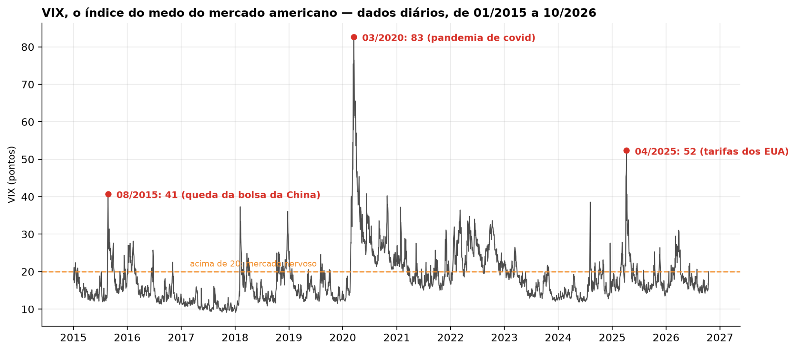  
Fonte: gerado pelo Claude (ANTHROPIC, 2026), com dados do FRED (FEDERAL RESERVE BANK OF ST. LOUIS, 2026).

Figura 20 – NQ (contrato futuro do índice Nasdaq-100) na pandemia de covid, com o VIX embaixo, *candles* semanais (*timeframe* de 1 semana), de 07/2019 a 12/2020  
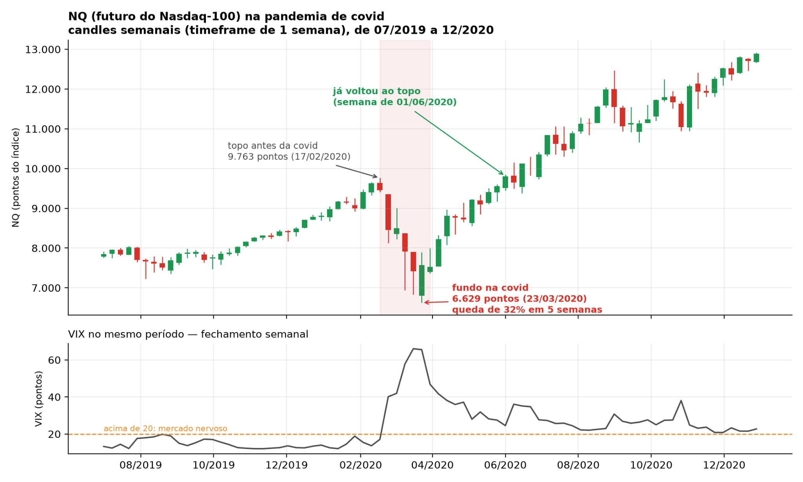  
Fonte: gerado pelo Claude (ANTHROPIC, 2026), com dados do Yahoo Finance (2026b).

A Figura 19 mostra que, na maior parte do tempo, de 2015 a 2026, o VIX ficou baixo, perto de 17 pontos, o que indica um mercado calmo. Os picos aparecem nos momentos de medo: o maior foi o da covid, com 82,69 pontos em 16/03/2020, e outro grande foi o das tarifas dos Estados Unidos, com 52,33 pontos em 08/04/2025. Mesmo assim, o VIX passou de 30 pontos em apenas cerca de 5% dos dias, ou seja, o medo forte é raro e costuma passar rápido. A Figura 20 mostra o mesmo acontecimento no preço: quando o NQ despencou, entre fevereiro e março de 2020, o VIX disparou ao mesmo tempo, e os *candles* semanais ficaram muito maiores. Depois, quando o VIX voltou a cair, o NQ se recuperou e voltou ao topo anterior em junho de 2020\.

### **1.7.5 A estratégia em momentos diferentes**

O mercado não se comporta sempre do mesmo jeito: de tempos em tempos, existem momentos de alta, de baixa e de lateralização.

Figura 21 – Os 3 regimes de mercado (alta, baixa e lateral) no Ibovespa (IBOV), *candles* semanais (*timeframe* de 1 semana), de 01/2020 a 10/2026, com o *circuit breaker* de 26/10/2026

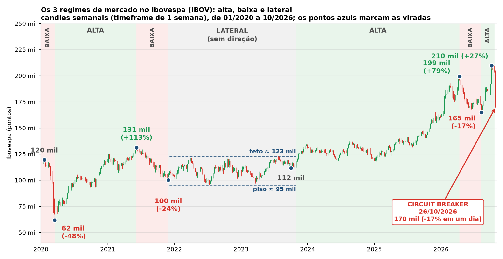

Fonte: gerado pelo Claude (ANTHROPIC, 2026), com dados do Yahoo Finance (2026b).

A Figura 21 mostra que a bolsa brasileira teve períodos de alta, de baixa e de lateralização em quase 7 anos, de 01/2020 a 10/2026. Depois de subir de 112 mil para 199 mil pontos (+79%), entre outubro de 2023 e abril de 2026, o índice caiu 17% em cerca de 4 meses, até 165 mil pontos em agosto de 2026\. Já em 26/10/2026, dia seguinte ao segundo turno da eleição presidencial, uma queda do mesmo tamanho aconteceu em um único dia: quando o Ibovespa chegou a 10% de queda, a B3 acionou o *circuit breaker*, uma pausa obrigatória de 30 minutos em que nenhuma ação é comprada ou vendida, para acalmar o mercado (FURLAN, 2026). Na volta das negociações, o índice chegou a 169.516 pontos, 17% abaixo do fechamento do dia anterior, de 205.083 pontos.

### **1.7.6 O que isso significa**

O preço de um ativo não depende só de gráficos, mas também de notícias, de indicadores e das emoções das pessoas. Por isso, o mercado passa por fases diferentes: de alta, de baixa, de lateralização e de crises, como o *circuit breaker* de 26/10/2026. Uma estratégia que ganha em uma fase com pouca volatilidade pode perder em uma fase de alta volatilidade. Assim, no presente trabalho, as estratégias foram testadas em ativos e *timeframes* diferentes, para analisar e comparar (análise estatística) se o resultado se mantém.

# **2 MÉTODO E MATERIAIS**

Neste trabalho, utilizaram-se as seguintes ferramentas matemáticas para avaliar a tomada de decisão nas operações de *day trade*: o retorno, a taxa de acerto, o *payoff*, a esperança matemática, a taxa de acerto mínima, a lei dos grandes números e a noção de limite, a média, o desvio-padrão, a margem de erro da média e o *drawdown*. Os cálculos e as simulações foram feitos em Python, e os gráficos de funções foram conferidos no Desmos (2026). Essa análise foi realizada sobre nove ativos (EUR/USD, SPY, NQ, IBOV, PETR4, ITUB4, MGLU3, BTC/USD e Tesla), avaliando-se como parâmetros o *timeframe* (de 5 a 30 minutos, um para cada estratégia), os custos de cada operação e as regras de entrada e saída das quatro estratégias testadas (ORB, VWAP, IFR e cruzamento de médias móveis), como o período dos indicadores, o *stop* e o alvo. Este capítulo apresenta uma descrição das técnicas e dos termos utilizados no trabalho.

## **2.1 Retorno**

O retorno de uma operação é dado em porcentagem e pode ser de ganho ou de perda. No mercado financeiro, os *traders* usam a porcentagem porque ela permite comparar o desempenho de diferentes operações, ativos ou carteiras de tamanhos distintos. Ganhar R\$1.000,00 com um capital de R\$2.000,00 (retorno de 50%) representa uma eficiência e um risco muito diferente de ganhar R\$1.000,00 investindo R\$100.000,00 (retorno de 1%). A porcentagem também permite avaliar se uma estratégia é consistente a longo prazo sem que os resultados fiquem distorcidos pelo crescimento do capital ao longo do tempo. 

A fórmula do retorno é:  

$$
Retorno=\frac{preço\ de\ saída-preço\ de\ entrada}{preço\ de\ entrada}
$$

Em que:

* Retorno \= ganho ou perda da operação, em porcentagem do valor investido;  
* preço de saída \= preço da venda, que fecha a operação;  
* preço de entrada \= preço da compra, que abre a operação.

Mas também é preciso incluir os custos, ou seja, a fórmula fica:

$$
Retorno=\frac{preço\ de\ saída-preço\ de\ entrada}{preço\ de\ entrada}-custos
$$

Em que:

* custos \= gastos da operação, como a corretagem e as taxas, em porcentagem do valor investido.

Figura 22 – Um exemplo de cálculo do retorno de uma operação em Python, sem e com custos (compra de 10 ações a US\$80 e venda a US\$100)  
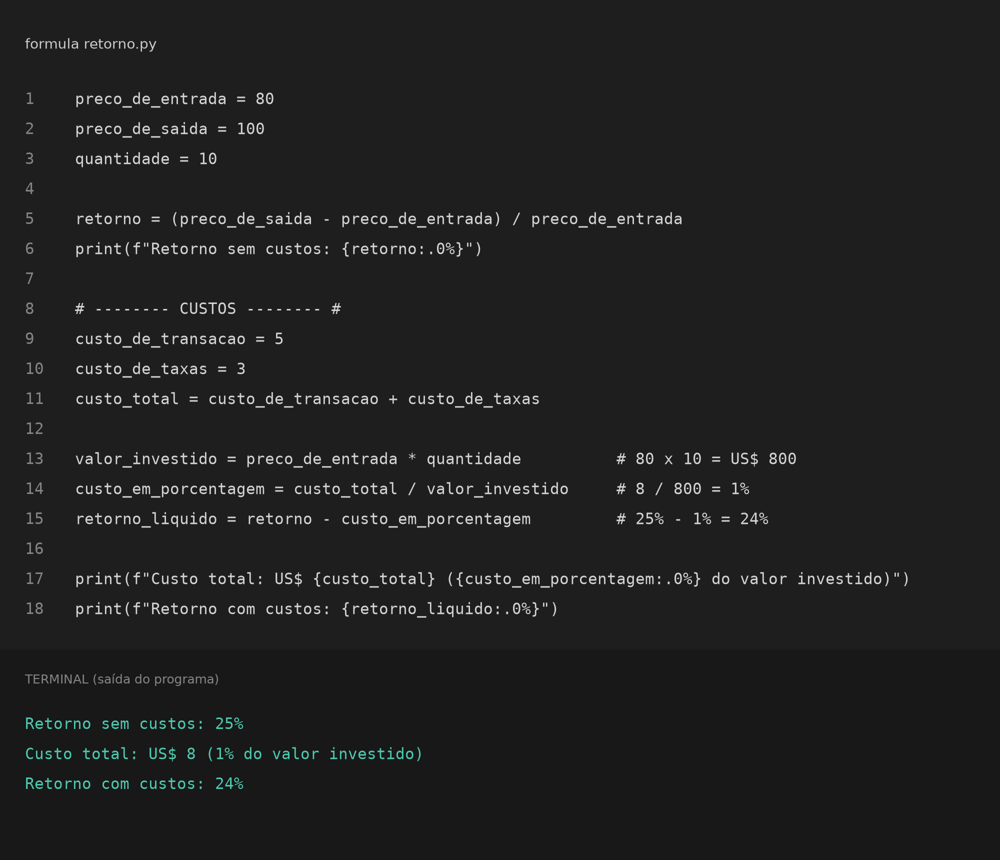  
Fonte: gerado pelo Claude (ANTHROPIC, 2026), a partir de programa em Python do autor, com valores hipotéticos.

Na Figura 22, o programa calcula o retorno sem custos, o custo total e, por fim, o retorno com custos.

## **2.2 Taxa de acerto e *payoff***

A taxa de acerto é a porcentagem de operações que deram lucro. A fórmula é:  

$$
Taxa\ de\ acerto=\frac{número\ de\ operações\ com\ lucro}{número\ total\ de\ operações}
$$

Em que:

* Taxa de acerto \= porcentagem das operações que deram lucro;  
* número de operações com lucro \= quantas operações terminaram com ganho;  
* número total de operações \= quantas operações foram feitas ao todo, com lucro ou com prejuízo.

Figura 23 – Exemplo de cálculo da taxa de acerto em Python (6 operações com lucro em um total de 10\)  
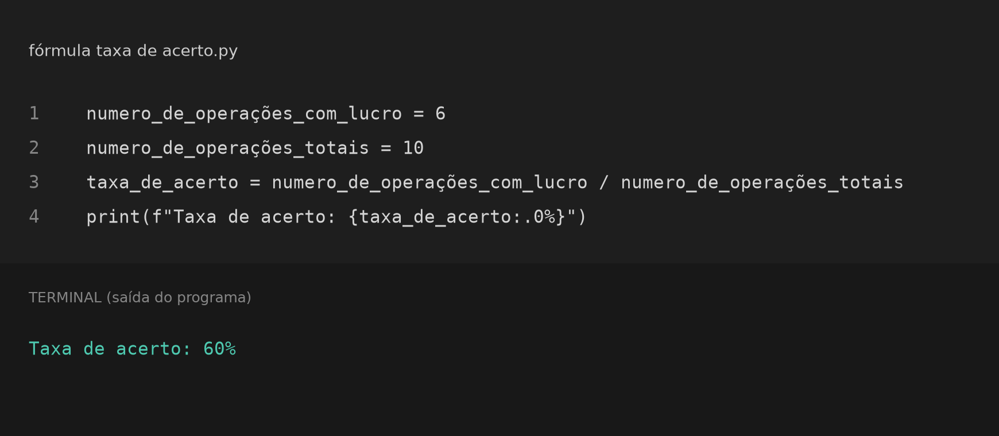  
Fonte: gerado pelo Claude (ANTHROPIC, 2026), a partir de programa em Python do autor, com valores hipotéticos.

Na Figura 23, o programa calcula a taxa de acerto.

O *payoff* compara o tamanho do ganho com o tamanho da perda. A fórmula é:

$$
Payoff=\frac{ganho\ médio}{perda\ média}
$$

Em que:

* *Payoff* \= quantas vezes o ganho médio é maior que a perda média;  
* ganho médio \= média só das operações que deram lucro;  
* perda média \= média só das operações que deram prejuízo, sem o sinal de menos.

Figura 24 – Exemplo de cálculo do *payoff* em Python (21 operações com lucro e 14 com prejuízo)

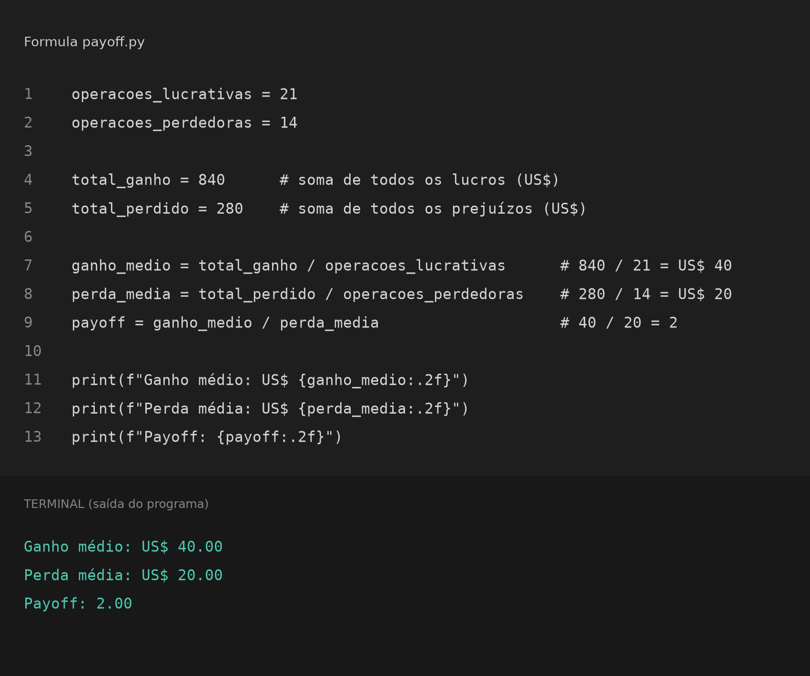

Fonte: gerado pelo Claude (ANTHROPIC, 2026), a partir de programa em Python do autor, com valores hipotéticos.

Na Figura 24, o programa calcula o ganho médio, a perda média e, por fim, o *payoff*. Um *payoff* de 2,00 significa que o lucro médio quando se ganha é o dobro do prejuízo médio quando se perde (2 para 1).

Nenhuma dessas duas medidas, sozinha, mostra se uma estratégia é boa. Uma estratégia que acerta 90% das vezes, mas ganha US\$1 em cada acerto e perde US\$20 em cada erro, termina 10 operações com prejuízo: $`9\times 1-1\times 20=-\text{US}\$11`$. Já uma estratégia que acerta apenas 30% das vezes, mas ganha US\$5 em cada acerto e perde US\$1 em cada erro, termina 10 operações com lucro: $`3\times 5-7\times 1=+\text{US}\$8`$. Por isso, a taxa de acerto e o *payoff* precisam ser analisados juntos, e é exatamente isso que a esperança matemática faz, como mostra a próxima seção.  
 

## **2.3 Esperança matemática**

A esperança matemática (E) é o resultado médio que se espera de cada operação, se a estratégia for repetida muitas vezes. A fórmula é:

$$
E=(taxa\ de\ acerto\times ganho\ médio)-(taxa\ de\ erro\times perda\ média)
$$

Em que:

* E \= esperança matemática, ou seja, o resultado médio esperado em cada operação;  
* taxa de acerto \= porcentagem das operações que deram lucro;  
* ganho médio \= média só das operações que deram lucro;  
* taxa de erro \= porcentagem das operações que deram prejuízo (o que falta para a taxa de acerto chegar a 100%);  
* perda média \= média só das operações que deram prejuízo, sem o sinal de menos.

Figura 25 – Exemplo de cálculo da esperança matemática em Python (taxa de acerto de 40%, ganho médio de US\$40 e perda média de US\$20)  
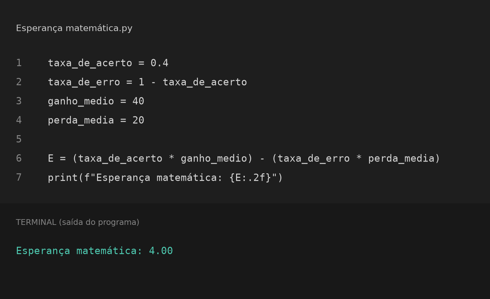  
Fonte: gerado pelo Claude (ANTHROPIC, 2026), a partir de programa em Python do autor, com valores hipotéticos.

A Figura 25 mostra o programa calculando a esperança matemática. Um ponto interessante deste exemplo é que a estratégia erra mais do que acerta e, mesmo assim, ganha dinheiro: como o *payoff* é de 2 para 1, a esperança matemática continua positiva (US\$4 por operação).

## **2.4 Taxa de acerto mínima**

A taxa de acerto mínima é a menor porcentagem de acertos que uma estratégia precisa ter para não perder dinheiro, ou seja, para que a esperança matemática seja zero. A fórmula é:

$$
Taxa\ de\ acerto\ mínima=\frac{1}{1+payoff}
$$

Em que:

* Taxa de acerto mínima \= menor taxa de acerto com a qual a estratégia não perde dinheiro, ou seja, com esperança matemática igual a zero;  
* *payoff* \= quantas vezes o ganho médio é maior que a perda média (seção 2.2).

Figura 26 – Exemplo de cálculo da taxa de acerto mínima em Python (*payoff* de 2\)  
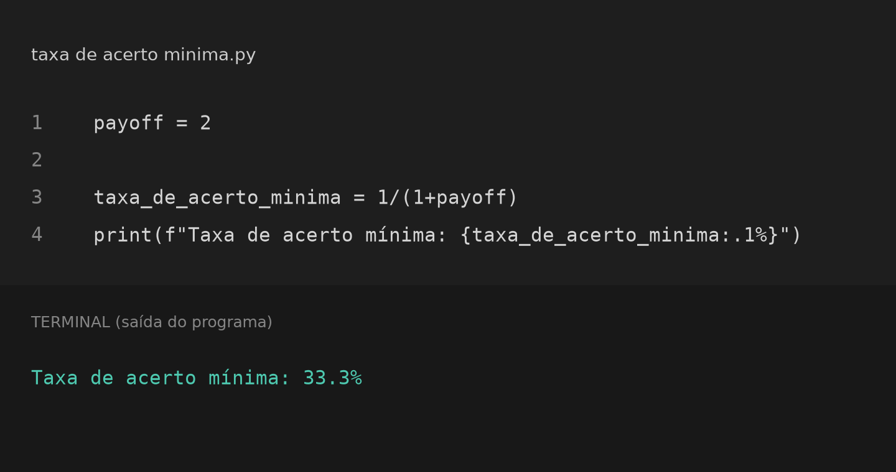  
Fonte: gerado pelo Claude (ANTHROPIC, 2026), a partir de programa em Python do autor, com valores hipotéticos.

A Figura 26 mostra o programa calculando a taxa de acerto mínima. A taxa de acerto necessária depende do *payoff*. Se o ganho médio é igual à perda média (*payoff* 1), é preciso acertar 50% das operações. Se o ganho médio é o dobro da perda média (*payoff* 2), basta acertar 33,3%. Já se o ganho médio é só a metade da perda média (*payoff* 0,5), é preciso acertar 66,7%. A estratégia da Figura 25 acerta 40% com *payoff* 2\. Como 40% é maior que 33,3%, ela ganha dinheiro. 

## **2.5 Sorte ou vantagem: a lei dos grandes números**

A lei dos grandes números diz que, quanto mais vezes um experimento é repetido, mais o resultado médio se aproxima do valor real. Um exemplo é o jogo de cara ou coroa: ao jogar uma moeda 10 vezes, pode sair 30% de caras só por sorte, mas, em 10.000 lançamentos, o resultado fica muito próximo de 50%.

Em linguagem matemática, a lei dos grandes números pode ser escrita como um limite, em que n é o número de lançamentos (ROSS, 2009):

$\lim\limits_{n\rightarrow \infty }\frac{número\ de\ caras}{n}=0,5$, com probabilidade 1  
Em que:

* lim (n → ∞) \= limite quando n tende ao infinito (explicado logo abaixo);  
* número de caras \= quantos lançamentos deram cara;  
* n \= número de lançamentos da moeda;  
* 0,5 \= chance de sair cara em um lançamento (50%);  
* com probabilidade 1 \= a porcentagem de caras chega perto de 0,5 com certeza, e não apenas na maioria das vezes.

A expressão “lim (n → ∞)” lê-se “limite quando n tende ao infinito”. Ela mostra de qual valor uma conta se aproxima quando n fica cada vez maior, sem parar. Um exemplo simples é a conta $\frac{1}{n}$: com n \= 10, o resultado é 0,1; com n \= 100, é 0,01; com n \= 1.000, é 0,001. O resultado nunca chega exatamente a zero, mas fica cada vez mais perto dele, por isso se diz que o limite de $\frac{1}{n}$ é zero. Na lei dos grandes números, o que se aproxima de um valor é a porcentagem de caras, que tende a 50%. A diferença é que cada lançamento é sorteado, então existem sequências que fogem da regra, como sair cara em todos os lançamentos, para sempre. Essas sequências não são impossíveis, mas a chance de acontecerem é zero. Por isso se diz que a aproximação acontece “com probabilidade 1”, ou seja, quase com certeza.

Figura 27 – Simulação da lei dos grandes números em Python (moeda lançada 10, 100, 1.000 e 10.000 vezes)  
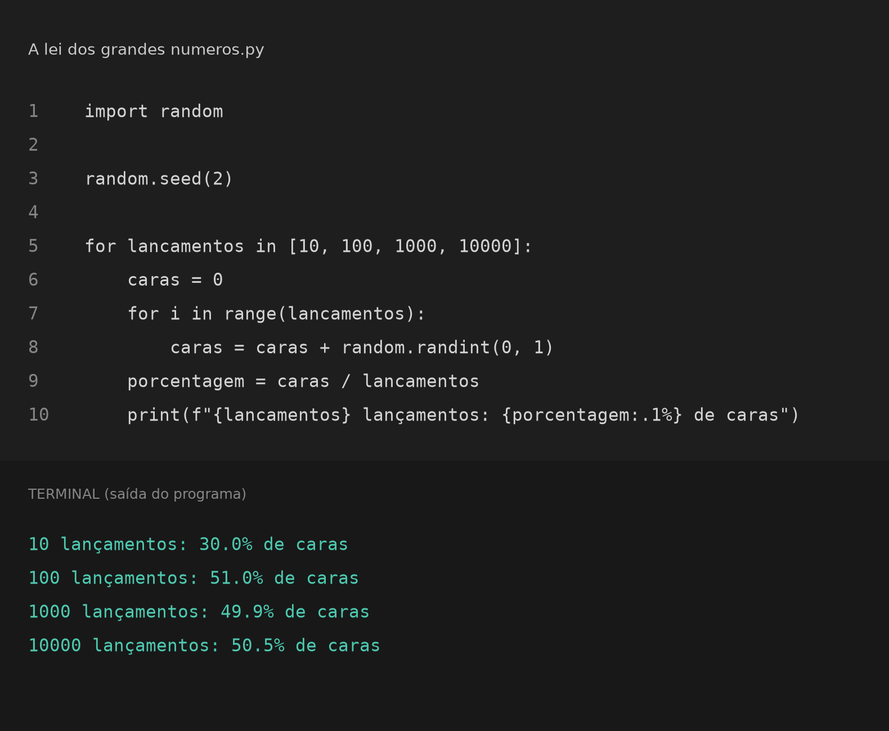  
Fonte: gerado pelo Claude (ANTHROPIC, 2026), a partir de programa em Python do autor, com lançamentos de moeda simulados e com base em Ross (2009).

Figura 28 – Porcentagem de caras de acordo com o número de lançamentos da moeda (resultado da simulação da Figura 27\)  
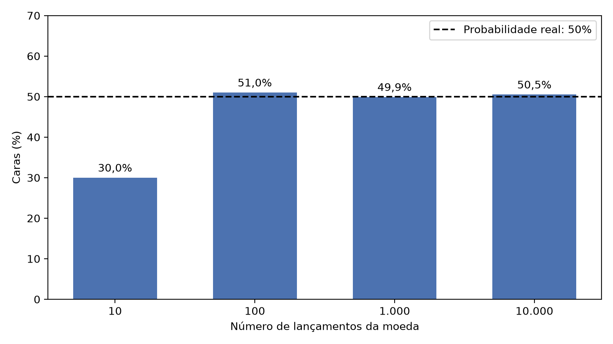  
Fonte: gerado pelo Claude (ANTHROPIC, 2026), com os resultados da simulação da Figura 27\.

A Figura 27 mostra o programa que simula o lançamento de uma moeda 10, 100, 1.000 e 10.000 vezes e calcula a porcentagem de caras em cada caso, e a Figura 28 mostra esse mesmo resultado em um gráfico de barras. Com 10 lançamentos, saíram apenas 30% de caras, longe dos 50% esperados. Já com 100, 1.000 e 10.000 lançamentos, o resultado ficou entre 49,9% e 51,0%, muito perto da linha de 50%. Isso mostra a lei dos grandes números na prática: com poucas repetições, a sorte pesa muito no resultado; com muitas, o resultado se aproxima do valor real.  
No *trading*, acontece o mesmo. Uma estratégia que lucrou em poucas operações pode ter tido apenas sorte, e só um número grande de operações mostra se ela tem vantagem ou não. Por isso, no *quant trading*, as estratégias são testadas em *backtests* com vários anos de dados, que costumam somar centenas de operações. Mesmo assim, não basta olhar só para o lucro final: é preciso analisar o relatório completo da estratégia, como a taxa de acerto, o *payoff*, a esperança matemática e o *drawdown*.

Um *backtest* com muitas operações não garante que a estratégia funcione, mas permite saber, com mais segurança, se o resultado veio de uma vantagem real ou apenas da sorte. A próxima seção mostra como medir essa segurança com a margem de erro.

## **2.6 Margem de erro da média**

A média das operações de um *backtest* é só uma estimativa: se a estratégia fosse testada em outro período, a média sairia um pouco diferente, e a margem de erro mostra o tamanho dessa incerteza. A fórmula é:

$$
Margem\ de\ erro=2\times \frac{desvio-padrão}{\sqrt{n}}
$$

Em que:

* Margem de erro \= quanto a média pode estar acima ou abaixo do valor verdadeiro, com cerca de 95% de confiança;  
* 2 \= número que dá cerca de 95% de confiança;  
* desvio-padrão \= quanto os resultados variam em torno da média;  
* √n \= raiz quadrada do número de operações (n).

O desvio-padrão mede o quanto os resultados variam em torno da média: se quase todas as operações dão resultados parecidos, ele é pequeno; se umas ganham muito e outras perdem muito, ele é grande. No caso de uma moeda, em que cada lançamento vale 1 (cara) ou 0 (coroa), o desvio-padrão é 0,5. Já o número 2 da fórmula serve para dar cerca de 95% de confiança: se o teste fosse repetido muitas vezes, em cerca de 95 de cada 100 vezes o valor verdadeiro ficaria dentro da faixa que vai da média menos a margem de erro até a média mais a margem de erro.

Figura 29 – Exemplo de cálculo da margem de erro em Python (1.000 lançamentos de uma moeda, com desvio-padrão de 0,5)  
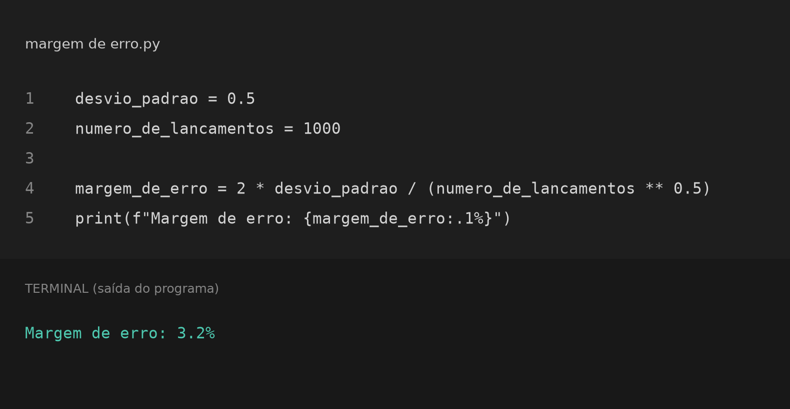  
Fonte: gerado pelo Claude (ANTHROPIC, 2026), a partir de programa em Python do autor, com valores hipotéticos e com base em Ross (2009).

A Figura 29 mostra o programa calculando a margem de erro para 1.000 lançamentos de uma moeda, cujo desvio-padrão é 0,5. O resultado é 3,2%, ou seja, a porcentagem de caras deve ficar entre 46,8% e 53,2%. 

Quanto mais operações, menor a margem de erro, porque o número de operações fica dentro da raiz, embaixo da divisão. É a lei dos grandes números da seção 2.5 transformada em conta.

Quando o número de operações (n) cresce sem parar, a margem de erro tende a zero:

$$
\lim\limits_{n\rightarrow \infty }2\times \frac{desvio-padrão}{\sqrt{n}}=0
$$

Em que:

* lim (n → ∞) \= limite quando n tende ao infinito (seção 2.5);  
* 2, desvio-padrão e √n \= os mesmos termos da fórmula da margem de erro;  
* 0 \= valor do qual a margem de erro se aproxima quando o número de operações (n) cresce.

A margem de erro também mostra se uma estratégia tem vantagem de verdade. Se a faixa entre a média menos a margem de erro e a média mais a margem de erro passa pelo zero, não dá para saber se a estratégia ganha ou perde dinheiro, porque o resultado pode ter vindo só da sorte. Por exemplo, imagine uma estratégia hipotética que, em 400 operações, teve retorno médio de R\$10,00 por operação, com desvio-padrão de R\$200,00. A margem de erro é $`2\times \frac{200}{\sqrt{400}}=2\times \frac{200}{20}=\text{R}\$20`$. Assim, o retorno médio verdadeiro deve estar entre $`\text{R}\$10-\text{R}\$20=-\text{R}\$10`$ e $`\text{R}\$10+\text{R}\$20=\text{R}\$30`$, uma faixa que inclui o zero. Por isso, esse teste não mostra se a estratégia tem vantagem, mesmo com centenas de operações.  
A margem de erro mostra se uma estratégia ganha ou perde na média, mas não mostra o tamanho das quedas que o capital pode sofrer pelo caminho. Essa medida é o *drawdown*, assunto da próxima seção.

## **2.7 *Drawdown***

O *drawdown* é a queda do capital desde o ponto mais alto (pico) que ele já atingiu até o valor atual. Ele mostra o quanto o capital da conta caiu antes de voltar a subir de novo. A fórmula do *drawdown* é:

$$
drawdown=\frac{valor\ atual-maior\ valor\ anterior}{maior\ valor\ anterior}
$$

Em que:

* *drawdown* \= queda do capital desde o pico, em porcentagem (é zero no pico e negativo nas quedas);  
* valor atual \= capital da conta no momento;  
* maior valor anterior \= maior valor (pico) que o capital já atingiu até esse momento.

Figura 30 – Exemplo de *drawdown* de uma conta hipotética ao longo de 7 dias  
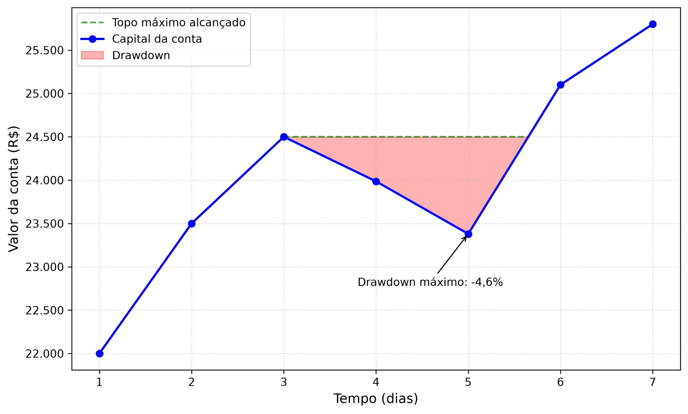  
Fonte: gerado pelo Claude (ANTHROPIC, 2026), a partir de programa em Python do autor, com valores hipotéticos e com base em Rodrigues (2025).

A Figura 30 mostra o capital de uma conta hipotética ao longo de 7 dias (linha azul) e o maior valor que ela já atingiu (linha verde tracejada). No dia 3, a conta chegou a R\$24.500 e, depois, caiu até R\$23.380 no dia 5\. Esse é o *drawdown* máximo do período: $\frac{23.380-24.500}{24.500}$ \= −4,6%. A área vermelha mostra o tempo em que a conta ficou abaixo do topo, até voltar a superá-lo entre os dias 5 e 6\.  
O *drawdown* é importante, pois ajuda o operador a avaliar não apenas a rentabilidade, mas também as quedas de seu capital no mercado financeiro, e ajuda o investidor a não tomar decisões impulsivas e a se manter disciplinado em momentos de pânico ou de alta volatilidade (RODRIGUES, 2025).   
Recuperar uma queda é mais difícil do que parece, pois exige muito do emocional do *trader*. O ganho necessário para voltar ao valor anterior é dado por:

$$
ganho\ necessário=\frac{perda}{1-perda}
$$

Em que:

* ganho necessário \= quanto é preciso ganhar, em porcentagem, para voltar ao valor de antes da perda;  
* perda \= tamanho da queda, em número decimal e sem o sinal de menos (0,2 para uma perda de 20%);  
* 1 − perda \= parte do capital que sobrou depois da perda (0,8, ou 80%, quando a perda é de 20%).

Figura 31 – Exemplo de cálculo do ganho necessário para recuperar uma perda em Python (perdas de 10%, 20% e 50%)  
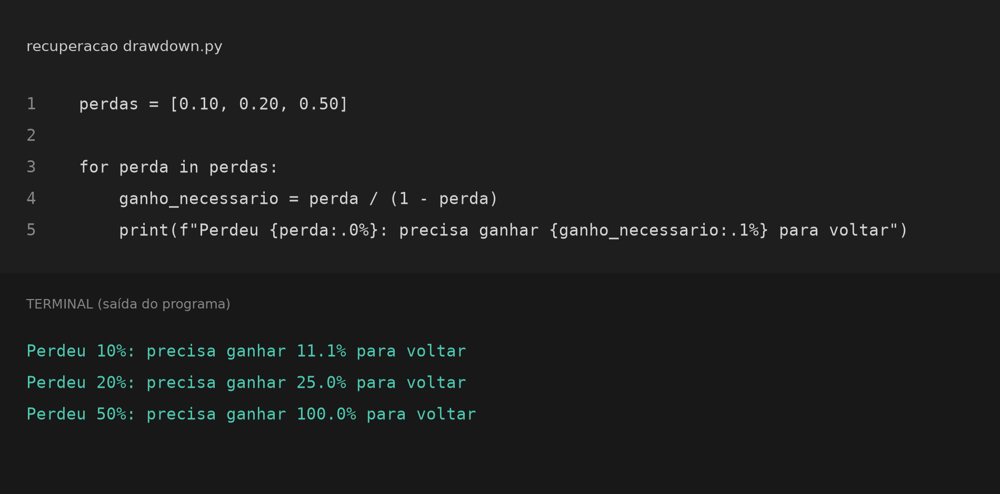  
Fonte: gerado pelo Claude (ANTHROPIC, 2026), a partir de programa em Python do autor, com valores hipotéticos.

A Figura 31 mostra o programa calculando quanto é preciso ganhar para voltar ao valor anterior depois de uma perda. Quem perde 10% precisa ganhar 11,1%; quem perde 20% precisa ganhar 25%; e quem perde 50% precisa ganhar 100%, ou seja, dobrar o capital que sobrou. Isso acontece porque, depois da perda, o ganho é calculado sobre um valor menor. Por isso, evitar quedas grandes é tão importante quanto buscar lucro.

## **2.8 Obtenção de dados**

### **2.8.1 Tipo de pesquisa**

Este trabalho é uma pesquisa quantitativa, porque os resultados são medidos com números: retorno, taxa de acerto, *payoff*, esperança matemática, margem de erro e *drawdown*. Além disso, é uma pesquisa bibliográfica, porque a base teórica (capítulos 1 e 2\) foi construída a partir de livros, artigos e materiais de instituições como a CVM e a B3. A parte prática é uma simulação com dados históricos de fontes públicas (*backtest*): as estratégias são transformadas em regras de computador, programadas em Python e aplicadas aos preços reais do passado, como se as operações tivessem sido feitas naquela época.

### **2.8.2 Os ativos escolhidos**

Os ativos escolhidos para este trabalho são EUR/USD, SPY, NQ, IBOV, PETR4, ITUB4, BTC/USD, Tesla e MGLU3.  
Esses ativos são de tipos diferentes: três ações brasileiras (PETR4, da Petrobras; ITUB4, do Itaú Unibanco; e MGLU3, do Magazine Luiza), uma ação americana (Tesla), o índice da bolsa brasileira (IBOV, que representa o comportamento do mercado brasileiro e não pode ser comprado diretamente), um fundo negociado em bolsa que acompanha o índice americano S\&P 500 (SPY), um contrato futuro do índice Nasdaq-100 (NQ), um par de moedas (EUR/USD, o euro cotado em dólar) e uma criptomoeda (BTC/USD, o bitcoin cotado em dólar).  
A escolha de mercados tão diferentes tem um motivo: testar a sensibilidade das estratégias à volatilidade, ou seja, verificar se elas funcionam melhor em ativos calmos ou em ativos agitados. Por isso, os ativos foram organizados do menos volátil para o mais volátil. Nos 90 dias analisados, a variação diária típica (o desvio-padrão dos retornos diários) foi de 0,27% no EUR/USD, 0,69% no SPY, 1,19% no NQ, 1,41% no IBOV, 2,01% na PETR4, 2,05% no ITUB4, 2,06% no BTC/USD, 3,05% na Tesla e 5,79% na MGLU3, como mostra a Figura 32\.  
Figura 32 – Volatilidade dos ativos escolhidos, do menor para o maior desvio-padrão dos retornos diários (*timeframe* diário, de 12/07/2026 a 09/10/2026)  
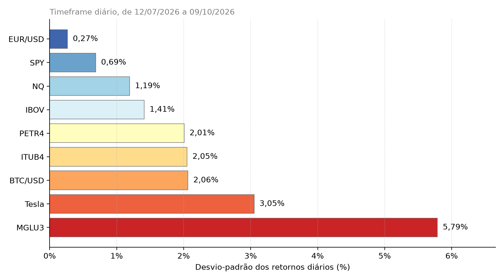  
Fonte: gerado pelo Claude (ANTHROPIC, 2026), com dados do Yahoo Finance, Binance, HistData e Bybit.

A Figura 32 mostra os nove ativos organizados da menor para a maior volatilidade. O EUR/USD é o mais calmo, com variação diária típica de 0,27%, e a MGLU3 é a mais agitada, com 5,79%. Quanto maior a barra, maior a variação do ativo no dia.   
O NQ é negociado na bolsa de Chicago, e cada ponto do índice vale US\$20 por contrato (CME GROUP, 2026). Por exemplo, se o índice sobe 100 pontos, quem comprou 1 contrato ganha $`100\times \text{US}\$20=\text{US}\$2.000`$; se o índice cai 100 pontos, perde $`\text{US}\$2.000`$. Isso mostra como um contrato futuro pode multiplicar tanto os ganhos quanto as perdas.

### **2.8.3 Dados e ferramentas**

Os dados utilizados na pesquisa quantitativa foram coletados do Yahoo Finance, da Binance, do HistData, da Bybit e do Profit Pro, da Nelogica (de onde vieram os *timeframes* de minuto das ações brasileiras), e cobrem 90 dias, de 12/07/2026 a 09/10/2026. Os dados foram organizados em 13 *timeframes*: 1 min, 2 min, 3 min, 5 min, 15 min, 30 min, 1 h, 2 h, 4 h, 6 h, 8 h, 12 h e 24 h; nos testes, cada estratégia usou um deles (seção 2.9). Cada mercado funciona em um horário diferente: o BTC/USD é negociado 24 horas por dia, todos os dias; o EUR/USD, 24 horas de segunda a sexta; o NQ, quase 24 horas, de domingo às 18h a sexta às 17h (CME GROUP, 2026); a bolsa americana (SPY e Tesla), das 9h30 às 16h, no horário de Nova York; e a B3 (PETR4, ITUB4, MGLU3 e IBOV), das 10h às 17h, no horário de Brasília.  
As ferramentas utilizadas neste trabalho foram: o VS Code, para escrever os programas em Python 3.14; as bibliotecas do Python como NumPy para contas matemáticas, pandas para organizar os dados em tabelas (os *candles*), Matplotlib para fazer os gráficos, e yfinance para importar os dados do Yahoo Finance para os códigos; o Black Arrow foi utilizado para analisar gráficos e estudar estratégias; o TradingView, para analisar gráficos; o Profit Pro, para baixar o histórico de minuto das ações brasileiras; o Desmos (2026), para desenhar e conferir gráficos de funções, como as retas da oferta e da demanda; o Claude Code, para auxiliar na montagem de códigos e gráficos e na conferência de fontes; e o Google Docs, onde o trabalho foi escrito.

### **2.8.4 O *backtest***

O *backtest* é uma simulação com dados do passado: o programa aplica as regras de cada estratégia nesses dados, *candle* por *candle*, como se estivesse operando de verdade.  
O *backtest* serve para testar uma estratégia antes de arriscar dinheiro de verdade. Em poucos minutos, o computador simula centenas de operações, algo que levaria meses ou até anos operando manualmente. Isso é importante por causa da lei dos grandes números (seção 2.5): com poucas operações, o resultado pode ter vindo só da sorte, mas, com muitas, é possível saber se a estratégia tem vantagem de verdade. Por isso, antes de colocar uma estratégia no mercado, os *traders* quantitativos testam suas regras em *backtests* (CHAN, 2021).  
O *backtest* funciona em etapas. Primeiro, o programa lê os *candles* do ativo e calcula o indicador da estratégia, como o IFR ou a VWAP. Depois, confere, *candle* por *candle*, se a regra de entrada aconteceu. Se aconteceu, ele simula uma compra ou uma venda e espera a regra de saída, que pode ser o *stop*, o alvo ou o fim do pregão. Por fim, anota o resultado da operação e repete o processo até o fim dos dados. Por exemplo, em uma estratégia de rompimento hipotética, se o preço passa de US\$102, o programa compra; se o pregão termina em US\$104, o lucro é de US\$2 por ação, antes dos custos.  
Como o trabalho estuda o *day trade*, toda operação simulada é aberta e fechada no mesmo dia. Em cada operação, são descontados a corretagem, as taxas e o *slippage*, pois, sem eles, o resultado do *backtest* seria melhor do que o resultado real (seção 1.2). Ao final, o *backtest* entrega a lista de todas as operações, a evolução do capital ao longo do tempo e as medidas do capítulo 2: taxa de acerto, *payoff*, esperança matemática, margem de erro e *drawdown*.  
Alguns erros podem deixar o *backtest* falso. O primeiro é olhar o futuro, ou seja, usar uma informação que ainda não existia no momento da decisão, como o preço de fechamento de um *candle* que ainda não terminou. O segundo é o *overfitting*, que é quando a estratégia se ajusta perfeitamente ao passado (BAILEY et al., 2014). O terceiro é usar dados com erros ou buracos; por isso, os dados deste trabalho foram conferidos antes dos testes.  
O *backtest* também tem três limitações. A primeira é que um bom resultado no passado não garante lucro no futuro, porque o mercado muda (existem regimes de mercado, ou seja, há fases de alta, baixa e lateralização). A segunda é que, na vida real, a ordem pode ser executada a um preço pior do que o esperado que chamamos de *slippage*. A terceira é que o programa não sente emoções, mas o *trader* que opera de verdade sente e pode deixar de seguir as regras (seção 1.5). Por isso, depois do *backtest*, é comum testar a estratégia em uma conta de simulação, com o mercado ao vivo, antes de usar dinheiro de verdade, para ver se ela realmente funciona na prática.  
Neste trabalho, o *backtest* é programado em Python, sem usar plataformas prontas, para que cada regra fique visível e possa ser conferida (Apêndice A). As quatro estratégias (ORB, VWAP, IFR e cruzamento de médias móveis) são testadas nos nove ativos, cada uma em um *timeframe* (seção 2.9), com os dados de 90 dias descritos na seção 2.8.3.

### **2.8.5 Treino e teste**

Como visto na seção 1.6, um dos maiores perigos do *quant trading* é o *overfitting*: uma estratégia ajustada até funcionar perfeitamente no passado pode não funcionar no futuro (BAILEY et al., 2014). Para diminuir esse risco, os dados deste trabalho foram divididos em duas partes, chamadas de treino e teste.  
A ideia é parecida com estudar para uma prova. Quem resolve exercícios antigos está treinando; depois, na prova, aparecem questões novas. Se o aluno apenas decorou as respostas dos exercícios, ele vai mal na prova; se aprendeu de verdade, vai bem nos dois. Com as estratégias acontece o mesmo: o treino são os exercícios, e o teste é a prova.  
Os 90 dias de dados foram divididos assim: os primeiros 60 dias, de 12/07/2026 a 09/09/2026, formam o treino, e os últimos 30 dias, de 10/09/2026 a 09/10/2026, formam o teste. O teste fica com o período mais recente porque ele faz o papel do futuro, que a estratégia ainda não conhece.  
No treino, a regressão linear escolhe os seus pesos, e as quatro estratégias usam esse período só para calcular os indicadores, como o IFR e as médias móveis, pois as suas regras já foram definidas antes, nos exemplos da seção 2.9. Depois, a regressão e as estratégias são aplicadas no teste sem nenhuma mudança nas regras. Os dados do teste não são usados em nenhum momento da escolha, pois, se fossem, o teste deixaria de mostrar como a estratégia se comporta em dados novos.  
Por fim, os resultados do teste são analisados com as medidas do capítulo 2\. Testar várias versões de cada estratégia no treino e comparar com o teste fica para trabalhos futuros: se uma estratégia ganha dinheiro no treino, mas perde no teste, ela provavelmente apenas se ajustou ao passado, o que é chamado de *overfitting*. Se ganhar nos dois, há mais chance de a vantagem ser real, embora isso ainda não garanta lucro no futuro.

### **2.8.6 Limitações**

A principal limitação deste trabalho é a quantidade de dados, porque dados de muito tempo custam caro. As fontes grátis guardam pouco histórico de minuto: o Yahoo Finance dá só 7 dias de *candles* de 1 minuto por vez e 60 dias de *candles* de 5 a 30 minutos. Para conseguir os 90 dias de minuto das ações brasileiras, foi preciso assinar o Profit Pro, que é pago. Anos de dados no *timeframe* de minutos de vários ativos custam ainda mais. Por isso, o trabalho usou 90 dias, e não vários anos.   
Essa limitação traz outra: com apenas 90 dias, e só 30 deles no teste, algumas combinações geram poucas operações. Na VWAP do SPY, por exemplo, houve só 1 operação no teste, e por isso a margem de erro desses testes fica grande (seção 2.6). Além disso, os 90 dias mostram apenas um momento do mercado, de julho a outubro de 2026\. Uma estratégia que funcionou nesse período pode não funcionar em outro regime de mercado, como uma fase de queda forte.  
Os dados também vieram de fontes diferentes: Yahoo Finance, Binance, HistData, Bybit e Profit Pro. Em alguns casos, os dados de minuto não são do ativo exato: no SPY e no NQ, foram usados os índices S\&P 500 e Nasdaq-100 em CFD, do HistData, e, na Tesla, o contrato da Bybit, que é negociado 24 horas por dia. Os preços ficam muito próximos dos oficiais, mas não são idênticos. Além disso, os dados de minuto do EUR/USD, do SPY e do NQ não têm volume, e a VWAP precisa do volume para ser calculada, o que exige uma solução diferente ao testar essa estratégia.  
Por fim, a corretagem, as taxas e o *slippage* mudam de corretora para corretora e de um dia para outro, então o trabalho usa valores estimados, que podem ser diferentes dos reais. Também foram testadas apenas quatro estratégias, com uma versão cada uma, entre as muitas que existem. Um próximo passo, em trabalhos futuros, seria testar essas estratégias em vários anos de dados e em mais regimes de mercado.

## **2.9 As estratégias testadas**

Neste trabalho foram testadas quatro estratégias de *day trade* baseadas em análise técnica: o rompimento da faixa de abertura (ORB), a VWAP, o IFR e o cruzamento de médias móveis. Duas seguem a tendência (ORB e médias) e duas apostam na volta do preço (VWAP e IFR). Para cada uma, as próximas seções mostram a ideia, a fórmula, as regras exatas de entrada e saída e um exemplo em um dia real. Todas foram testadas nos 9 ativos, cada uma em um *timeframe*: ORB e IFR em 30 minutos, VWAP em 15 minutos e cruzamento de médias em 5 minutos.

### **2.9.1 ORB: rompimento da faixa de abertura**

A estratégia ORB (*Opening Range Breakout*), que em português significa rompimento da faixa de abertura, parte da ideia de que os primeiros minutos do pregão mostram a direção do dia. Primeiro, marcam-se a máxima e a mínima do primeiro *candle* do dia, no *timeframe* escolhido, que formam a faixa de abertura. Com base nisso, se o preço passa da máxima, a estratégia compra no rompimento; se o preço passa abaixo da mínima, a estratégia vende no rompimento. A operação é encerrada no fim do dia ou quando atinge o *stop* ou o alvo. Zarattini, Barbon e Aziz (2024) testaram a ORB de 5 minutos em mais de 7.000 ações dos Estados Unidos, de 2016 a 2023, e encontraram ganhos maiores que os de só comprar e manter o mercado, mas apenas nas ações que estavam com volume fora do normal no dia.

Figura 33 – Exemplo da ORB na PETR4 em dois dias reais, 15/09/2026 e 16/09/2026: a faixa de abertura e os dois futuros possíveis, com alvo e *stop* hipotéticos (*timeframe* de 30 minutos)

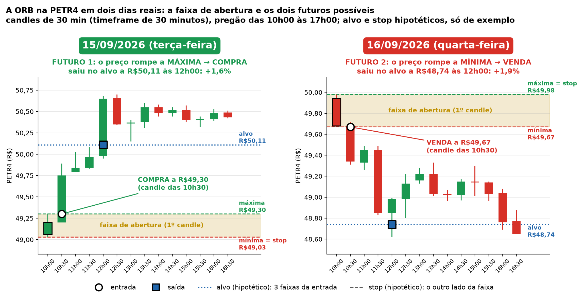

Fonte: gerado pelo Claude (ANTHROPIC, 2026), com dados do Profit Pro (NELOGICA, 2026).

A Figura 33 mostra a ORB em dois dias reais da PETR4. Em 15/09/2026, a faixa de abertura foi de R\$49,03 a R\$49,30; o preço rompeu a máxima às 10h30, a estratégia comprou a R\$49,30 e saiu no alvo de R\$50,11 às 12h00 (+1,6%). Em 16/09/2026, a faixa foi de R\$49,67 a R\$49,98; o preço rompeu a mínima, a estratégia vendeu a R\$49,67 e saiu no alvo de R\$48,74 às 12h00 (+1,9%, porque na venda o lucro vem da queda). O *stop* e o alvo são hipotéticos, usados só neste exemplo: o *stop* fica no outro lado da faixa, e o alvo, a três vezes o tamanho da faixa a partir da entrada; nos dois dias, o *stop* não foi atingido. Esses dois dias foram escolhidos como exemplo: em muitos outros, o rompimento falha, e só o *backtest* mostra se a ORB ganha na média.

### **2.9.2 VWAP: preço médio ponderado pelo volume**

A VWAP (*Volume Weighted Average Price*) é o preço médio do dia, em que cada preço pesa conforme o volume negociado nele. Ela recomeça todo dia, na abertura do pregão, e é usada por grandes investidores como referência do “preço justo” do dia. A ideia da estratégia é que o preço, quando se afasta muito da VWAP, tende a voltar para ela: se o preço está bem abaixo dela, a estratégia compra; se está bem acima, vende. Por isso, ela é o contrário da ORB: enquanto a ORB segue a tendência, a VWAP aposta na reversão à média, ou seja, na volta do preço para o valor justo do dia. A VWAP surgiu como uma medida de custo: Berkowitz, Logue e Noser (1988) a usaram para avaliar se as grandes operações da Bolsa de Nova York eram feitas acima ou abaixo do preço médio do dia.

A conta da VWAP é:

$$
VWAP=\frac{\Sigma (P\times V)}{\Sigma V}
$$

$$
P=\frac{máxima+mínima+fechamento}{3}
$$

Em que:

* VWAP \= preço médio do dia ponderado pelo volume, do começo do pregão até o *candle* atual;  
* P \= preço típico do *candle*;  
* V \= volume do *candle*, ou seja, a quantidade negociada;  
* Σ \= soma de todos os *candles* do dia, desde a abertura;  
* máxima, mínima e fechamento \= o maior preço, o menor preço e o último preço do *candle*.

Por exemplo, imagine um dia com só dois *candles*. No primeiro, a máxima foi R\$11, a mínima foi R\$9 e o fechamento foi R\$10. O preço típico dele é:

$$
P=\frac{11+9+10}{3}=10
$$

Agora, imagine que esse *candle* teve 10 ações negociadas e que o segundo teve preço típico de R\$14, com 30 ações negociadas. A VWAP do dia é:

$$
VWAP=\frac{10\times 10+14\times 30}{10+30}=\frac{520}{40}=13
$$

A média simples dos dois preços seria R\$12, mas a VWAP ficou em R\$13, mais perto do preço do segundo *candle*, em que foram negociadas mais ações.

Figura 34 – Exemplo da VWAP no ITUB4 em um dia real, 03/09/2026: uma venda e uma compra quando o preço se afasta 0,6% da VWAP, com alvo e *stop* hipotéticos (*timeframe* de 15 minutos)

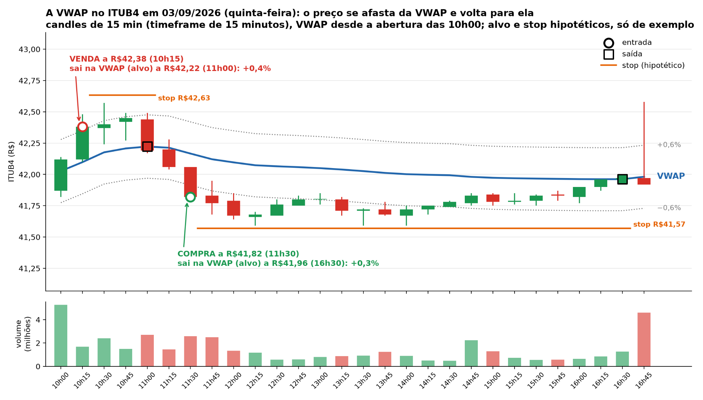

Fonte: gerado pelo Claude (ANTHROPIC, 2026), com dados do Profit Pro (NELOGICA, 2026).

A Figura 34 mostra um gráfico de *candles* no *timeframe* de 15 minutos do ITUB4 no dia 03/09/2026, com duas operações da estratégia VWAP (a linha azul): uma venda e uma compra. Na primeira operação (venda), a estratégia vendeu a R\$42,38 às 10h15, quando o preço estava mais de 0,6% acima da VWAP, e saiu na VWAP (o alvo) a R\$42,22 às 11h00 (+0,4%); na segunda (compra), a estratégia comprou a R\$41,82 às 11h30, mais de 0,6% abaixo da VWAP, e saiu na VWAP a R\$41,96 às 16h30 (+0,3%). O *stop* hipotético, marcado em laranja, ficava 0,6% contra cada operação (R\$42,63 na venda e R\$41,57 na compra) e não foi atingido. Esses valores servem só de exemplo, e o dia foi escolhido porque as duas operações deram certo: em muitos outros, o preço não volta para a VWAP, e só o *backtest* mostra se a estratégia ganha na média.

### **2.9.3 IFR: índice de força relativa**

O IFR (Índice de Força Relativa) é um indicador que mede, numa escala de 0 a 100, se as últimas altas foram mais fortes que as últimas quedas, normalmente nos últimos 14 *candles*. Quando o IFR passa de 70, o indicador mostra que o ativo está sobrecomprado; quando fica abaixo de 30, mostra que o ativo está sobrevendido. O IFR tem o mesmo princípio da VWAP, o da reversão à média; a diferença é que a VWAP olha a distância do preço até a média do dia, enquanto o IFR olha a força das altas e das quedas recentes. O indicador foi criado por Wilder (1978), que usou 14 períodos e as faixas de 70 e 30, valores que continuam sendo os mais usados (MURPHY, 1999).

A conta do IFR é:

$$
IFR=100-\frac{100}{1+RS}
$$

$$
RS=\frac{média\ das\ altas}{média\ das\ quedas}
$$

Em que:

* IFR \= índice de força relativa, que vai de 0 a 100;  
* RS \= força relativa, ou seja, quantas vezes as altas foram maiores que as quedas;  
* média das altas \= média das subidas de um fechamento para o seguinte nos últimos 14 *candles*, calculada pelo método de Wilder;  
* média das quedas \= a mesma conta feita com as descidas.

Um exemplo, se nos últimos 14 *candles* a média das altas foi de US\$30 e a média das quedas foi de US\$10, a força relativa é:

$$
RS=\frac{30}{10}=3
$$

Com isso, o IFR é:

$$
IFR=100-\frac{100}{1+3}=100-25=75
$$

Como o IFR passou de 70, o ativo está sobrecomprado, e a estratégia vende. Se as altas e as quedas tivessem a mesma média, o RS seria 1 e o IFR ficaria em 50, no meio da escala.

Figura 35 – Exemplo do IFR no BTC/USD em um dia real, 03/08/2026: uma compra com o IFR abaixo de 30 e uma venda com o IFR acima de 70, com alvo e *stop* hipotéticos (*timeframe* de 30 minutos, IFR de 14 períodos)

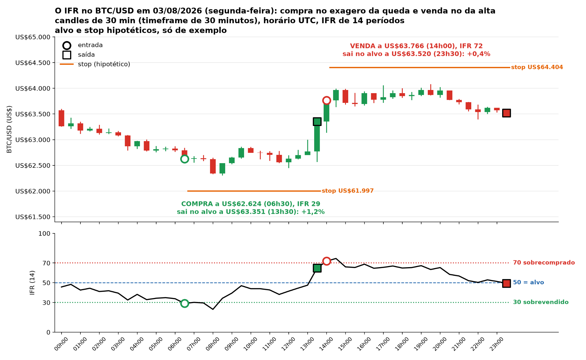

Fonte: gerado pelo Claude (ANTHROPIC, 2026), com dados da Binance (BINANCE, 2026).

A Figura 35 mostra um gráfico de *candles* de 30 minutos do BTC/USD no dia 03/08/2026, com o IFR de 14 períodos abaixo. Às 06h30, o IFR caiu para 29 e a estratégia comprou a US\$62.624, saindo no alvo (o IFR de volta a 50\) a US\$63.351 (+1,2%); às 14h00, o IFR subiu para 72 e ela vendeu a US\$63.766, saindo a US\$63.520 (+0,4%). O alvo e o *stop* de 1% contra a operação são hipotéticos, usados só neste exemplo.

### **2.9.4 Cruzamento de médias móveis**

A média móvel é o preço médio dos últimos N *candles*. A cada *candle* novo no gráfico, a média anda junto. A estratégia de cruzamento de médias usa duas médias: uma rápida e outra lenta. Quanto menor o período da média móvel, mais rápida ela é; quanto maior o período, mais lenta ela é. A média rápida reage logo quando o preço muda, e a lenta demora mais para reagir. Quando uma média móvel cruza a outra, ela indica uma compra ou uma venda. A média móvel mais utilizada no mercado é a exponencial (MME), porque ela dá mais peso aos *candles* mais recentes. A conta que a média exponencial usa é:

$$
MME=preço\times k+MM{E}_{anterior}\times (1-k)
$$

$$
k=\frac{2}{N+1}
$$

Em que:

* MME \= média móvel exponencial no *candle* atual;  
* preço \= preço de fechamento do *candle* atual;  
* k \= peso do preço novo na média (quanto maior o valor de k, mais rápido a média reage ao preço);  
* MMEanterior \= valor da média no *candle* anterior;  
* N \= período da média, ou seja, quantos *candles* ela usa (9 na média rápida e 21 na lenta, no exemplo da Figura 36).

Por exemplo, na média de 9 períodos (N \= 9), o peso do preço novo é:

$$
k=\frac{2}{9+1}=\frac{2}{10}=\frac{1}{5}
$$

Se a média estava em R\$10 e o *candle* novo fechou em R\$15, ela fica:

$$
MME=15\times \frac{1}{5}+10\times (1-\frac{1}{5})=3+8=11
$$

A média andou de R\$10 para R\$11, ou seja, só uma parte do caminho até o preço de R\$15. É por isso que a média é mais lenta que o preço: ela vai atrás dele aos poucos. Quanto maior o N, menor o k, e mais devagar a média anda.

Quando a média rápida cruza a lenta para cima, a estratégia compra; quando cruza para baixo, vende. No cruzamento contrário, ela fecha a operação e já entra no sentido oposto, o que no mercado se chama “virar a mão”. Murphy (1999) descreve o cruzamento de duas médias como um dos métodos mais usados para seguir a tendência, e Brock, Lakonishok e LeBaron (1992), ao testarem regras de médias móveis no índice Dow Jones de 1897 a 1986, encontraram resultados a favor delas.

Figura 36 – Exemplo do cruzamento de médias na Tesla em um dia real, 16/09/2026: uma compra e uma venda quando a MME de 9 períodos cruza a de 21, virando a mão, com *stop* hipotético (*timeframe* de 5 minutos)

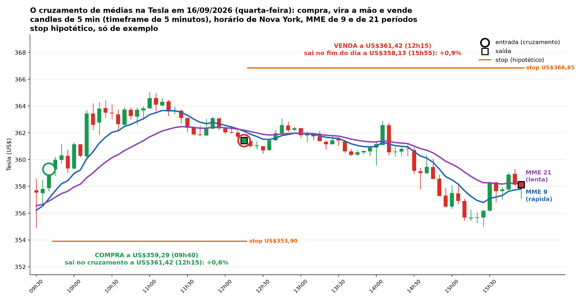

Fonte: gerado pelo Claude (ANTHROPIC, 2026), com dados do Yahoo Finance (YAHOO FINANCE, 2026b).

A Figura 36 mostra um gráfico de *candles* de 5 minutos da Tesla no dia 16/09/2026, com a MME de 9 períodos (azul) e a de 21 (roxa). Às 09h40, a média rápida cruzou a lenta para cima e a estratégia comprou a US\$359,29; às 12h15, ela cruzou para baixo, e a estratégia virou a mão: saiu da compra a US\$361,42 (+0,6%) e vendeu, fechando a venda no fim do dia a US\$358,13 (+0,9%). O *stop* de 1,5% contra a operação é hipotético, usado só neste exemplo.

### **2.9.5 As regras usadas na simulação**

As estratégias ORB, VWAP, IFR e cruzamento de médias móveis utilizaram regras para operarem nos dados (Quadro 1):

* A estratégia ORB operou no *timeframe* de 30 minutos e fazia suas entradas com um rompimento da mínima ou da máxima do primeiro *candle*, com alvo de 3x1, e o *stop* sempre ficava abaixo do topo ou acima do fundo;  
* A VWAP operou no *timeframe* de 15 minutos e fazia suas entradas quando o preço se afastava 0,6% da sua média e saía quando o preço voltava para ela;  
* O IFR operou no *timeframe* de 30 minutos, com 14 períodos, e fazia suas entradas quando o indicador ficava abaixo de 30 (sobrevendido) ou acima de 70 (sobrecomprado), com a saída da operação quando o indicador voltava a 50;  
* O cruzamento de médias operou no gráfico de 5 minutos e fazia suas operações quando uma média de 9 períodos cruzava uma média de 21 períodos. Ela não tem alvo e vira a mão no cruzamento contrário.

Quadro 1 – Regras de cada estratégia na simulação: *timeframe*, entrada, saída no alvo e *stop* (mês de teste, 10/09 a 09/10/2026)

| Estratégia | *Timeframe* | Entrada | Saída (alvo) | *Stop* |
| :---: | :---: | ----- | ----- | ----- |
| ORB | 30 min | A faixa vai da mínima à máxima do 1º *candle* do dia. Compra quando o preço passa da máxima e vende quando passa da mínima (uma operação por dia). | 3 vezes o tamanho da faixa | O outro lado da faixa |
| VWAP | 15 min | O *candle* fecha 0,6% ou mais abaixo da VWAP: compra. Fecha 0,6% ou mais acima: vende. | O preço voltar à VWAP | 0,6% contra a operação |
| IFR | 30 min | IFR de 14 períodos em 30 ou menos: compra. Em 70 ou mais: vende. | O IFR voltar a 50 | 1% contra a operação |
| Cruzamento de médias | 5 min | A MME de 9 períodos cruza a de 21 para cima: compra. Para baixo: vende. | Não tem: no cruzamento contrário, vira a mão | 1,5% contra a operação |

Fonte: gerado pelo Claude (ANTHROPIC, 2026), com base nas regras dos exemplos da seção 2.9.

# **3 RESULTADOS E DISCUSSÕES**

Este capítulo apresenta os resultados de duas formas de usar os preços passados para operar, um modelo de previsão estatística (a regressão linear), e as quatro estratégias de análise técnica descritas na seção 2.9 (ORB, VWAP, IFR e cruzamento de médias móveis). Todas foram testadas nos nove ativos do trabalho que são: EUR/USD, SPY, NQ, IBOV, PETR4, ITUB4, BTC/USD, Tesla e MGLU3, no mês de execução das estratégias nos ativos, de 10/09 a 09/10/2026, que não foi utilizado no treinamento. A regressão aprendeu com os dados nos dois meses de treino (12/07 a 09/09/2026), e as estratégias usaram exatamente as regras dos exemplos da seção 2.9, sem nenhum ajuste; o treino serviu só para calcular o IFR e as médias móveis desde antes do começo do teste. Antes dos testes, os dados de cada ativo foram comparados hora por hora com uma segunda fonte, e a diferença média ficou entre 0,004% e 0,10%; essa conferência encontrou e corrigiu um salto falso de 1% na série do NQ, causado pela troca do contrato futuro de setembro pelo de dezembro.

Para comparar as abordagens com dinheiro, cada uma começou com um capital inicial de US\$1.000 em cada ativo e seguiu as mesmas regras: operações de *day trade*, fechadas sempre no último *candle* do dia, o capital inteiro em cada operação, sem alavancagem; e o desconto do custo de cada operação, que inclui corretagem, taxas e *slippage*. Como referência, foi calculado também o resultado de comprar o ativo no começo do mês e vender no fim, sem nenhuma operação no meio, chamado de *buy and hold* (em português, “comprar e segurar”). Os ativos negociados em reais e o NQ foram simulados em porcentagem, como se os US\$1.000 estivessem aplicados neles.

O primeiro teste foi o da regressão linear (um modelo estatístico que prevê um movimento futuro). A cada hora do mês de teste, o modelo previu o preço da hora seguinte, e a previsão foi comparada com o preço real e com a previsão mais simples possível, o de que a próxima hora fecha no mesmo preço da última. A Tabela 2 mostra o resultado.

Tabela 2 – Erro da previsão da regressão linear e acerto da direção no teste, com *candles* de 1 hora (10/09 a 09/10/2026)

| Ativo | Erro médio do modelo estatístico | Erro de repetir o último preço | Acerto da direção |
| :---: | :---: | :---: | :---: |
| EUR/USD | 0,050% | 0,049% | 49,4% |
| SPY | 0,168% | 0,165% | 46,7% |
| NQ | 0,134% | 0,132% | 48,7% |
| IBOV | 0,345% | 0,347% | 55,6% |
| PETR4 | 0,550% | 0,541% | 50,0% |
| ITUB4 | 0,526% | 0,514% | 49,7% |
| BTC/USD | 0,237% | 0,236% | 50,1% |
| Tesla | 0,484% | 0,479% | 53,9% |
| MGLU3 | 1,358% | 1,336% | 42,9% |

Fonte: gerado pelo Claude (ANTHROPIC, 2026), com dados do Yahoo Finance (YAHOO FINANCE, 2026b), da Binance (BINANCE, 2026\) e do HistData (HISTDATA, 2026).

Em oito dos nove ativos, o modelo errou igual ou um pouco mais que o palpite de repetir o último preço; só no IBOV ele foi 0,002 ponto percentual melhor. O acerto da direção, ou seja, se o preço ia subir ou cair, ficou entre 42,9% e 55,6%, perto dos 50% de jogar uma moeda como descrito na seção 2.5 na lei dos grandes números. Na prática, o modelo quase sempre repetiu o último preço: na PETR4, por exemplo, ele previu em média variações de 0,08% por hora, enquanto o preço real variou em média 0,54%, quase sete vezes mais. Os pesos encontrados no treino ficaram todos perto de zero, o que mostra que as variações passadas quase não ajudam a prever a próxima.

Figura 37 – Preço real da PETR4 comparado com o previsto pela regressão linear no teste (*timeframe* de 1 hora, regressão com as 3 últimas variações; 10/09 a 09/10/2026)

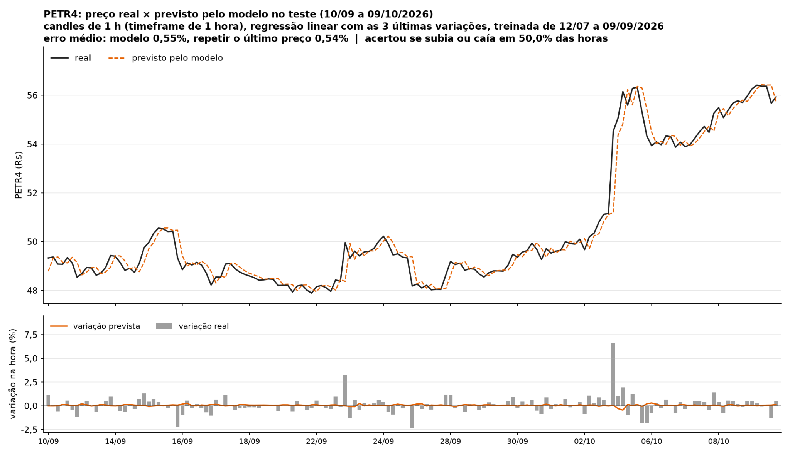

Fonte: gerado pelo Claude (ANTHROPIC, 2026), com dados do Yahoo Finance (YAHOO FINANCE, 2026b).

A Figura 37 mostra, como exemplo, o preço real da PETR4 (linha preta) e o preço previsto pelo modelo (linha laranja tracejada) em cada hora do teste. A linha prevista parece acompanhar a real, mas fica sempre uma hora atrasada, porque o modelo quase repete o último preço. Na parte de baixo, as barras cinza são a variação real de cada hora, e a linha laranja, a variação prevista, que fica quase sempre perto de zero. Por isso, na PETR4, o erro médio do modelo (0,55%) foi praticamente igual ao de repetir o último preço (0,54%), e ele acertou se o preço ia subir ou cair em 50,0% das horas.

Figura 38 – Ganho ou perda de US\$1.000 em cada ativo com a regressão linear, com e sem custos, comparado com o *buy and hold* (*timeframe* de 1 hora; 10/09 a 09/10/2026)

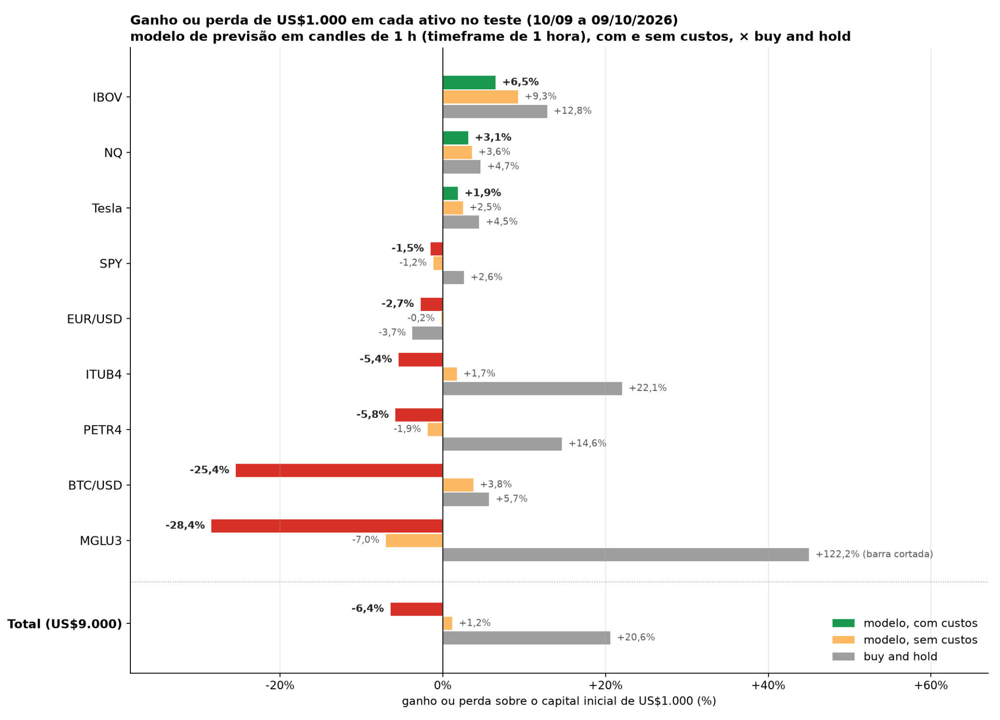

Fonte: gerado pelo Claude (ANTHROPIC, 2026), com dados do Yahoo Finance (YAHOO FINANCE, 2026b), da Binance (BINANCE, 2026\) e do HistData (HISTDATA, 2026).

A Figura 38 mostra o resultado da simulação com a regressão em cada ativo: a primeira barra é o resultado com custos (verde quando ganhou e vermelha quando perdeu), a segunda, sem custos (laranja), e a terceira, o *buy and hold* (cinza). Sem os custos, o modelo teria ganhado em cinco dos nove ativos; com eles, ganhou só em três (IBOV, NQ e Tesla) e perdeu 6,4% no total, enquanto o *buy and hold* ganhou 20,6%. A maior diferença aparece no BTC/USD: sem custos, \+3,8%; com custos, −25,4%.

A Tabela 3 reúne o resultado da simulação com capital para todas as abordagens, somando os nove ativos. A VWAP soma só oito, porque o EUR/USD, como todo o mercado de câmbio, não tem um volume central, e sem o volume não é possível calcular a VWAP.

Tabela 3 – Resultado de cada abordagem no teste, somando os ativos, com capital inicial de US\$1.000 por ativo (10/09 a 09/10/2026)

| Medida | ORB | VWAP | IFR | Médias | Regressão | *Buy and hold* |
| :---: | :---: | :---: | :---: | :---: | :---: | :---: |
| *Timeframe* | 30 min | 15 min | 30 min | 5 min | 1 h | — |
| Operações no mês | 210 | 399 | 153 | 1.359 | 995 | 1 por ativo |
| Taxa de acerto | 34,3% | 43,6% | 49,7% | 25,7% | 46,2% | — |
| *Payoff* | 1,68 | 0,78 | 0,93 | 1,70 | 0,83 | — |
| Ganho médio por operação antes do custo | \+0,040% | \+0,020% | \+0,079% | \+0,014% | \+0,013% | — |
| Custo médio por operação | 0,094% | 0,190% | 0,114% | 0,104% | 0,077% | — |
| Resultado com custos | −1,4% | −7,1% | −0,7% | −9,2% | −6,4% | \+20,6% |
| Resultado sem custos | \+0,9% | \+0,9% | \+1,3% | \+2,6% | \+1,2% | \+20,6% |
| Ativos com lucro | 3 de 9 | 4 de 8 | 5 de 9 | 3 de 9 | 3 de 9 | 8 de 9 |

Fonte: gerado pelo Claude (ANTHROPIC, 2026), com dados do Profit Pro (NELOGICA, 2026), do Yahoo Finance (YAHOO FINANCE, 2026b), da Binance (BINANCE, 2026), da Bybit (BYBIT, 2026\) e do HistData (HISTDATA, 2026).

Com os custos, as cinco abordagens que operaram terminaram o mês com prejuízo. A ordem, da que menos perdeu para a que mais perdeu, foi: IFR (−0,7%), ORB (−1,4%), regressão (−6,4%), VWAP (−7,1%) e cruzamento de médias (−9,2%). No mesmo período, o *buy and hold* ganhou 20,6%. Sem os custos, todas as abordagens teriam terminado com um ganho pequeno, entre \+0,9% e \+2,6%, e a ordem quase se inverte: o cruzamento de médias, o pior com custos, passa a ser o melhor sem eles. A Tabela 4 mostra o resultado de cada ativo.

Figura 39 – Capital de cada abordagem dia a dia no mês de teste, com custos, somando os ativos (*timeframes*: ORB e IFR de 30 minutos, VWAP de 15 minutos, cruzamento de médias de 5 minutos e regressão de 1 hora; 10/09 a 09/10/2026)

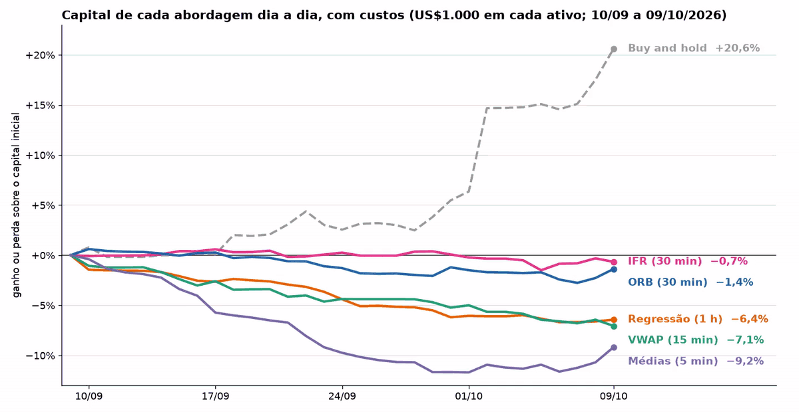

Fonte: gerado pelo Claude (ANTHROPIC, 2026), com dados do Profit Pro (NELOGICA, 2026), do Yahoo Finance (YAHOO FINANCE, 2026b), da Binance (BINANCE, 2026), da Bybit (BYBIT, 2026\) e do HistData (HISTDATA, 2026).

A Figura 39 mostra o capital de cada abordagem dia a dia, somando os nove ativos (oito na VWAP) e já com os custos. A linha tracejada é o *buy and hold*, que subiu principalmente a partir do fim de setembro, com a alta forte da B3. As linhas das estratégias e da regressão ficaram perto de zero ou desceram aos poucos, porque cada operação pagava um custo, e a do cruzamento de médias, que fez 1.359 operações, foi a que mais caiu. No Google Docs, a figura é animada e mostra o mês passando; no PDF e na versão impressa, ela aparece parada, com o resultado final de 09/10/2026.

Tabela 4 – Ganho ou perda de US\$1.000 em cada ativo no teste, com custos (10/09 a 09/10/2026)

| Ativo | ORB | VWAP | IFR | Médias | Regressão | *Buy and hold* |
| :---: | :---: | :---: | :---: | :---: | :---: | :---: |
| EUR/USD | −0,7% | 0% | −1,0% | −1,3% | −2,7% | −3,7% |
| SPY | −1,6% | \+0,0% | \+0,9% | \+0,9% | −1,5% | \+2,6% |
| NQ | \+2,2% | \+1,4% | \+0,8% | \+8,3% | \+3,1% | \+4,7% |
| IBOV | −5,2% | \+2,0% | \+0,7% | −3,5% | \+6,5% | \+12,8% |
| PETR4 | \+4,2% | −0,3% | −0,5% | −9,1% | −5,8% | \+14,6% |
| ITUB4 | −5,8% | −6,7% | −5,3% | −6,5% | −5,4% | \+22,1% |
| BTC/USD | −2,8% | −18,5% | −6,7% | −65,7% | −25,4% | \+5,7% |
| Tesla | −9,6% | \+4,5% | \+3,6% | −14,6% | \+1,9% | \+4,5% |
| MGLU3 | \+6,9% | −39,0% | \+1,6% | \+8,8% | −28,4% | \+122,2% |

Fonte: gerado pelo Claude (ANTHROPIC, 2026), com dados do Profit Pro (NELOGICA, 2026), do Yahoo Finance (YAHOO FINANCE, 2026b), da Binance (BINANCE, 2026), da Bybit (BYBIT, 2026\) e do HistData (HISTDATA, 2026).

Das 44 combinações de abordagem e ativo, 18 terminaram com lucro e 26 com prejuízo. A melhor abordagem mudou de um ativo para outro: a ORB foi a melhor no EUR/USD, na PETR4 e no BTC/USD; o cruzamento de médias, no SPY, no NQ e na MGLU3; a regressão, no IBOV; o IFR, no ITUB4; e a VWAP, na Tesla. Só em três ativos alguma abordagem foi melhor que o *buy and hold*: no EUR/USD, que caiu 3,7% no mês, quatro abordagens perderam menos que isso; no NQ, o cruzamento de médias ganhou 8,3%, contra 4,7%; e na Tesla, a VWAP empatou com o *buy and hold*, com 4,5%.

Figura 40 – Ganho ou perda de US\$1.000 de cada abordagem em cada ativo, com custos (*timeframes*: ORB e IFR de 30 minutos, VWAP de 15 minutos, cruzamento de médias de 5 minutos e regressão de 1 hora; 10/09 a 09/10/2026)

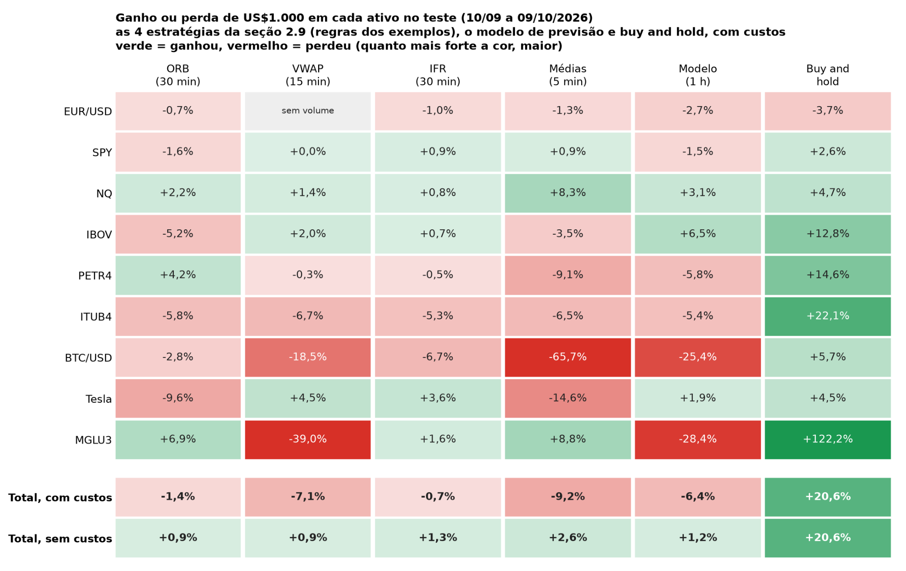

Fonte: gerado pelo Claude (ANTHROPIC, 2026), com dados do Profit Pro (NELOGICA, 2026), do Yahoo Finance (YAHOO FINANCE, 2026b), da Binance (BINANCE, 2026), da Bybit (BYBIT, 2026\) e do HistData (HISTDATA, 2026).

A Figura 40 é um *heatmap* (mapa de calor), uma tabela colorida que reúne o resultado com custos de todas as abordagens em todos os ativos, quanto mais forte o verde, maior o ganho, e quanto mais forte o vermelho, maior a perda. A coluna do *buy and hold* é quase toda verde, enquanto as colunas das estratégias e do modelo têm mais vermelho, principalmente nas linhas do BTC/USD e da MGLU3. Nas duas últimas linhas aparecem os totais, com custos, todas as abordagens que operaram perderam; sem custos, todas ficaram um pouco acima de zero.

Cada estratégia teve um comportamento próprio. A ORB fez 210 operações, cerca de uma por dia em cada ativo, e acertou 34,3% delas; metade das operações terminou no *stop*, e só 15,2% chegaram ao alvo de três faixas, o que mostra que o rompimento da faixa de abertura muitas vezes falha. Os melhores resultados foram na MGLU3 (+6,9%) e na PETR4 (+4,2%), em que a compra de 15/09/2026, mostrada na Figura 33, rendeu 1,56% já com o custo. O pior foi na Tesla (−9,6%), onde a estratégia perdeu quase o mesmo sem custos (−9,4%), ou seja, errou de fato, e não só por causa dos custos.

Figura 41 – Ganho ou perda de US\$1.000 em cada ativo com a ORB, com e sem custos, comparado com o *buy and hold* (*timeframe* de 30 minutos; 10/09 a 09/10/2026)

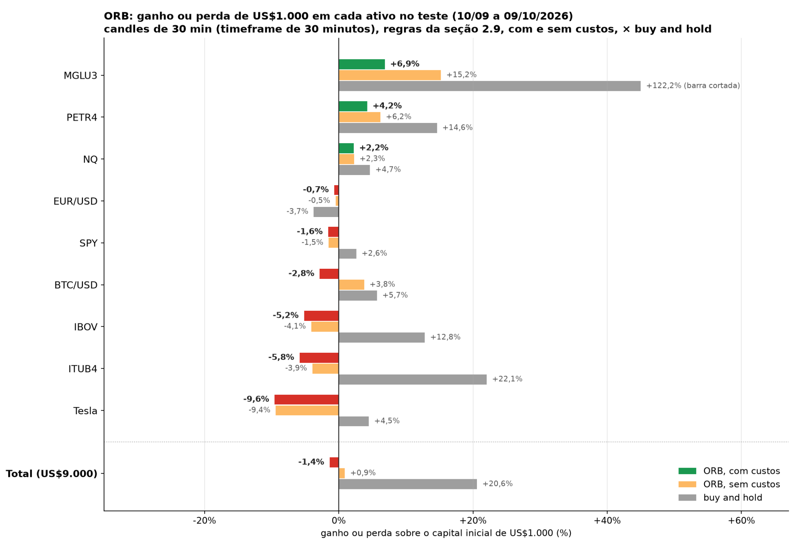

Fonte: gerado pelo Claude (ANTHROPIC, 2026), com dados do Profit Pro (NELOGICA, 2026), do Yahoo Finance (YAHOO FINANCE, 2026b), da Binance (BINANCE, 2026), da Bybit (BYBIT, 2026\) e do HistData (HISTDATA, 2026).

A Figura 41 mostra o resultado da ORB em cada ativo, no mesmo formato da Figura 38: com custos (verde ou vermelho), sem custos (laranja) e o *buy and hold* (cinza). Sem os custos, a ORB teria ganhado em quatro dos nove ativos; com eles, ganhou em três (MGLU3, PETR4 e NQ). Ela só perdeu menos que o *buy and hold* no EUR/USD, que caiu no mês.

A VWAP fez 399 operações e acertou 43,6%. Ela foi bem na Tesla (+4,5%), no IBOV (+2,0%) e no NQ (+1,4%), mas perdeu muito no BTC/USD (−18,5%) e na MGLU3 (−39,0%). No SPY, que é um ativo calmo, o preço quase nunca se afastou 0,6% da VWAP, e a estratégia fez uma única operação no mês.

Figura 42 – Ganho ou perda de US\$1.000 em cada ativo com a VWAP, com e sem custos, comparado com o *buy and hold* (*timeframe* de 15 minutos; 10/09 a 09/10/2026)

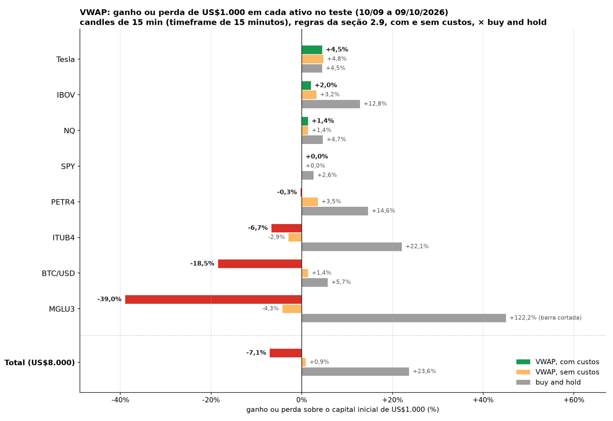

Fonte: gerado pelo Claude (ANTHROPIC, 2026), com dados do Profit Pro (NELOGICA, 2026), do Yahoo Finance (YAHOO FINANCE, 2026b), da Binance (BINANCE, 2026), da Bybit (BYBIT, 2026\) e do HistData (HISTDATA, 2026).

A Figura 42 mostra o resultado da VWAP em cada ativo, no mesmo formato. O EUR/USD não aparece, porque não tem volume; por isso, o total do *buy and hold* neste gráfico é de 23,6%, e não de 20,6%. Sem os custos, a VWAP teria ganhado em seis dos oito ativos; com eles, ganhou em quatro (Tesla, IBOV, NQ e SPY, este com quase zero). A maior diferença aparece no BTC/USD: sem custos, \+1,4%; com custos, −18,5%, porque foram 99 operações. Na MGLU3, a VWAP perdeu até sem os custos (−4,3%), e com eles a perda chegou a 39,0%.

O IFR foi a estratégia que operou menos (153 operações) e a que menos perdeu (−0,7%), com acerto de 49,7%. Seus melhores resultados foram na Tesla (+3,6%) e na MGLU3 (+1,6%), e os piores, no BTC/USD (−6,7%) e no ITUB4 (−5,3%). Um dia do BTC/USD mostra os dois lados da estratégia: em 11/09/2026, uma venda com o IFR acima de 70 bateu o *stop* e perdeu 1,22% com o custo, e, uma hora e meia depois, outra venda saiu no alvo, com o IFR de volta a 50, e ganhou 1,70%.

Figura 43 – Ganho ou perda de US\$1.000 em cada ativo com o IFR, com e sem custos, comparado com o *buy and hold* (*timeframe* de 30 minutos; 10/09 a 09/10/2026)

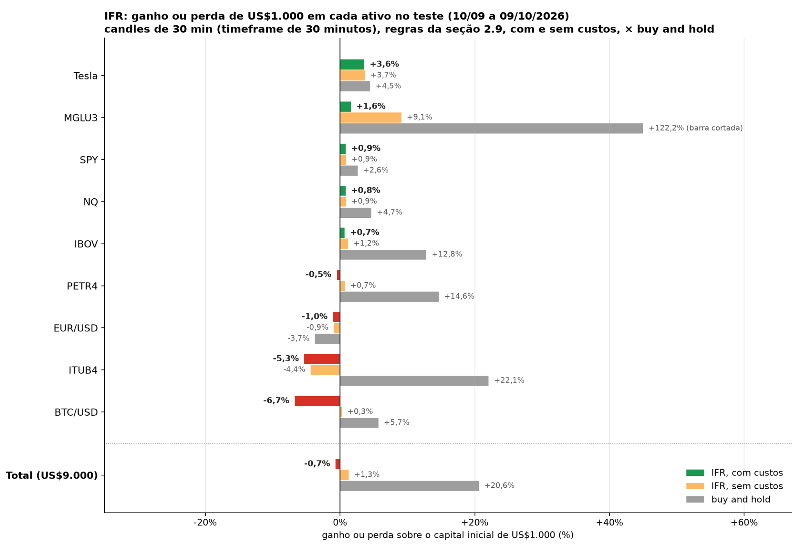

Fonte: gerado pelo Claude (ANTHROPIC, 2026), com dados do Profit Pro (NELOGICA, 2026), do Yahoo Finance (YAHOO FINANCE, 2026b), da Binance (BINANCE, 2026), da Bybit (BYBIT, 2026\) e do HistData (HISTDATA, 2026).

A Figura 43 mostra o resultado do IFR em cada ativo. As barras são as menores entre as quatro estratégias, porque o IFR operou pouco, de 10 a 33 vezes por ativo no mês. Sem os custos, ele teria ganhado em sete dos nove ativos; com eles, ganhou em cinco (Tesla, MGLU3, SPY, NQ e IBOV). Ele só perdeu menos que o *buy and hold* no EUR/USD.

O cruzamento de médias foi a estratégia que mais operou (1.359 operações) e a que mais perdeu (−9,2%). O acerto foi de só 25,7%, mas o *payoff* foi de 1,70: como ela segue a tendência, perde pouco sucessivamente, quando o preço vai e volta, e ganha bastante poucas vezes, quando o preço anda numa direção só. Ela teve o melhor resultado de todo o teste, no NQ (+8,3%), e também o pior, no BTC/USD (−65,7%).

Figura 44 – Ganho ou perda de US\$1.000 em cada ativo com o cruzamento de médias, com e sem custos, comparado com o *buy and hold* (*timeframe* de 5 minutos; 10/09 a 09/10/2026)

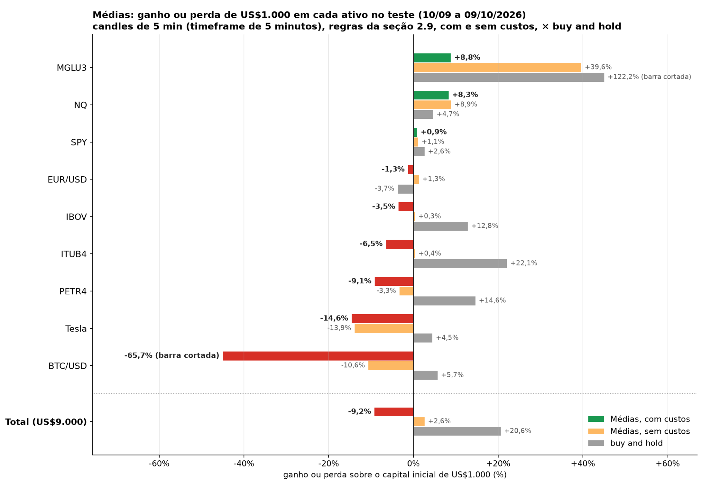

Fonte: gerado pelo Claude (ANTHROPIC, 2026), com dados do Profit Pro (NELOGICA, 2026), do Yahoo Finance (YAHOO FINANCE, 2026b), da Binance (BINANCE, 2026), da Bybit (BYBIT, 2026\) e do HistData (HISTDATA, 2026).

A Figura 44 mostra o resultado do cruzamento de médias em cada ativo. Nele, a diferença entre as barras com e sem custos é a maior de todas, porque foram 1.359 operações. Sem os custos, ele teria ganhado em seis dos nove ativos, e na MGLU3 chegaria a \+39,6%; com eles, ganhou em três (MGLU3, NQ e SPY), e no BTC/USD a perda foi de 65,7%. No NQ, ele ganhou do *buy and hold*: \+8,3%, contra \+4,7%.

O fator que mais explica esses resultados é o custo. Em todas as abordagens, o ganho médio de cada operação antes do custo foi positivo, mas menor que o custo médio (Tabela 3): no IFR, por exemplo, cada operação ganhava em média 0,079% e pagava 0,114%, e na VWAP o custo foi quase dez vezes maior que o ganho. É como uma loja que tem lucro em cada produto, mas paga um frete maior que esse lucro: quanto mais vende, mais perde. Por isso, as combinações que operaram mais perderam mais: as que fizeram até 30 operações no mês terminaram, em média, com −0,4%; as que fizeram de 31 a 100, com −4,4%; e as que fizeram mais de 100, com −17,2%. O caso mais extremo foi o cruzamento de médias no BTC/USD, em que 435 operações, cada uma custando 0,22%, levaram a conta de US\$1.000 para US\$342,74. O que pesa é a soma dos custos: no NQ, o cruzamento de médias também fez muitas operações (211), mas cada uma custava só 0,003%, e ele terminou com lucro.

O tipo de mercado também influenciou o resultado, como foi discutido na seção 1.7.5. O mês de teste foi de alta forte na B3: o IBOV subiu 12,8%, e a MGLU3, 122,2%. Na MGLU3, as estratégias que seguem a tendência ganharam (ORB \+6,9% e médias \+8,8%), enquanto a VWAP, que aposta na volta do preço para a média, perdeu 39,0%: a cada vez que o preço subia 0,6% acima da VWAP, ela vendia, mas o preço continuava subindo e batia o *stop*. Só em 10/09/2026 foram quatro vendas seguidas no *stop*, e no mês inteiro ela acertou só 29,6% das 135 operações na MGLU3. Somando todos os ativos, sem os custos, as estratégias que seguem a tendência (+1,8%) foram um pouco melhores que as que apostam na volta (+1,1%).

É muito importante ressaltar que no mês da simulação, os ativos da bolsa brasileira passaram por um período de mercado direcional, ou seja, um mercado em que o preço anda com força em uma só direção, neste caso a de alta, em vez de ficar lateral, subindo e descendo dentro de uma faixa. Esse mês fica inteiro dentro da última fase de alta do Ibovespa mostrada na Figura 21 (seção 1.7.5), que vai de agosto a outubro de 2026\. No teste, o IBOV subiu 12,8%, a PETR4, 14,6%, o ITUB4, 22,1%, e a MGLU3, 122,2%, enquanto os ativos de fora da B3 variaram de −3,7% (EUR/USD) a \+5,7% (BTC/USD). Em um mercado assim, quem compra e espera fica com quase toda a alta, e quem faz *day trade* precisa fechar a posição no fim de cada dia e pagar o custo de entrar de novo no dia seguinte. Por isso, nos quatro ativos da B3, o *buy and hold* ganhou de todas as abordagens testadas. Os resultados da simulação nos ativos brasileiros, portanto, refletem esse momento de tendência forte e podem ser bem diferentes em um mês de mercado lateral ou de queda.

A volatilidade fez diferença no tamanho dos resultados. Nos três ativos mais calmos (EUR/USD, SPY e NQ), todos os resultados ficaram entre −2,7% e \+8,3%; nos três mais voláteis (BTC/USD, Tesla e MGLU3), foram de −65,7% a \+8,8%, e foi neles que aparecem todos os *drawdowns* maiores que 30%. Como foi visto na seção 2.7, recuperar uma queda exige um ganho maior que ela: depois do *drawdown* de 65,7% do cruzamento de médias no BTC/USD, a conta precisaria ganhar 191,8% só para voltar aos US\$1.000.

Os resultados também mostram que a taxa de acerto sozinha não diz se uma estratégia ganha, como foi visto na seção 2.4. A VWAP no NQ teve *payoff* de 0,59, o que exigia um acerto mínimo de 62,9%; ela acertou 72,2% e ganhou. O cruzamento de médias no NQ teve *payoff* de 2,37, e o acerto mínimo era de só 29,7%; ele acertou 39,3% e também ganhou. Já a ORB na Tesla teve *payoff* de 0,47, que exigia 68,0% de acerto, mas acertou só 32,1% e perdeu.

Para saber se algum resultado positivo mostra uma vantagem real, foi usada a margem de erro da seção 2.6. Das 43 combinações com mais de uma operação, só uma teve a faixa da esperança inteira acima de zero: o cruzamento de médias no NQ, com esperança de \+0,038% por operação e faixa de 0,000% a 0,076%, exatamente no limite. Com tantos testes, encontrar uma combinação no limite é o que se espera do acaso, como alerta Bailey et al. (2014). Por outro lado, sete combinações tiveram a faixa inteira abaixo de zero, ou seja, perderam de forma consistente: a ORB na Tesla, a VWAP no BTC/USD e na MGLU3, o IFR no ITUB4, o cruzamento de médias no BTC/USD e na Tesla, e a regressão no BTC/USD.

A regressão linear e as estratégias têm origens diferentes: a regressão é uma conta cujos pesos o computador escolheu no treino, e as estratégias são regras criadas por pessoas a partir de indicadores do gráfico. Mesmo assim, nenhuma previu muito melhor que a outra. A regressão teve lucro em 46,2% das operações, e o IFR, a estratégia que mais acertou, em 49,7%, os dois perto dos 50% de uma moeda. O que fez o IFR e a ORB perderem menos que a regressão não foi prever melhor, e sim operar menos: 153 e 210 operações, contra 995\.

O *buy and hold* foi a melhor alternativa neste mês porque a maioria dos ativos subiu, mas isso depende da direção do mercado: no EUR/USD, que caiu, o *buy and hold* perdeu 3,7%, mais do que todas as abordagens. Juntando todos os resultados, nenhuma abordagem, nem as estratégias de análise técnica nem a regressão linear, conseguiu ganhar de forma consistente depois dos custos. Antes dos custos, todas ficaram perto de zero, o que é compatível com a hipótese do mercado eficiente de Fama (1970): se os preços passados já não ajudam a prever os próximos, nenhuma regra baseada só neles deveria ganhar muito, e os custos transformam esse quase zero em prejuízo.

Esses resultados valem para as condições testadas: um único mês de teste, que na B3 foi de mercado direcional de alta, uma única versão de cada estratégia, com os números dos exemplos da seção 2.9, e o capital inteiro em cada operação. Os ativos em reais e o NQ foram simulados em porcentagem, o EUR/USD ficou sem a VWAP, e a fonte de dados do EUR/USD não tem a sexta-feira, 25/09/2026. Outro período, outras versões das estratégias ou um controle do risco de cada operação poderiam levar a resultados diferentes.

# **4 CONCLUSÃO**

O presente trabalho buscou saber se a matemática aplicada no *day trade* ajuda ou não a ter lucros consistentes no mercado financeiro. Quatro estratégias e uma de regressão linear foram testadas em regras de computador, todas feitas em Python, e foram testadas com custo, sem custo e o *buy and hold*. Nenhuma das estratégias obteve uma vantagem estatística e matemática, pois os dados utilizados para a pesquisa são muito curtos para um *backtest* e depois replicar 30 dias no OOS. Além disso, a regressão linear foi treinada em uma amostra muito pequena (IS), e, no período de teste (OOS), a grande maioria dos ativos subiu, mas no mercado existem períodos de lateralização, de alta e de baixa e as estratégias não foram testadas em outros períodos de mercado apenas com dados coletados.

Os custos foram uma pista importante para isso. Um exemplo é o cruzamento de médias móveis que fez mais de 1.000 operações no *timeframe* de 5 minutos e, se não tivesse custos, a estratégia no período de OOS teria ficado positiva, mas com os custos incluídos a estratégia passou a ser negativa.

No trabalho foram calculados a taxa de acerto, o *payoff*, a esperança matemática, a margem de erro e o *drawdown* utilizando o Claude Code em um programa de Python.

Nos trabalhos futuros sobre esse tema, serão utilizados mais anos de dados e meses incluindo os períodos de alta, baixa e lateralização, testar mais estratégias para colocar no IS e replicar no OOS (com uma amostra bem maior), testar outros modelos matemáticos, usar corretoras com menores custos.

Nesta pesquisa, aprendeu-se a utilizar Python para fazer cálculos matemáticos e fazer gráficos, temas de matemática e estatística complexos, analisar gráficos de forma técnica e fundamentalista, como funcionam as estratégias que foram utilizadas no trabalho, como a economia impacta o mercado financeiro, a obtenção de dados por diferentes plataformas e entre vários outros assuntos.

# **REFERÊNCIAS**

ANTHROPIC. **Claude Opus 5.5**. \[S. l.\]: Anthropic, 2026\. Modelo de linguagem de inteligência artificial. Disponível em: https\://claude.ai. Acesso em: 27 out. 2026\.

B3. **Conheça diferentes estratégias de day trade e suas diferenças na hora de operar.** Bora Investir, \[s.d.\]. Disponível em: [https\://borainvestir.b3.com.br/tipos-de-investimentos/renda-variavel/day-trade/conheca-diferentes-estrategias-de-day-trade-e-suas-diferencas-na-hora-de-operar/](https://borainvestir.b3.com.br/tipos-de-investimentos/renda-variavel/day-trade/conheca-diferentes-estrategias-de-day-trade-e-suas-diferencas-na-hora-de-operar/). Acesso em: 29 set. 2026\.

B3. **Volatilidade**: o que é, significado e definição. Bora Investir, 22 jun. 2023\. Disponível em: [https\://borainvestir.b3.com.br/glossario/volatilidade/](https://borainvestir.b3.com.br/glossario/volatilidade/). Acesso em: 7 out. 2026\.

B3. **Conheça 5 indicadores técnicos para operar no Day Trade.** Bora Investir, 17 jan. 2025\. Disponível em: [https\://borainvestir.b3.com.br/tipos-de-investimentos/renda-variavel/day-trade/conheca-5-indicadores-tecnicos-para-operar-no-day-trade/](https://borainvestir.b3.com.br/tipos-de-investimentos/renda-variavel/day-trade/conheca-5-indicadores-tecnicos-para-operar-no-day-trade/). Acesso em: 8 out. 2026\.

BAILEY, David H.; BORWEIN, Jonathan M.; LÓPEZ DE PRADO, Marcos; ZHU, Qiji Jim. Pseudo-mathematics and financial charlatanism: the effects of backtest overfitting on out-of-sample performance. **Notices of the American Mathematical Society**, v. 61, n. 5, p. 458-471, 2014\. DOI: [https\://doi.org/10.1090/noti1105](https://doi.org/10.1090/noti1105).

BANCO CENTRAL DO BRASIL. **Sistema Gerenciador de Séries Temporais (SGS)**: séries 432, 3698, 5793, 7326, 13522 e 13762\. Brasília, 2026\. Disponível em: [https\://www3.bcb.gov.br/sgspub/](https://www3.bcb.gov.br/sgspub/). Acesso em: 19 out. 2026\.

BERKOWITZ, Stephen A.; LOGUE, Dennis E.; NOSER, Eugene A. The total cost of transactions on the NYSE. **The Journal of Finance**, v. 43, n. 1, p. 97-112, 1988\. DOI: https\://doi.org/10.1111/j.1540-6261.1988.tb02591.x.

BERNANKE, Ben S.; KUTTNER, Kenneth N. What explains the stock market's reaction to Federal Reserve policy? **The Journal of Finance**, v. 60, n. 3, p. 1221-1257, 2005\. DOI: [https\://doi.org/10.1111/j.1540-6261.2005.00760.x](https://doi.org/10.1111/j.1540-6261.2005.00760.x).

BINANCE. **Spot REST API**: market data endpoints (candles do par BTCUSDT). \[S. l.\], 2026\. Disponível em: [https\://developers.binance.com/docs/binance-spot-api-docs/rest-api/market-data-endpoints](https://developers.binance.com/docs/binance-spot-api-docs/rest-api/market-data-endpoints). Acesso em: 11 out. 2026\.

BROCK, William; LAKONISHOK, Josef; LEBARON, Blake. Simple technical trading rules and the stochastic properties of stock returns. **The Journal of Finance**, v. 47, n. 5, p. 1731-1764, 1992\. DOI: https\://doi.org/10.1111/j.1540-6261.1992.tb04681.x.

BYBIT. **Bybit API v5**: get kline (candles do contrato TSLAUSDT). \[S. l.\], 2026\. Disponível em: [https\://bybit-exchange.github.io/docs/v5/market/kline](https://bybit-exchange.github.io/docs/v5/market/kline). Acesso em: 11 out. 2026\.

CBOE GLOBAL INDICES. **Cboe Volatility Index**: methodology. \[S. l.\]: Cboe, 2026\. Disponível em: https\://cdn.cboe.com/resources/indices/Volatility\_Index\_Methodology\_Cboe\_Volatility\_Index.pdf. Acesso em: 19 out. 2026\.  
CHAGUE, Fernando; DE-LOSSO, Rodrigo; GIOVANNETTI, Bruno. **Day trading for a living?** São Paulo: FEA-USP, 2019\. (Working Paper Series, n. 2019-47). Disponível em: [https\://ideas.repec.org/p/spa/wpaper/2019wpecon47.html](https://ideas.repec.org/p/spa/wpaper/2019wpecon47.html). Acesso em: 29 set. 2026\.

CHAN, Ernest P. **Quantitative trading**: how to build your own algorithmic trading business. 2\. ed. Hoboken: Wiley, 2021\.

CME GROUP. **E-mini Nasdaq-100 futures**: contract specs. Chicago: CME Group, 2026\. Disponível em: [https\://www\.cmegroup.com/markets/equities/nasdaq/e-mini-nasdaq-100.contractSpecs.html](https://www.cmegroup.com/markets/equities/nasdaq/e-mini-nasdaq-100.contractSpecs.html). Acesso em: 11 out. 2026\.

COATES, John M.; HERBERT, Joe. Endogenous steroids and financial risk taking on a London trading floor. **Proceedings of the National Academy of Sciences**, v. 105, n. 16, p. 6167-6172, 2008\. DOI: [https\://doi.org/10.1073/pnas.0704025105](https://doi.org/10.1073/pnas.0704025105). 

CVM. **O mercado de valores mobiliários brasileiro**. 5\. ed. Rio de Janeiro: CVM, 2024\.

DESMOS. **Desmos**: calculadora gráfica on-line. \[S. l.\]: Desmos Studio, 2026\. Disponível em: [https\://www\.desmos.com/calculator?lang=pt-BR](https://www.desmos.com/calculator?lang=pt-BR). Acesso em: 19 out. 2026\.

ENCYCLOPAEDIA BRITANNICA. **2026 Iran war**. Chicago: Encyclopaedia Britannica, 2026\. Disponível em: [https\://www\.britannica.com/event/2026-Iran-war](https://www.britannica.com/event/2026-Iran-war). Acesso em: 19 out. 2026\.

FAMA, Eugene F. Efficient capital markets: a review of theory and empirical work. **The Journal of Finance**, v. 25, n. 2, p. 383-417, 1970\. DOI: [https\://doi.org/10.2307/2325486](https://doi.org/10.2307/2325486).

FEDERAL RESERVE BANK OF ST. LOUIS. **FRED Economic Data**. St. Louis, 2026\. Disponível em: [https\://fred.stlouisfed.org/](https://fred.stlouisfed.org/). Acesso em: 29 set. 2026\.

FURLAN, Letícia. B3 aciona *circuit breaker* pela primeira vez desde 2020 após reeleição de Lula. **Exame**, São Paulo, 26 out. 2026\. Disponível em: https\://exame.com/invest/mercados/b3-aciona-circuit-breaker-pela-primeira-vez-desde-2020-apos-reeleicao-de-lula/. Acesso em: 27 out. 2026\.  
HISTDATA. **Download free forex data**: dados de 1 minuto de EUR/USD e dos índices S\&P 500 e Nasdaq-100 (CFD). \[S. l.\], 2026\. Disponível em: [https\://www\.histdata.com/download-free-forex-data/](https://www.histdata.com/download-free-forex-data/). Acesso em: 11 out. 2026\.

INTERNATIONAL MONETARY FUND. Advances in artificial intelligence: implications for capital market activities. In: INTERNATIONAL MONETARY FUND. **Global financial stability report**: steadying the course: uncertainty, artificial intelligence, and financial stability. Washington, DC: IMF, 2024\. cap. 3\. Disponível em: [https\://www\.imf.org/en/publications/gfsr/issues/2024/10/22/global-financial-stability-report-october-2024](https://www.imf.org/en/publications/gfsr/issues/2024/10/22/global-financial-stability-report-october-2024). Acesso em: 7 out. 2026\.

LISTER, Tim. Os impactos do fechamento de Ormuz se intensificarão, dizem analistas. **CNN Brasil**, São Paulo, 2 maio 2026\. Disponível em: [https\://www\.cnnbrasil.com.br/internacional/impactos-do-fechamento-de-ormuz-se-intensificarao-dizem-analistas/](https://www.cnnbrasil.com.br/internacional/impactos-do-fechamento-de-ormuz-se-intensificarao-dizem-analistas/). Acesso em: 19 out. 2026\.

LO, Andrew W.; REPIN, Dmitry V.; STEENBARGER, Brett N. Fear and greed in financial markets: a clinical study of day-traders. **American Economic Review**, v. 95, n. 2, p. 352-359, 2005\. DOI: [https\://doi.org/10.1257/000282805774670095](https://doi.org/10.1257/000282805774670095). 

MANKIW, N. Gregory. **Introdução à economia**. Tradução de Allan Vidigal Hastings. São Paulo: Pioneira Thomson Learning, 2005\.

MURPHY, John J. **Technical analysis of the financial markets**: a comprehensive guide to trading methods and applications. New York: New York Institute of Finance, 1999\.

NAKAMOTO, Satoshi. **Bitcoin**: a peer-to-peer electronic cash system. \[S. l.\], 2008\. Disponível em: [https\://bitcoin.org/bitcoin.pdf](https://bitcoin.org/bitcoin.pdf). Acesso em: 7 out. 2026\.

NELOGICA. **Profit Pro**: plataforma de análise gráfica e negociação. \[S. l.\]: Nelogica, 2026\. Disponível em: [https\://www\.nelogica.com.br/produtos/profit-pro](https://www.nelogica.com.br/produtos/profit-pro). Acesso em: 12 out. 2026\.

ODEAN, Terrance. Are investors reluctant to realize their losses? **The Journal of Finance**, v. 53, n. 5, p. 1775-1798, 1998\. DOI: [https\://doi.org/10.1111/0022-1082.00072](https://doi.org/10.1111/0022-1082.00072). 

RODRIGUES, Natalia. **Drawdown**: saiba como funciona esse indicador, interpretação e cálculo. CM Capital, 9 dez. 2025\. Disponível em: [https\://cmcapital.com.br/blog/drawdown/](https://cmcapital.com.br/blog/drawdown/). Acesso em: 10 out. 2026\.

ROSS, Sheldon. **A first course in probability**. 8\. ed. Upper Saddle River: Pearson Prentice Hall, 2009\.

STATISTA. **Comparison of the New York Stock Exchange (NYSE) and Nasdaq from January 2018 to June 2026, by market capitalization of listed companies**. Hamburg: Statista, 2026\. Dados da World Federation of Exchanges. Disponível em: [https\://www\.statista.com/statistics/1277195/nyse-nasdaq-comparison-market-capitalization-listed-companies/](https://www.statista.com/statistics/1277195/nyse-nasdaq-comparison-market-capitalization-listed-companies/). Acesso em: 7 out. 2026\.

TVERSKY, Amos; KAHNEMAN, Daniel. Advances in prospect theory: cumulative representation of uncertainty. **Journal of Risk and Uncertainty**, v. 5, n. 4, p. 297-323, 1992\. DOI: [https\://doi.org/10.1007/BF00122574](https://doi.org/10.1007/BF00122574).

WHALEY, Robert E. The investor fear gauge. **Journal of Portfolio Management**, v. 26, n. 3, p. 12-17, 2000\. DOI: 10.3905/jpm.2000.319728.

WILDER JR., J. Welles. **New concepts in technical trading systems**. Greensboro: Trend Research, 1978\.

YAHOO FINANCE. **NVIDIA Corporation (NVDA)**: cotação e histórico de preços. \[S. l.\], 2026a. Disponível em: [https\://finance.yahoo.com/quote/NVDA/](https://finance.yahoo.com/quote/NVDA/). Acesso em: 29 set. 2026\.

YAHOO FINANCE. **Yahoo Finance**: cotações históricas. \[S. l.\], 2026b. Disponível em: [https\://finance.yahoo.com/](https://finance.yahoo.com/). Acesso em: 29 set. 2026\.

ZARATTINI, Carlo; BARBON, Andrea; AZIZ, Andrew. **A profitable day trading strategy for the U.S. equity market**. Swiss Finance Institute Research Paper, n. 24-98, 2024\. DOI: [https\://doi.org/10.2139/ssrn.4729284](https://doi.org/10.2139/ssrn.4729284). Acesso em: 31 out. 2026\.

# **APÊNDICE A – CÓDIGO DAS ESTRATÉGIAS**

Este apêndice mostra o código em Python que transformou as regras das quatro estratégias (seção 2.9 e Quadro 1\) em um programa de computador. A simulação foi dividida em seis programas, escritos em Python 3.14:

* dados.py: abre os *candles* de cada ativo, acerta o fuso horário de cada mercado e separa o treino (12/07 a 09/09/2026) e o teste (10/09 a 09/10/2026);  
* custos.py: calcula o custo de cada operação, com corretagem, taxas e *slippage*;  
* metricas.py: calcula a taxa de acerto, o *payoff*, a esperança matemática, a margem de erro e o *drawdown*;  
* estrategias.py: simula as quatro estratégias no mês de teste, com US\$1.000 em cada ativo;  
* previsao.py: treina a regressão linear e faz as previsões de cada hora;  
* simulacao.py: simula as operações da regressão linear, também com US\$1.000 em cada ativo.

A seguir está a parte principal do programa estrategias.py: o cálculo dos indicadores (VWAP, IFR e médias móveis) e as regras de entrada e saída de cada estratégia. As linhas que começam com \# e os textos entre aspas triplas são comentários, que explicam o que cada parte faz e não são executados pelo computador. As outras partes do programa, que leem os dados, juntam os resultados e fazem os gráficos, não foram incluídas para o apêndice não ficar longo.

```python
# ---------------------------------------- os dados e os indicadores
def volume_do_yahoo(ativo):
    """SPY e NQ: o HistData não tem volume; usa o volume do Yahoo
    (15 min), que existe só no mês de teste."""
    y = pd.read_csv(
        TCC / "Dados do Yahoo Finance" / ativo / f"{ativo}_15min.csv"
    )
    y["Data"] = pd.to_datetime(y["Data"], utc=True).dt.tz_convert(FUSO[ativo])
    return y.set_index("Data")["Volume"]

def candles_do_teste(ativo, estrategia):
    """Abre os candles, calcula o indicador da estratégia com todo o
    histórico e devolve só o mês de teste."""
    c = carregar(ativo, TIMEFRAME[estrategia]).copy()
    if estrategia == "VWAP":
        if ativo == "EURUSD":
            # câmbio não tem volume centralizado: não há VWAP
            return None
        if ativo in ("SPY", "NQ"):
            c["Volume"] = volume_do_yahoo(ativo).reindex(c.index).fillna(0)
        # preço típico, como na Figura 34
        tipico = (c["High"] + c["Low"] + c["Close"]) / 3
        soma_pv = (tipico * c["Volume"]).groupby(c["dia"]).cumsum()
        soma_v = c["Volume"].groupby(c["dia"]).cumsum()
        # recomeça todo dia
        c["vwap"] = (soma_pv / soma_v).where(soma_v > 0)
    if estrategia == "IFR":
        variacao = c["Close"].diff()
        altas = variacao.clip(lower=0).ewm(alpha=1 / 14, adjust=False).mean()
        quedas = (
            (-variacao.clip(upper=0)).ewm(alpha=1 / 14, adjust=False).mean()
        )
        c["ifr"] = 100 - 100 / (1 + altas / quedas)
    if estrategia == "Médias":
        c["acima"] = (
            c["Close"].ewm(span=9, adjust=False).mean()
            > c["Close"].ewm(span=21, adjust=False).mean()
        )
    _, teste = treino_e_teste(c)
    return teste

# ---------------------------------------- peças iguais para as 4 estratégias
def bateu(lado, k, stop, alvo):
    """Stop e alvo dentro do candle, pela máxima e pela mínima.
    Os dois no mesmo candle: conta o stop.
    Se o candle já abre depois do nível (gap), sai na abertura."""
    if lado == "compra":
        if stop is not None and k.Low <= stop:
            return min(k.Open, stop), "stop"
        if alvo is not None and k.High >= alvo:
            return max(k.Open, alvo), "alvo"
    else:
        if stop is not None and k.High >= stop:
            return max(k.Open, stop), "stop"
        if alvo is not None and k.Low <= alvo:
            return min(k.Open, alvo), "alvo"
    return None

def abrir(lado, preco, k, i, stop, alvo=None):
    return {"lado": lado, "entrada": preco, "hora_entrada": k.Index,
            "i": i, "stop": stop, "alvo": alvo}

def fechar(op, preco, motivo, k, ativo, timeframe):
    """Fecha a operação: resultado = retorno − custo, em %."""
    custo = custo_percentual(ativo, op["entrada"], timeframe)
    if op["lado"] == "compra":
        retorno = (preco - op["entrada"]) / op["entrada"] * 100
    else:
        retorno = (op["entrada"] - preco) / op["entrada"] * 100
    return {"lado": op["lado"], "hora_entrada": op["hora_entrada"],
            "entrada": op["entrada"], "hora_saida": k.Index,
            "saida": preco, "motivo": motivo, "custo": custo,
            "sem_custo": retorno, "resultado": retorno - custo}

# ---------------------------------------- as 4 estratégias, um dia por vez
def orb(dia, ativo, tf):
    ops, aberta, operou = [], None, False
    # a faixa de abertura: o 1º candle do dia
    maxima, minima = dia[0].High, dia[0].Low
    faixa = maxima - minima
    if faixa <= 0:
        return ops
    for i, k in enumerate(dia[1:], start=1):
        if aberta is None and not operou and i < len(dia) - 1:
            sobe, desce = k.High > maxima, k.Low < minima
            if sobe or desce:
                # rompeu os dois lados no mesmo candle:
                # vale o lado mais perto da abertura
                if sobe and desce:
                    sobe = abs(k.Open - maxima) <= abs(k.Open - minima)
                lado = "compra" if sobe else "venda"
                preco = max(k.Open, maxima) if sobe else min(k.Open, minima)
                alvo = preco + 3 * faixa if sobe else preco - 3 * faixa
                stop = minima if sobe else maxima
                aberta, operou = abrir(lado, preco, k, i, stop, alvo), True
                # no candle da entrada, só o stop (o caso pior)
                saida = bateu(lado, k, aberta["stop"], None)
                if saida:
                    ops.append(fechar(aberta, *saida, k, ativo, tf))
                    aberta = None
                continue
        if aberta is not None:
            saida = bateu(aberta["lado"], k, aberta["stop"], aberta["alvo"])
            if saida:
                ops.append(fechar(aberta, *saida, k, ativo, tf))
                aberta = None
    if aberta is not None:
        ops.append(fechar(aberta, dia[-1].Close, "fim do dia", dia[-1],
                          ativo, tf))
    return ops

def vwap(dia, ativo, tf):
    ops, aberta = [], None
    for i, k in enumerate(dia):
        saiu = False
        if aberta is not None and i > aberta["i"]:
            # a VWAP que já era conhecida quando o candle começou
            alvo = dia[i - 1].vwap
            saida = bateu(aberta["lado"], k, aberta["stop"], alvo)
            if saida:
                ops.append(fechar(aberta, *saida, k, ativo, tf))
                aberta, saiu = None, True
        if (aberta is None and not saiu and i < len(dia) - 1
                and not np.isnan(k.vwap)):
            distancia = k.Close / k.vwap - 1
            if distancia >= 0.006:
                aberta = abrir("venda", k.Close, k, i, k.Close * 1.006)
            elif distancia <= -0.006:
                aberta = abrir("compra", k.Close, k, i, k.Close * 0.994)
    if aberta is not None:
        ops.append(fechar(aberta, dia[-1].Close, "fim do dia", dia[-1],
                          ativo, tf))
    return ops

def ifr(dia, ativo, tf):
    ops, aberta = [], None
    for i, k in enumerate(dia):
        saiu = False
        if aberta is not None and i > aberta["i"]:
            saida = bateu(aberta["lado"], k, aberta["stop"], None)
            if saida is None and (
                    (aberta["lado"] == "compra" and k.ifr >= 50)
                    or (aberta["lado"] == "venda" and k.ifr <= 50)):
                saida = (k.Close, "alvo (IFR voltou a 50)")
            if saida:
                ops.append(fechar(aberta, *saida, k, ativo, tf))
                aberta, saiu = None, True
        if aberta is None and not saiu and i < len(dia) - 1:
            if k.ifr <= 30:
                aberta = abrir("compra", k.Close, k, i, k.Close * 0.99)
            elif k.ifr >= 70:
                aberta = abrir("venda", k.Close, k, i, k.Close * 1.01)
    if aberta is not None:
        ops.append(fechar(aberta, dia[-1].Close, "fim do dia", dia[-1],
                          ativo, tf))
    return ops

def medias(dia, ativo, tf):
    ops, aberta = [], None
    for i, k in enumerate(dia):
        if aberta is not None and i > aberta["i"]:
            saida = bateu(aberta["lado"], k, aberta["stop"], None)
            if saida:
                ops.append(fechar(aberta, *saida, k, ativo, tf))
                aberta = None
        # as médias cruzaram neste candle
        if i > 0 and k.acima != dia[i - 1].acima and i < len(dia) - 1:
            lado = "compra" if k.acima else "venda"
            # cruzamento contrário: vira a mão
            if aberta is not None and aberta["lado"] != lado:
                ops.append(fechar(aberta, k.Close, "cruzamento contrário",
                                  k, ativo, tf))
                aberta = None
            if aberta is None:
                stop = k.Close * (0.985 if lado == "compra" else 1.015)
                aberta = abrir(lado, k.Close, k, i, stop)
    if aberta is not None:
        ops.append(fechar(aberta, dia[-1].Close, "fim do dia", dia[-1],
                          ativo, tf))
    return ops

REGRA = {"ORB": orb, "VWAP": vwap, "IFR": ifr, "Médias": medias}
```

# **APÊNDICE B – GLOSSÁRIO**

**Alavancagem:** Quando a corretora permite operar com um valor muito maior do que você tem na sua conta.

**Alvo:** No *day trade*, o alvo é uma ordem de compra ou venda lucrativa: quando o preço chega nela, a operação é fechada com lucro.

**Análise técnica:** É um método usado para prever o movimento futuro dos preços com base no estudo de dados do passado.

**_Backtest_:** Usa-se uma estratégia para operar em dados do passado e ver o relatório e o desempenho dela nesse determinado período.

**_Buy and hold_:** É o ato de comprar e segurar, ou seja, o *trader* só compra e espera por um determinado tempo.

**_Candle_:** Traduzindo, é uma vela. É o tipo de gráfico mais usado no mundo, o gráfico de *candles*. Cada *candle* mostra a abertura, a máxima, a mínima e o fechamento do preço em um período.

**_Circuit breaker_:** Um *circuit breaker* é quando há uma forte queda na bolsa e as negociações precisam parar por um determinado tempo, dependendo de quantos por cento o índice está caindo no dia. Na B3, quando o Ibovespa cai 10%, a parada é de 30 minutos (seção 1.7.5).

**_Day trade_:** É o ato de comprar e vender ativos no mesmo dia.

**_Drawdown_:** É um período de queda do capital, do pico até o ponto mais baixo depois dele.

**Esperança matemática:** A esperança matemática é usada para responder se, ao repetir uma estratégia milhares de vezes, no final ela perde ou ganha.

**Margem de erro:** Ela diz o quanto a média das operações pode estar errada só por sorte e, quanto mais operações, menor ela fica.

**Média móvel:** A média móvel é um indicador que faz cálculos matemáticos do preço para identificar uma tendência do ativo em um determinado *timeframe*.

**_Overfitting_:** O *overfitting* é quando se alinha a estratégia perfeitamente aos dados do passado. Consequentemente, ela ganha no IS, mas, replicando no OOS, ela não tem o mesmo desempenho que teve nos dados passados que foram testados.

**_Payoff_:** O *payoff* mede a relação entre o lucro médio e a perda média.

**Regressão linear:** É um modelo matemático e estatístico que faz previsões de preço do ativo.

**Reversão à média:** A reversão à média é quando o preço se estica demais (alta ou baixa) e se diz que o ativo está sobrecomprado ou sobrevendido e que, consequentemente, tem a tendência de voltar à média.

**_Slippage_:** O *slippage* é um custo. O que ocorre quando você coloca uma ordem é que ela, por exemplo, não necessariamente compra a US\$10,00. Ela vai comprar a US\$10,20, porque outro investidor comprou primeiro que você.

**_Stop_:** O *stop* é quando você coloca uma ordem no gráfico e, se ela for acionada, você toma prejuízo.

**Taxa de acerto:** A taxa de acerto é usada em relatórios de estratégias. É o quanto sua estratégia acerta.

**_Timeframe_:** O *timeframe* é o período do gráfico.

**_Trader_:** O *trader* é um especulador do mercado financeiro que compra ou vende ativos.

**Virar a mão:** Virar a mão é sair de uma operação e entrar no lado contrário ao mesmo tempo: quem estava comprado fica vendido, ou o contrário (é o que a estratégia das médias faz no cruzamento contrário, seção 2.9.4). Pode acontecer em dois casos:

1. Quando a operação estava indo de acordo com a sua ordem, só que ela voltou e você quis fazer uma virada de mão;  
2. Quando você toma *stop* e quer virar a mão para continuar com o preço caindo ou subindo.

**Volatilidade:** A volatilidade é a oscilação do preço do ativo. Ou seja, pode ser que ele tenha uma volatilidade alta ou uma volatilidade baixa. Se tiver uma volatilidade alta, ele oscila muito mais do que com a baixa.
