# Figuras do TCC

As 44 figuras do trabalho, **tiradas do PDF final** ([`entrega/TCC_Enzo_final.pdf`](../entrega/TCC_Enzo_final.pdf)) por [`extrair_do_pdf.py`](extrair_do_pdf.py): cada imagem é exatamente a que está no TCC, com a legenda e a fonte copiadas do PDF.

| Partes do trabalho | Figuras |
|---|---|
| 1 Revisão bibliográfica (1.1 a 1.6) | [1](#figura-1) a [12](#figura-12) |
| 1.7 A economia e o mercado | [13](#figura-13) a [21](#figura-21) |
| 2 Método: a matemática (2.1 a 2.7) | [22](#figura-22) a [31](#figura-31) |
| 2.8 e 2.9 Dados e estratégias | [32](#figura-32) a [36](#figura-36) |
| 3 Resultados e discussões | [37](#figura-37) a [44](#figura-44) |

## Figura 1

**Figura 1 – *Candles* do SPY no *timeframe* diário, com médias móveis simples de 20 e**

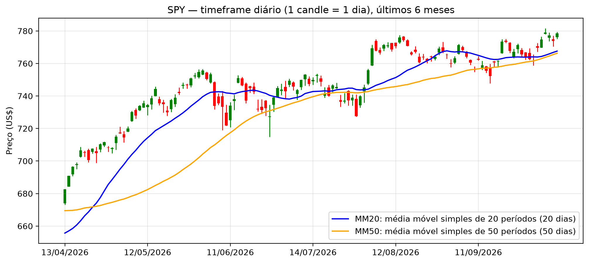

Fonte: gerado pelo Claude (ANTHROPIC, 2026), com dados do Yahoo Finance

Página 16 do PDF · 2012×899 px · gerada por [`graficos_2_3/grafico1_candles.py`](../graficos_2_3/grafico1_candles.py)

## Figura 2

**Figura 2 – Juros dos Estados Unidos e preço do SPY, dados mensais (exemplo de**

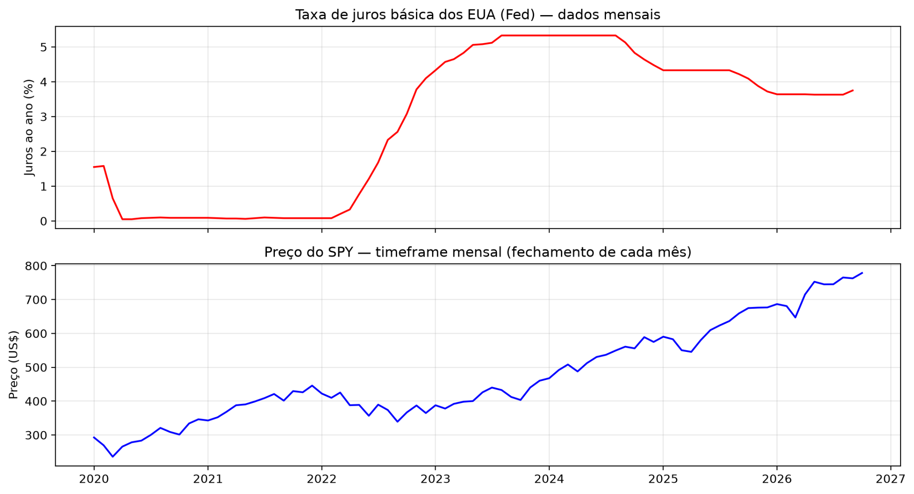

Fonte: gerado pelo Claude (ANTHROPIC, 2026), com dados do FRED (FEDERAL

Página 17 do PDF · 2048×1109 px · gerada por [`graficos_2_3/grafico2_juros_spy.py`](../graficos_2_3/grafico2_juros_spy.py)

## Figura 3

**Figura 3 – Lucro líquido anual e preço mensal da ação da NVIDIA (exemplo de**

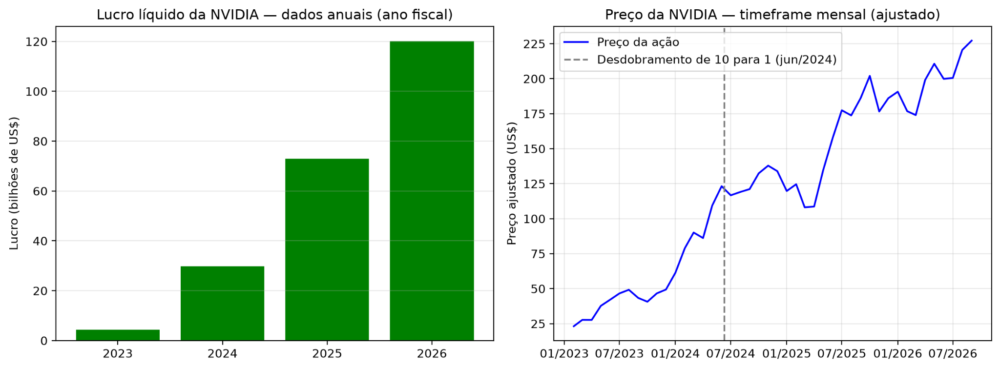

Fonte: gerado pelo Claude (ANTHROPIC, 2026), com dados do Yahoo Finance

Página 17 do PDF · 2048×756 px · gerada por [`graficos_2_3/grafico3_empresa.py`](../graficos_2_3/grafico3_empresa.py)

## Figura 4

**Figura 4 – Inflação e juros nos Estados Unidos, dados mensais (exemplo de análise**

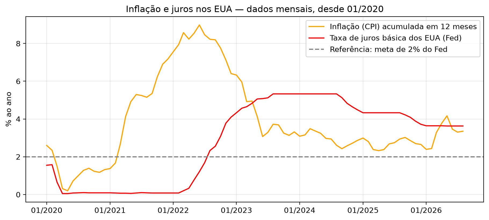

Fonte: gerado pelo Claude (ANTHROPIC, 2026), com dados do FRED (FEDERAL

Página 18 do PDF · 1821×822 px · gerada por [`graficos_2_3/grafico4_inflacao_juros.py`](../graficos_2_3/grafico4_inflacao_juros.py)

## Figura 5

**Figura 5 – Médias móveis exponenciais de 9 e 21 períodos no SPY, *timeframe* diário**

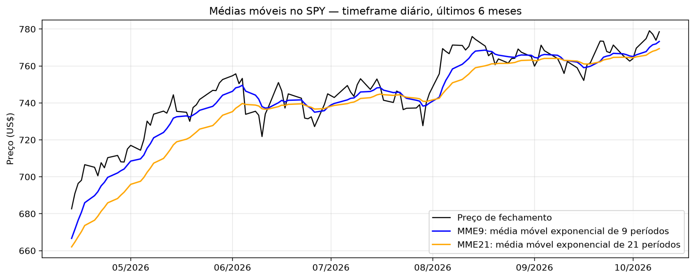

Fonte: gerado pelo Claude (ANTHROPIC, 2026), com dados do Yahoo Finance

Página 19 do PDF · 2048×825 px · gerada por [`graficos_2_4/indicadores.py`](../graficos_2_4/indicadores.py)

## Figura 6

**Figura 6 – IFR de 14 períodos no SPY, *timeframe* diário**

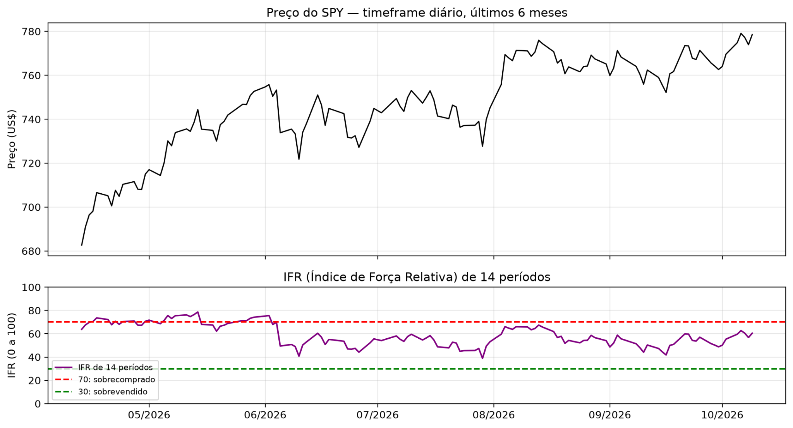

Fonte: gerado pelo Claude (ANTHROPIC, 2026), com dados do Yahoo Finance

Página 20 do PDF · 2048×1107 px · gerada por [`graficos_2_4/indicadores.py`](../graficos_2_4/indicadores.py)

## Figura 7

**Figura 7 – Bandas de Bollinger de 20 períodos e 2 desvios-padrão no SPY,**

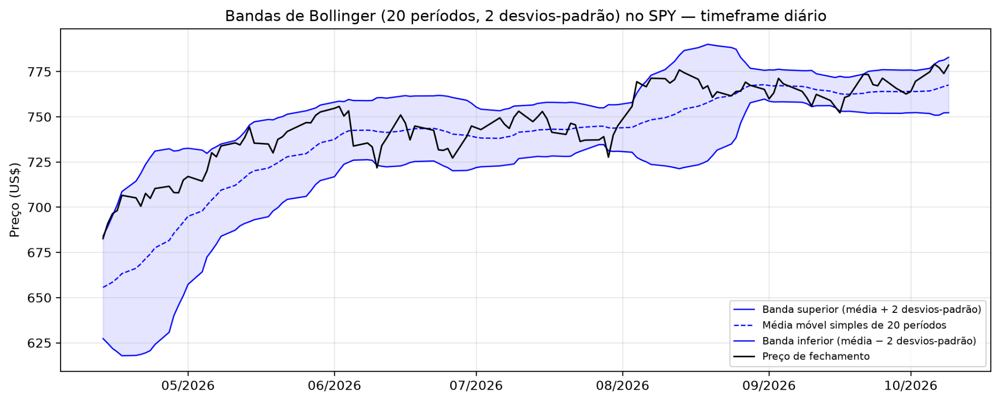

Fonte: gerado pelo Claude (ANTHROPIC, 2026), com dados do Yahoo Finance

Página 20 do PDF · 2048×825 px · gerada por [`graficos_2_4/indicadores.py`](../graficos_2_4/indicadores.py)

## Figura 8

**Figura 8 – MACD (12, 26, 9) no SPY, *timeframe* diário**

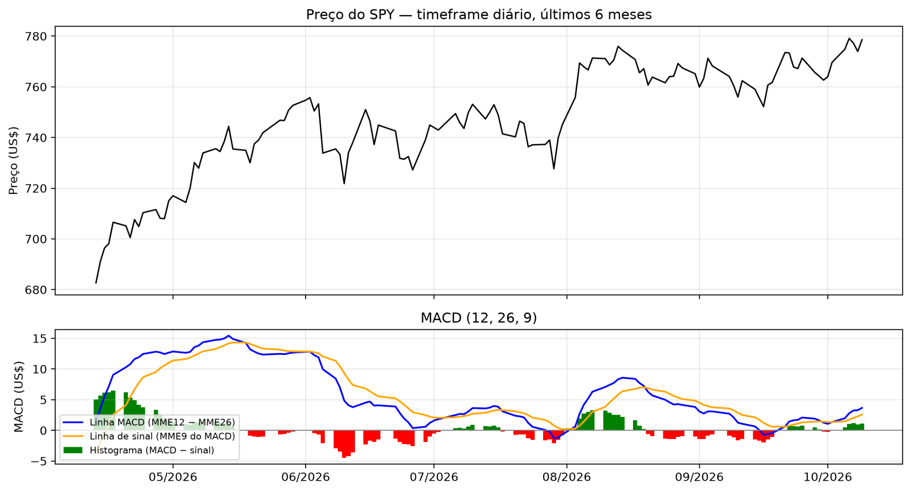

Fonte: gerado pelo Claude (ANTHROPIC, 2026), com dados do Yahoo Finance

Página 21 do PDF · 2048×1107 px · gerada por [`graficos_2_4/indicadores.py`](../graficos_2_4/indicadores.py)

## Figura 9

**Figura 9 – Volume financeiro diário do SPY, em bilhões de US$, *timeframe* diário**

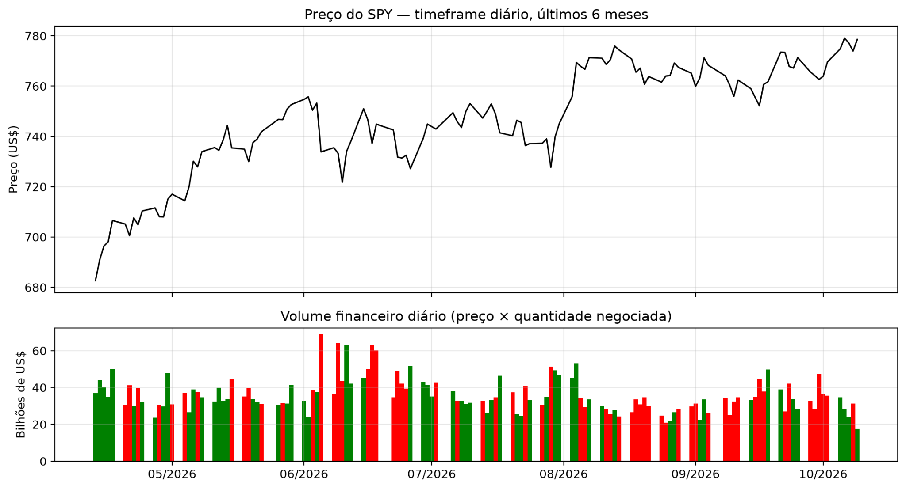

Fonte: gerado pelo Claude (ANTHROPIC, 2026), com dados do Yahoo Finance

Página 21 do PDF · 2048×1107 px · gerada por [`graficos_2_4/indicadores.py`](../graficos_2_4/indicadores.py)

## Figura 10

**Figura 10 – VWAP no SPY, *timeframe* de 1 hora, últimos 5 pregões**

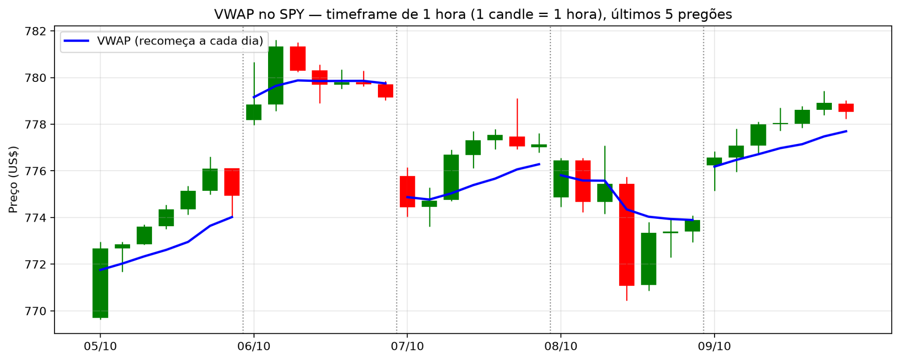

Fonte: gerado pelo Claude (ANTHROPIC, 2026), com dados do Yahoo Finance

Página 22 do PDF · 2048×825 px · gerada por [`graficos_2_4/indicadores.py`](../graficos_2_4/indicadores.py)

## Figura 11

**Figura 11 – Teoria do Prospecto: quanto um ganho e uma perda de US$100 são**

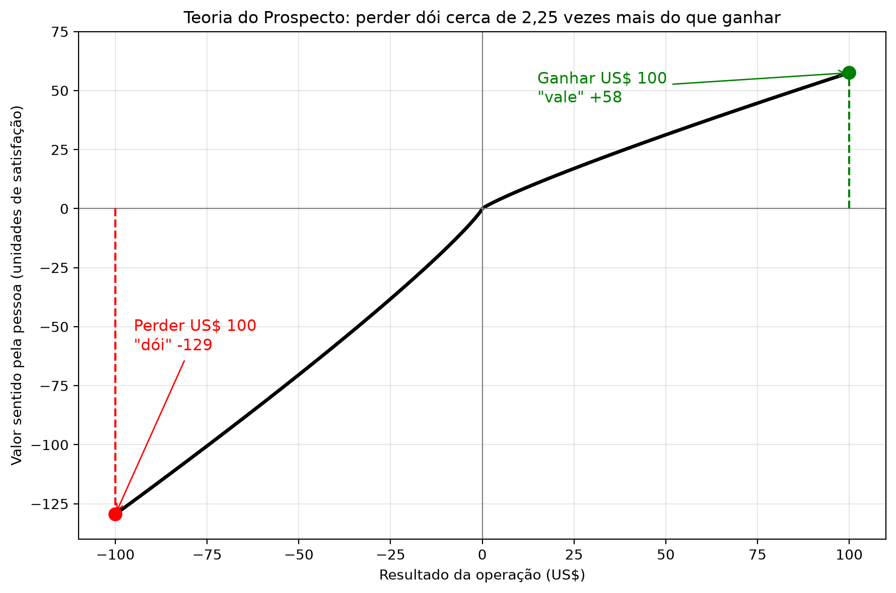

Fonte: gerado pelo Claude (ANTHROPIC, 2026), com base em Tversky e Kahneman

Página 24 do PDF · 1779×1178 px · gerada por [`graficos_2_5/emocoes.py`](../graficos_2_5/emocoes.py)

## Figura 12

**Figura 12 – Efeito disposição: porcentagem de ações no lucro e no prejuízo que**

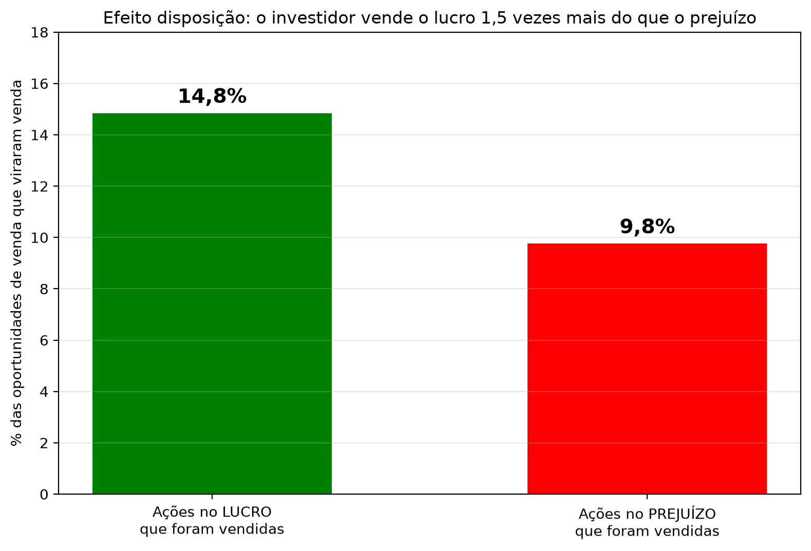

Fonte: gerado pelo Claude (ANTHROPIC, 2026), com dados de Odean (1998).

Página 25 do PDF · 1579×1075 px · gerada por [`graficos_2_5/emocoes.py`](../graficos_2_5/emocoes.py)

## Figura 13

**Figura 13 – Preço do petróleo Brent na guerra entre EUA/Israel e Irã, *candles***

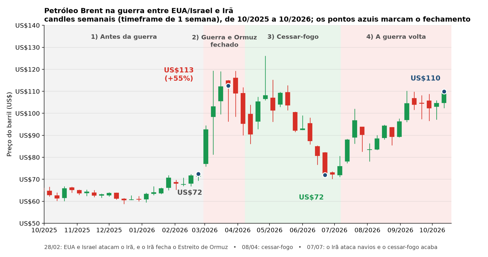

Fonte: gerado pelo Claude (ANTHROPIC, 2026), com dados do Yahoo Finance

Página 28 do PDF · 2048×1080 px · gerada por [`graficos_cap2/petroleo_guerra_ira.py`](../graficos_cap2/petroleo_guerra_ira.py)

## Figura 14

**Figura 14 – O que acontece quando a taxa Selic sobe e quando ela cai**

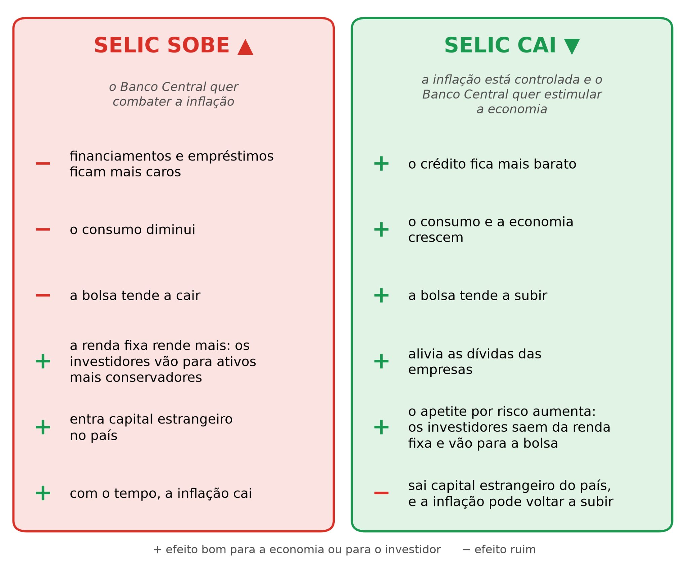

Fonte: gerado pelo Claude (ANTHROPIC, 2026), com base no texto do autor e em

Página 30 do PDF · 2048×1676 px · gerada por [`graficos_cap2/efeitos_selic.py`](../graficos_cap2/efeitos_selic.py)

## Figura 15

**Figura 15 – Juros (meta da taxa Selic) e inflação (IPCA acumulado em 12 meses) no**

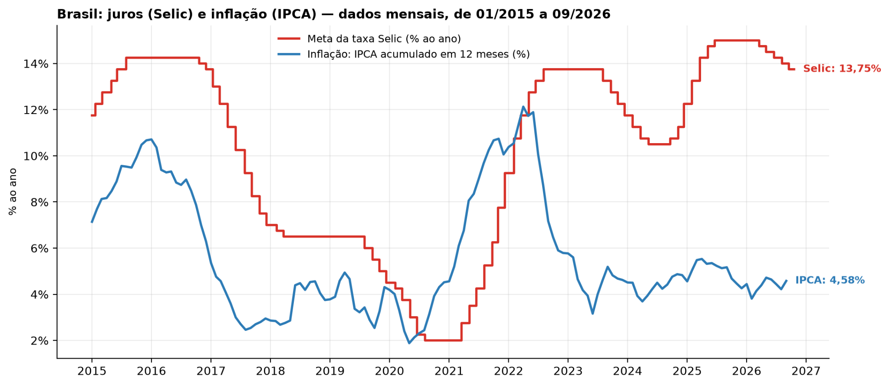

Fonte: gerado pelo Claude (ANTHROPIC, 2026), com dados do Banco Central do

Página 31 do PDF · 2048×890 px · gerada por [`graficos_cap2/economia.py`](../graficos_cap2/economia.py)

## Figura 16

**Figura 16 – Exemplo da lei da oferta e da demanda no preço de uma ação (números**

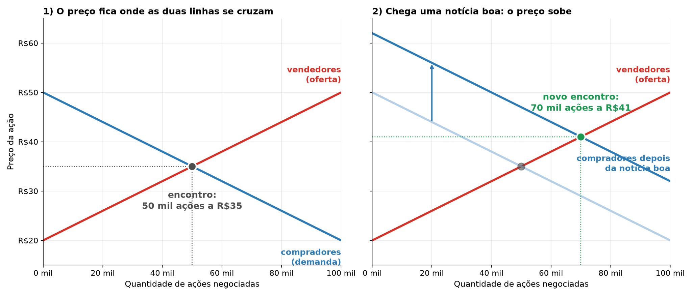

Fonte: gerado pelo Claude (ANTHROPIC, 2026), com valores hipotéticos e com

Página 32 do PDF · 2048×878 px · gerada por [`graficos_cap2/oferta_demanda.py`](../graficos_cap2/oferta_demanda.py)

## Figura 17

**Figura 17 – Indicadores macroeconômicos do Brasil: PIB (anual), dívida bruta do**

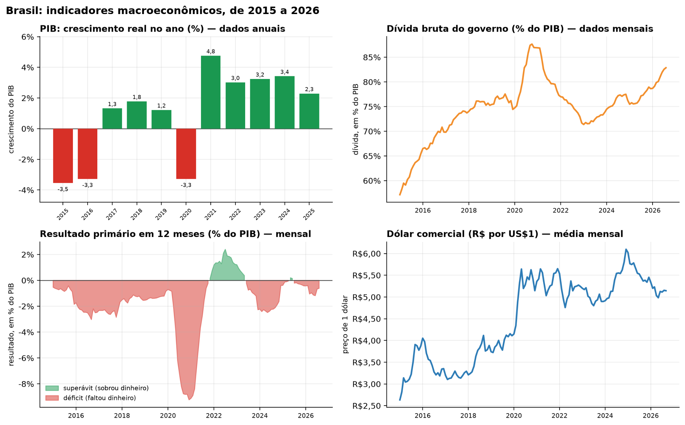

Fonte: gerado pelo Claude (ANTHROPIC, 2026), com dados do Banco Central do

Página 35 do PDF · 2048×1270 px · gerada por [`graficos_cap2/economia.py`](../graficos_cap2/economia.py)

## Figura 18

**Figura 18 – Indicadores microeconômicos do Itaú Unibanco (ITUB4): receita, lucro**

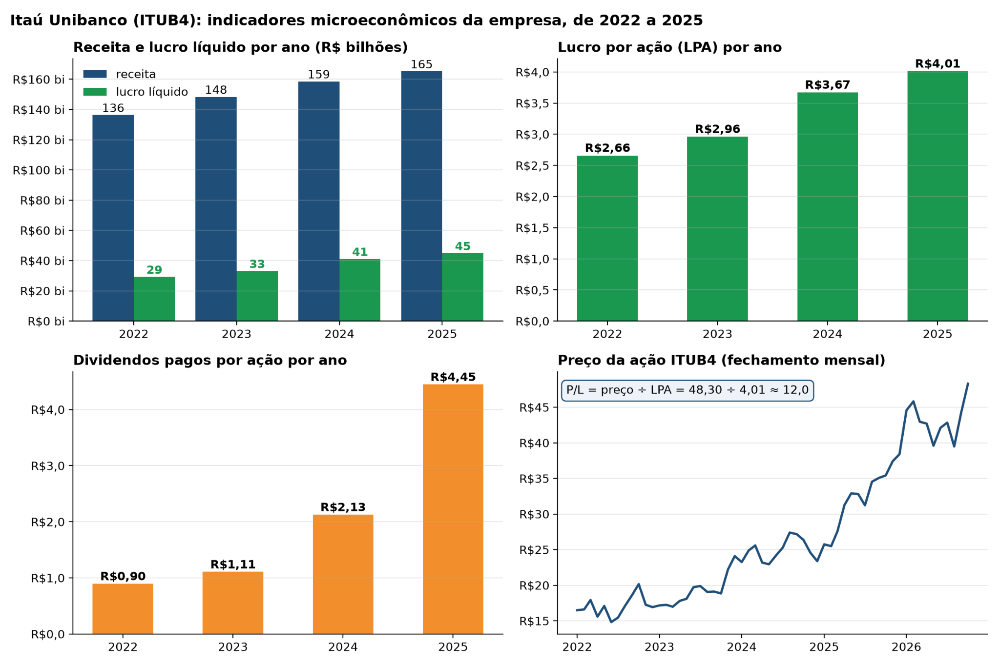

Fonte: gerado pelo Claude (ANTHROPIC, 2026), com dados do Yahoo Finance

Página 36 do PDF · 2048×1365 px · gerada por [`graficos_cap2/micro_itau.py`](../graficos_cap2/micro_itau.py)

## Figura 19

**Figura 19 – VIX, o índice de volatilidade (“índice do medo”) do mercado americano,**

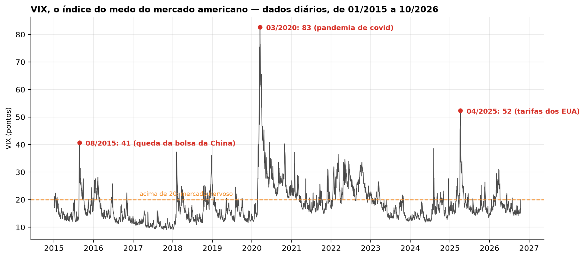

Fonte: gerado pelo Claude (ANTHROPIC, 2026), com dados do FRED (FEDERAL

Página 37 do PDF · 2048×906 px · gerada por [`graficos_cap2/economia.py`](../graficos_cap2/economia.py)

## Figura 20

**Figura 20 – NQ (contrato futuro do índice Nasdaq-100) na pandemia de covid, com o**

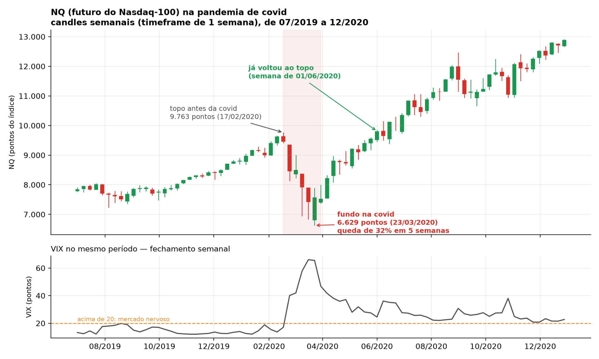

Fonte: gerado pelo Claude (ANTHROPIC, 2026), com dados do Yahoo Finance

Página 38 do PDF · 2048×1229 px · gerada por [`graficos_cap2/nq_covid.py`](../graficos_cap2/nq_covid.py)

## Figura 21

**Figura 21 – Os 3 regimes de mercado (alta, baixa e lateral) no Ibovespa (IBOV),**

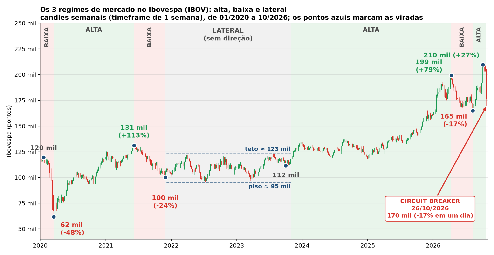

Fonte: gerado pelo Claude (ANTHROPIC, 2026), com dados do Yahoo Finance

Página 39 do PDF · 2048×1058 px · gerada por [`graficos_cap2/regimes_ibov.py`](../graficos_cap2/regimes_ibov.py)

## Figura 22

**Figura 22 – Um exemplo de cálculo do retorno de uma operação em Python, sem e**

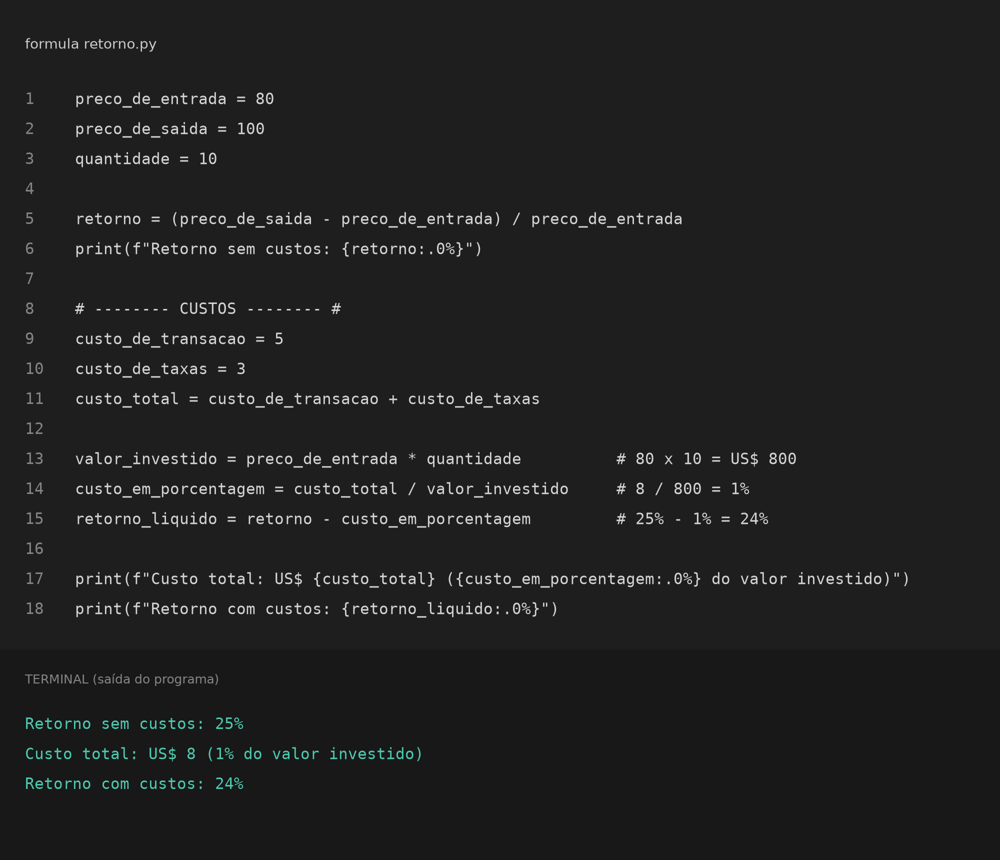

Fonte: gerado pelo Claude (ANTHROPIC, 2026), a partir de programa em Python do

Página 42 do PDF · 2000×1720 px · gerada por programa do Enzo [`formula retorno.py`](../formula%20retorno.py), transformado em imagem por [`graficos_cap3/imagem_codigo_retorno.py`](../graficos_cap3/imagem_codigo_retorno.py)

## Figura 23

**Figura 23 – Exemplo de cálculo da taxa de acerto em Python (6 operações com lucro**

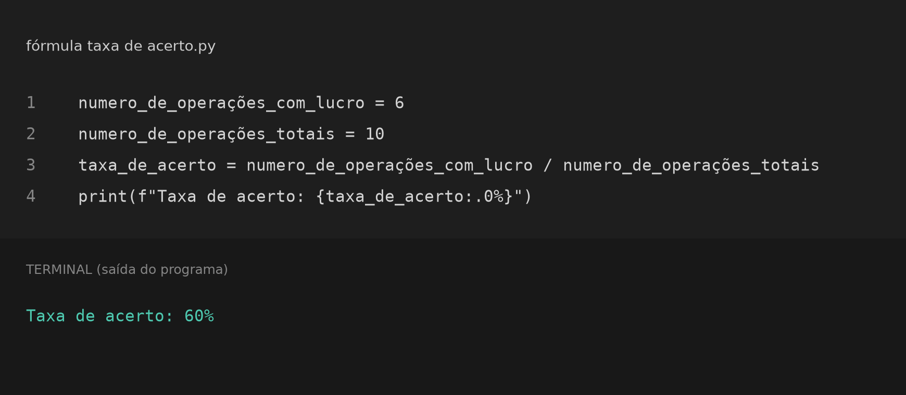

Fonte: gerado pelo Claude (ANTHROPIC, 2026), a partir de programa em Python do

Página 43 do PDF · 1740×760 px · gerada por programa do Enzo [`fórmula taxa de acerto.py`](../fórmula%20taxa%20de%20acerto.py), transformado em imagem por [`graficos_cap3/imagem_codigo_retorno.py`](../graficos_cap3/imagem_codigo_retorno.py)

## Figura 24

**Figura 24 – Exemplo de cálculo do *payoff* em Python (21 operações com lucro e 14**

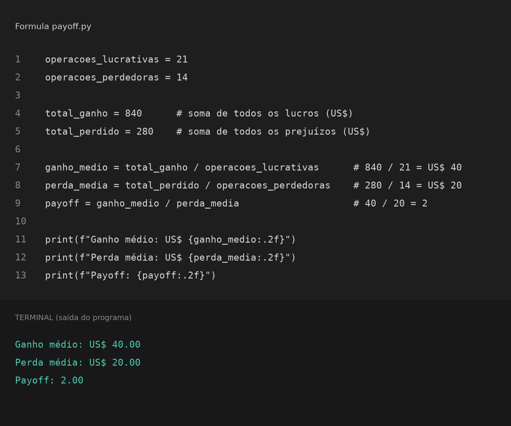

Fonte: gerado pelo Claude (ANTHROPIC, 2026), a partir de programa em Python do

Página 44 do PDF · 1700×1420 px · gerada por programa do Enzo [`Formula payoff.py`](../Formula%20payoff.py), transformado em imagem por [`graficos_cap3/imagem_codigo_retorno.py`](../graficos_cap3/imagem_codigo_retorno.py)

## Figura 25

**Figura 25 – Exemplo de cálculo da esperança matemática em Python (taxa de acerto**

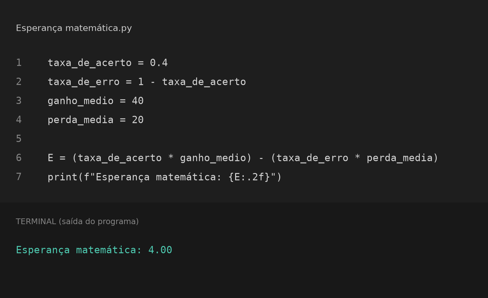

Fonte: gerado pelo Claude (ANTHROPIC, 2026), a partir de programa em Python do

Página 46 do PDF · 1540×940 px · gerada por programa do Enzo [`Esperança matemática.py`](../Esperança%20matemática.py), transformado em imagem por [`graficos_cap3/imagem_codigo_retorno.py`](../graficos_cap3/imagem_codigo_retorno.py)

## Figura 26

**Figura 26 – Exemplo de cálculo da taxa de acerto mínima em Python (*payoff* de 2)**

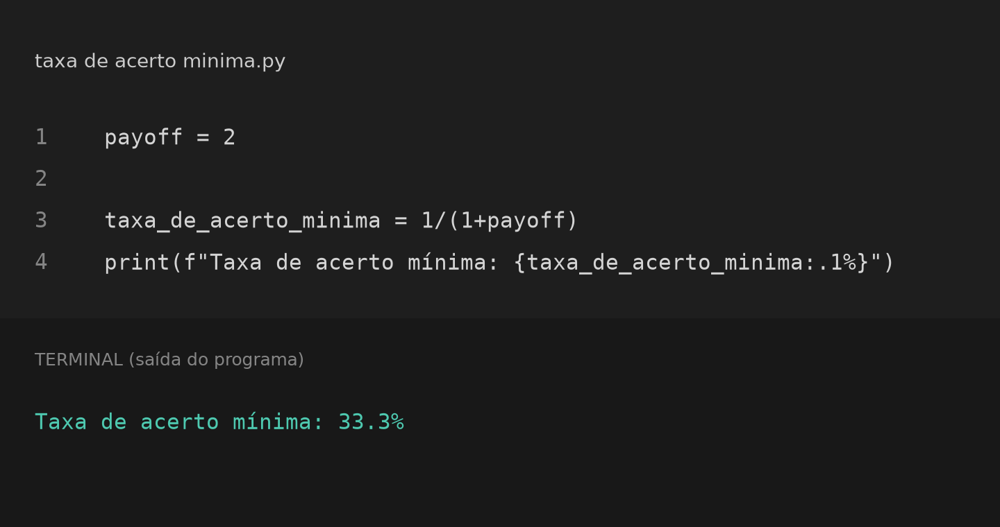

Fonte: gerado pelo Claude (ANTHROPIC, 2026), a partir de programa em Python do

Página 47 do PDF · 1440×760 px · gerada por programa do Enzo [`taxa de acerto minima.py`](../taxa%20de%20acerto%20minima.py), transformado em imagem por [`graficos_cap3/imagem_codigo_retorno.py`](../graficos_cap3/imagem_codigo_retorno.py)

## Figura 27

**Figura 27 – Simulação da lei dos grandes números em Python (moeda lançada 10,**

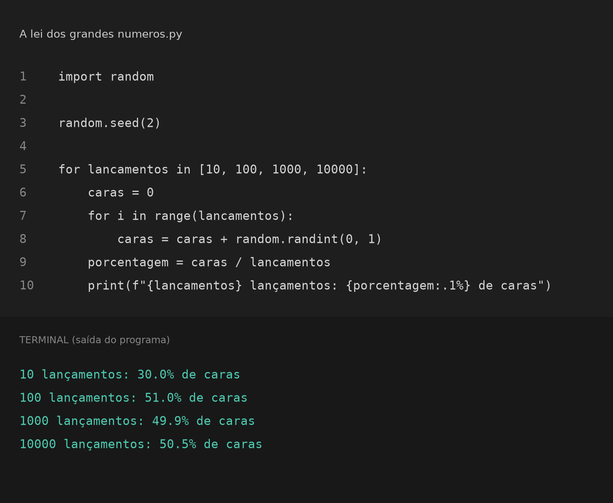

Fonte: gerado pelo Claude (ANTHROPIC, 2026), a partir de programa em Python do

Página 49 do PDF · 1580×1300 px · gerada por programa do Enzo [`A lei dos grandes numeros.py`](../A%20lei%20dos%20grandes%20numeros.py), transformado em imagem por [`graficos_cap3/imagem_codigo_retorno.py`](../graficos_cap3/imagem_codigo_retorno.py)

## Figura 28

**Figura 28 – Porcentagem de caras de acordo com o número de lançamentos da**

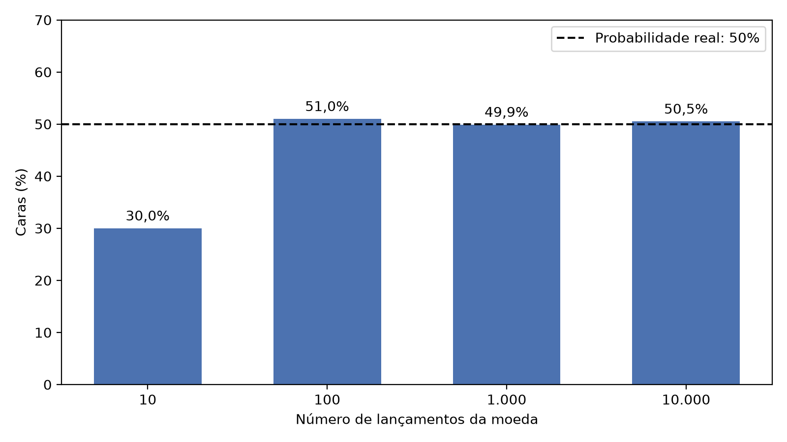

Fonte: gerado pelo Claude (ANTHROPIC, 2026), com os resultados da simulação da

Página 50 do PDF · 1600×900 px · gerada por programa do Enzo [`graficos_cap3/grafico_lei_grandes_numeros.py`](../graficos_cap3/grafico_lei_grandes_numeros.py), transformado em imagem por [`graficos_cap3/imagem_codigo_retorno.py`](../graficos_cap3/imagem_codigo_retorno.py)

## Figura 29

**Figura 29 – Exemplo de cálculo da margem de erro em Python (1.000 lançamentos**

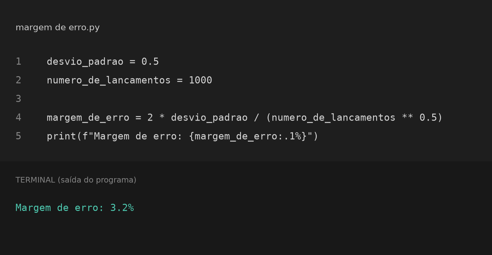

Fonte: gerado pelo Claude (ANTHROPIC, 2026), a partir de programa em Python do

Página 52 do PDF · 1580×820 px · gerada por programa do Enzo [`margem de erro.py`](../margem%20de%20erro.py), transformado em imagem por [`graficos_cap3/imagem_codigo_retorno.py`](../graficos_cap3/imagem_codigo_retorno.py)

## Figura 30

**Figura 30 – Exemplo de *drawdown* de uma conta hipotética ao longo de 7 dias**

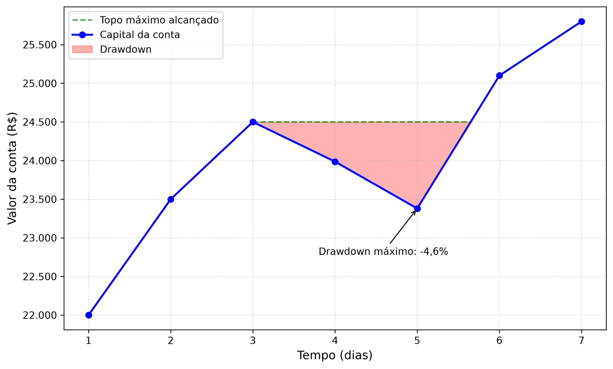

Fonte: gerado pelo Claude (ANTHROPIC, 2026), a partir de programa em Python do

Página 54 do PDF · 2048×1234 px · gerada por programa do Enzo [`drawdown.py`](../drawdown.py), transformado em imagem por [`graficos_cap3/imagem_codigo_retorno.py`](../graficos_cap3/imagem_codigo_retorno.py)

## Figura 31

**Figura 31 – Exemplo de cálculo do ganho necessário para recuperar uma perda em**

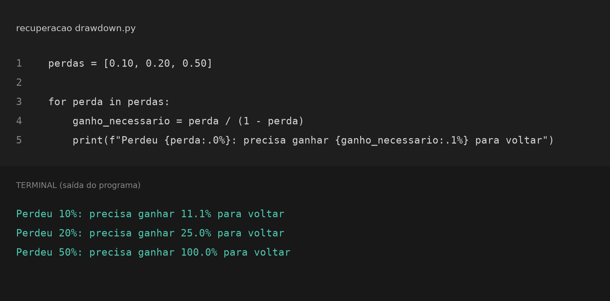

Fonte: gerado pelo Claude (ANTHROPIC, 2026), a partir de programa em Python do

Página 55 do PDF · 1900×940 px · gerada por programa do Enzo [`recuperacao drawdown.py`](../recuperacao%20drawdown.py), transformado em imagem por [`graficos_cap3/imagem_codigo_retorno.py`](../graficos_cap3/imagem_codigo_retorno.py)

## Figura 32

**Figura 32 – Volatilidade dos ativos escolhidos, do menor para o maior desvio-padrão**

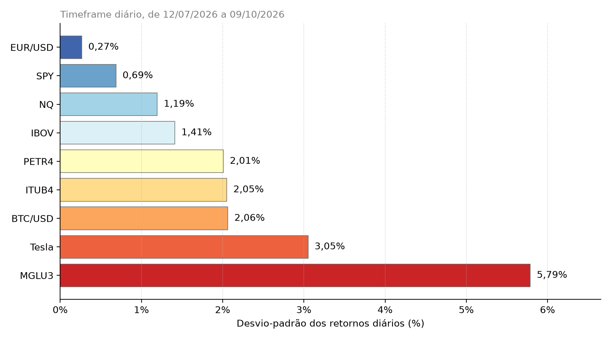

Fonte: gerado pelo Claude (ANTHROPIC, 2026), com dados do Yahoo Finance,

Página 57 do PDF · 1800×1000 px · gerada por [`graficos_cap4/volatilidade_ativos.py`](../graficos_cap4/volatilidade_ativos.py)

## Figura 33

**Figura 33 – Exemplo da ORB na PETR4 em dois dias reais, 15/09/2026 e**

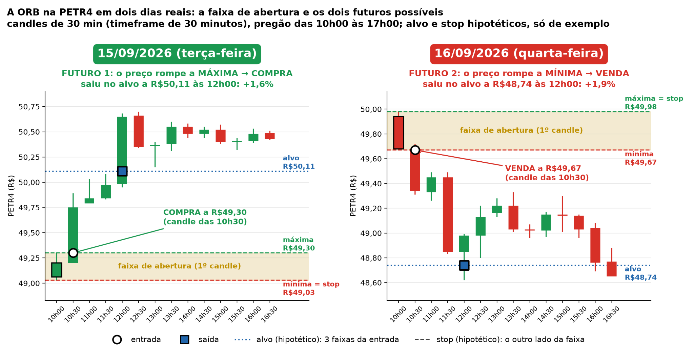

Fonte: gerado pelo Claude (ANTHROPIC, 2026), com dados do Profit Pro

Página 62 do PDF · 2048×1040 px · gerada por [`graficos_2_9/orb_exemplo.py`](../graficos_2_9/orb_exemplo.py)

## Figura 34

**Figura 34 – Exemplo da VWAP no ITUB4 em um dia real, 03/09/2026: uma venda e**

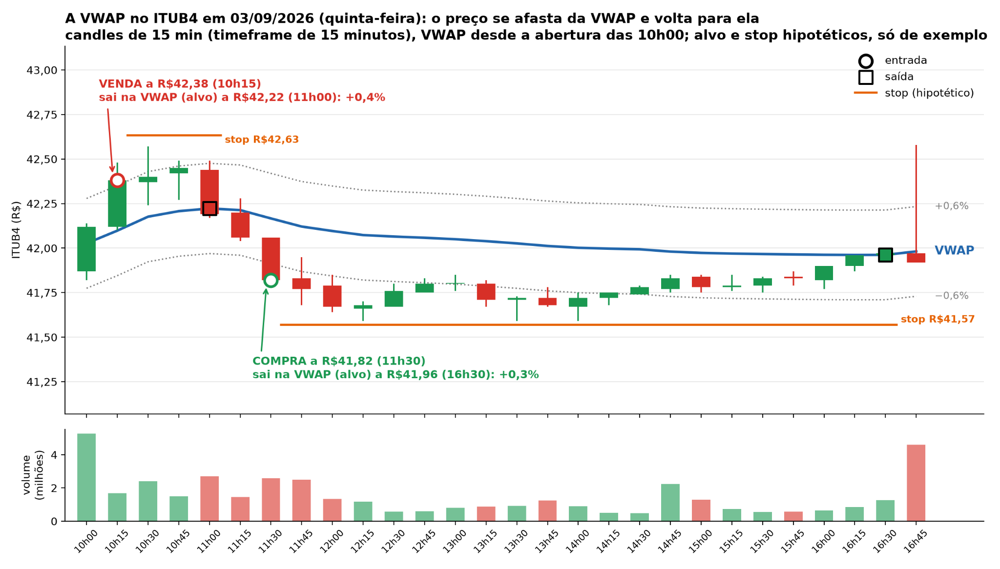

Fonte: gerado pelo Claude (ANTHROPIC, 2026), com dados do Profit Pro

Página 65 do PDF · 2048×1166 px · gerada por [`graficos_2_9/vwap_exemplo.py`](../graficos_2_9/vwap_exemplo.py)

## Figura 35

**Figura 35 – Exemplo do IFR no BTC/USD em um dia real, 03/08/2026: uma compra**

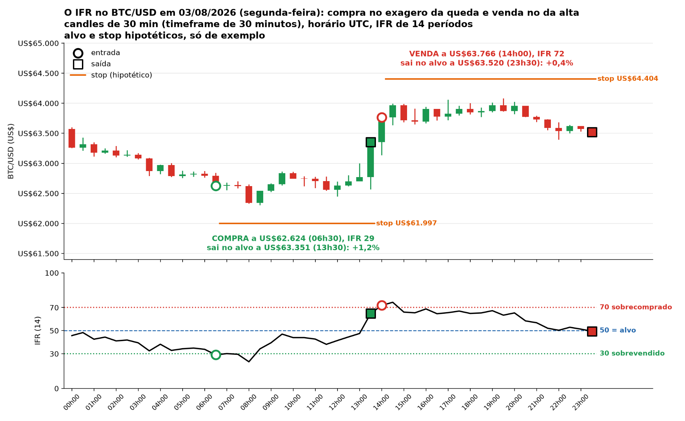

Fonte: gerado pelo Claude (ANTHROPIC, 2026), com dados da Binance (BINANCE,

Página 67 do PDF · 2048×1260 px · gerada por [`graficos_2_9/ifr_exemplo.py`](../graficos_2_9/ifr_exemplo.py)

## Figura 36

**Figura 36 – Exemplo do cruzamento de médias na Tesla em um dia real, 16/09/2026:**

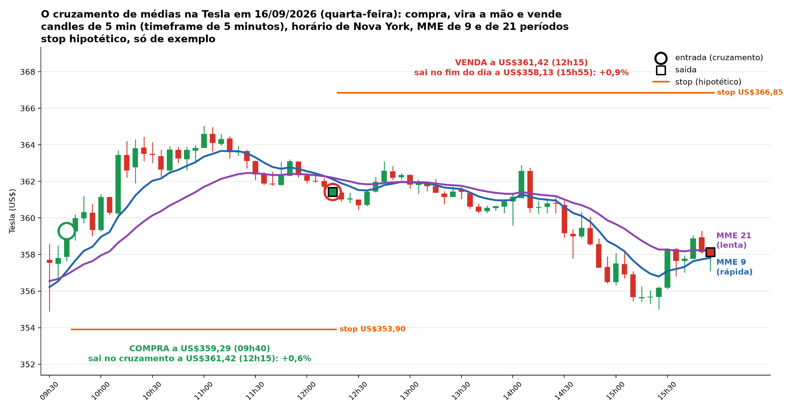

Fonte: gerado pelo Claude (ANTHROPIC, 2026), com dados do Yahoo Finance

Página 70 do PDF · 2048×1053 px · gerada por [`graficos_2_9/medias_exemplo.py`](../graficos_2_9/medias_exemplo.py)

## Figura 37

**Figura 37 – Preço real da PETR4 comparado com o previsto pela regressão linear no**

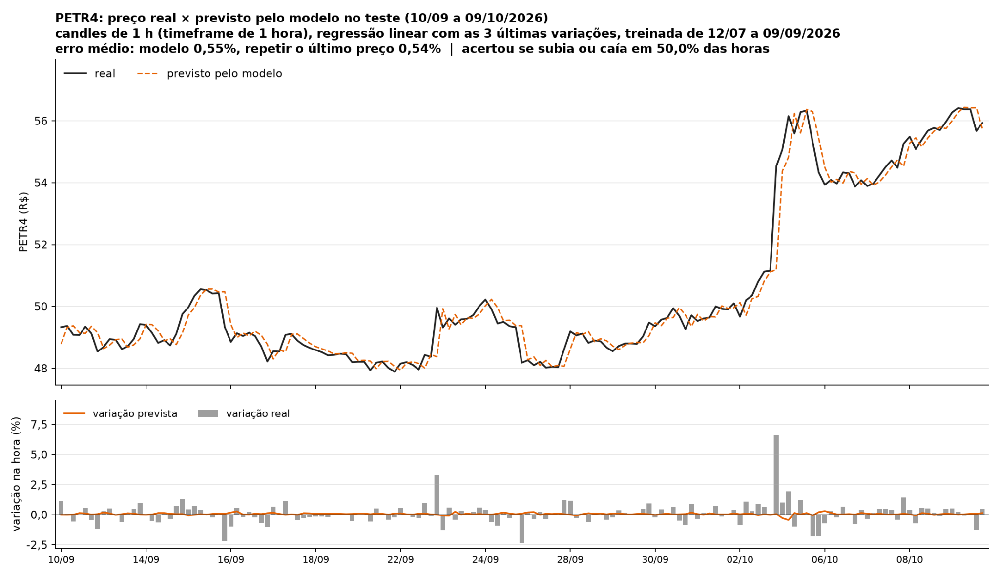

Fonte: gerado pelo Claude (ANTHROPIC, 2026), com dados do Yahoo Finance

Página 74 do PDF · 2048×1182 px · gerada por [`previsao/previsao.py`](../previsao/previsao.py)

## Figura 38

**Figura 38 – Ganho ou perda de US$1.000 em cada ativo com a regressão linear,**

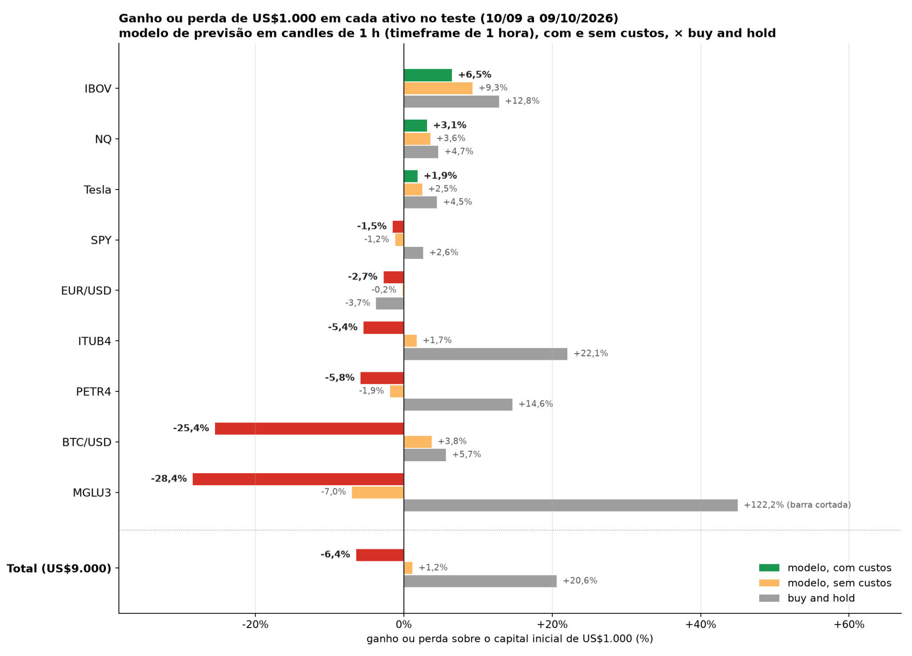

Fonte: gerado pelo Claude (ANTHROPIC, 2026), com dados do Yahoo Finance

Página 75 do PDF · 2048×1475 px · gerada por [`previsao/simulacao.py`](../previsao/simulacao.py)

## Figura 39

**Figura 39 – Capital de cada abordagem dia a dia no mês de teste, com custos,**

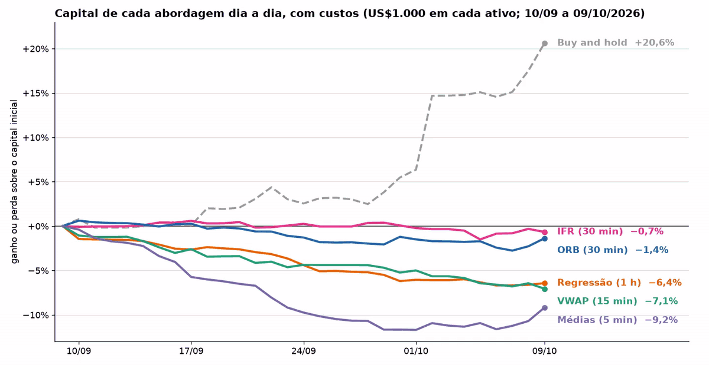

Fonte: gerado pelo Claude (ANTHROPIC, 2026), com dados do Profit Pro

Página 77 do PDF · 1200×620 px · gerada por [`comparativo/corrida_capital.py`](../comparativo/corrida_capital.py) · no Google Docs ela é animada: [`Figura_39.gif`](Figura_39.gif)

## Figura 40

**Figura 40 – Ganho ou perda de US$1.000 de cada abordagem em cada ativo, com**

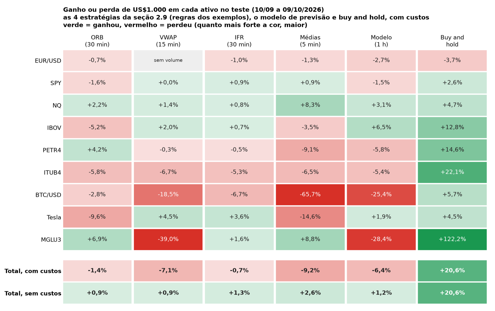

Fonte: gerado pelo Claude (ANTHROPIC, 2026), com dados do Profit Pro

Página 79 do PDF · 2048×1292 px · gerada por [`estrategias_2_9/estrategias.py`](../estrategias_2_9/estrategias.py)

## Figura 41

**Figura 41 – Ganho ou perda de US$1.000 em cada ativo com a ORB, com e sem**

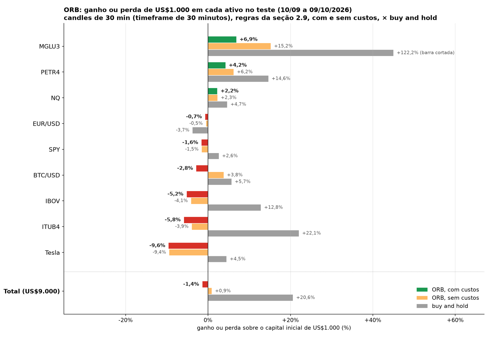

Fonte: gerado pelo Claude (ANTHROPIC, 2026), com dados do Profit Pro

Página 80 do PDF · 2048×1409 px · gerada por [`estrategias_2_9/estrategias.py`](../estrategias_2_9/estrategias.py)

## Figura 42

**Figura 42 – Ganho ou perda de US$1.000 em cada ativo com a VWAP, com e sem**

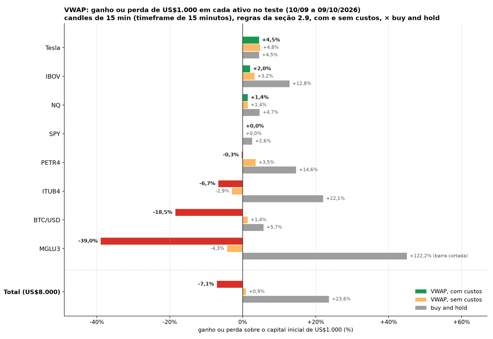

Fonte: gerado pelo Claude (ANTHROPIC, 2026), com dados do Profit Pro

Página 81 do PDF · 2048×1409 px · gerada por [`estrategias_2_9/estrategias.py`](../estrategias_2_9/estrategias.py)

## Figura 43

**Figura 43 – Ganho ou perda de US$1.000 em cada ativo com o IFR, com e sem**

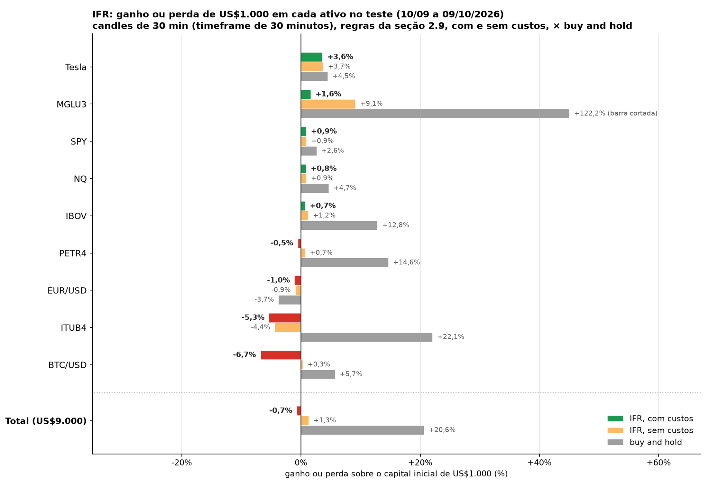

Fonte: gerado pelo Claude (ANTHROPIC, 2026), com dados do Profit Pro

Página 82 do PDF · 2048×1409 px · gerada por [`estrategias_2_9/estrategias.py`](../estrategias_2_9/estrategias.py)

## Figura 44

**Figura 44 – Ganho ou perda de US$1.000 em cada ativo com o cruzamento de**

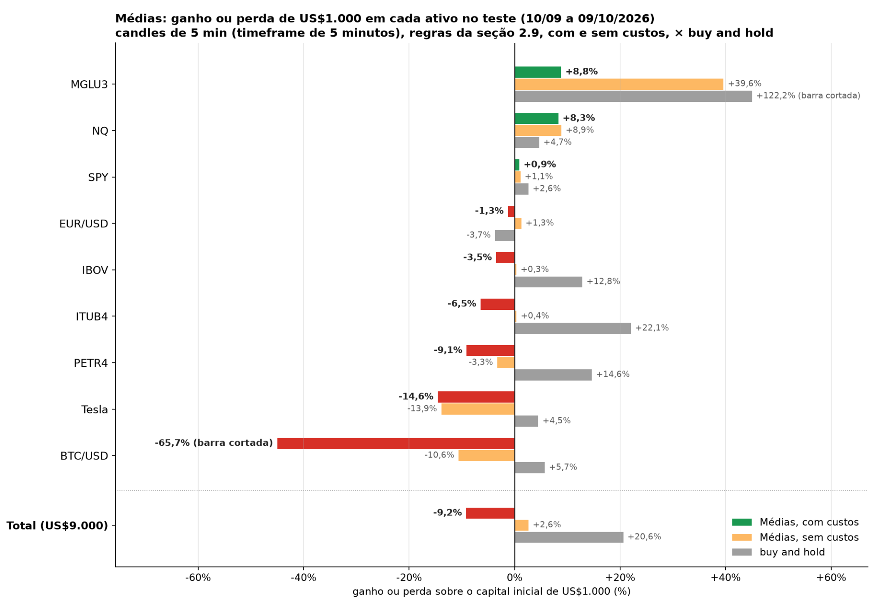

Fonte: gerado pelo Claude (ANTHROPIC, 2026), com dados do Profit Pro

Página 84 do PDF · 2048×1409 px · gerada por [`estrategias_2_9/estrategias.py`](../estrategias_2_9/estrategias.py)
